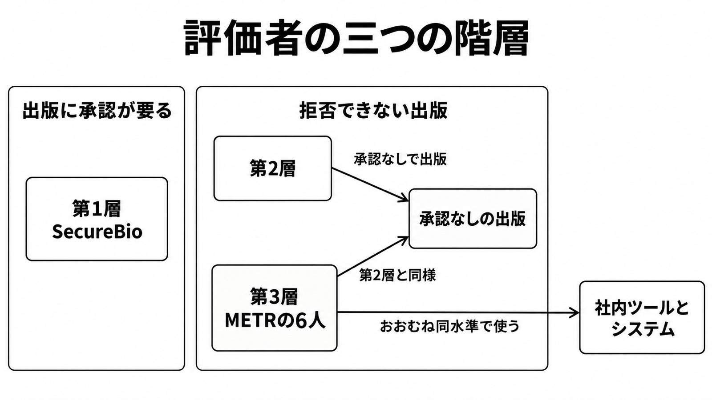
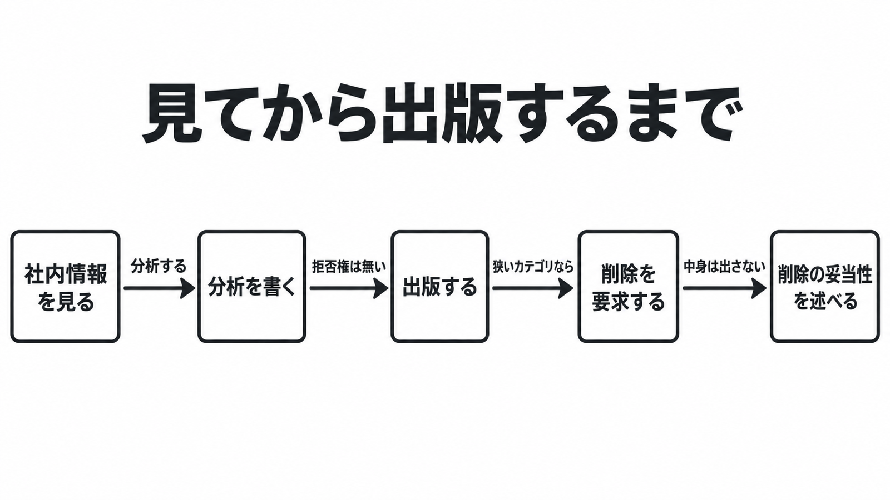

# AnthropicがMETRの6人に与えた従業員相当のアクセス ダイジェスト

元記事: [AnthropicがMETRの6人に与えた従業員相当のアクセス](../../../../../articles/anthropic-metr-ft-content-p9_20261016.md)

## ひとことで言うと

2026年10月15日、Anthropic は METR の 6 人に、リスク評価チームとおおむね同水準の社内ツールとシステムを与え始めた。出版は拒否できないが、学習・出荷・配備を止める権限は公開文書に無い。

## 核心ポイント

1. 「従業員相当」の比較対象は、全社員でも経営陣でもなく、自社のリスク評価チームである。顧客データ、弁護士秘匿特権、モデルアーキテクチャは共有しない例で、アーキテクチャは関連が高いとき社内の明示的な承認のうえで共有を求める。
2. Anthropic は出版を拒否できず、事前に決めた狭いカテゴリの削除だけを要求できる。METR は削除の中身を明かさずに、その削除が妥当だったかを公に述べてよい。
3. 同じ発表は評価者を三つの階層に分けている。第1層 (SecureBio) は出版に Anthropic の承認が要り、第3層 (METR) は承認なしで出版できる。
4. 公開された権限は、見る、書く、削除に反論する、までである。METR は、会社の開発や配備を決めるつもりはなく、提案する評価はモデル配備の go / no-go を含まないと書いている。
5. 外部評価を頼む側は、「見える範囲」と「止める権限」を別の条項として扱う。これは公開条件から元記事が導いた解釈である。

## メンタルモデル

第1層だけが「出版に承認が要る」側にあり、第2層と第3層は承認なしで出版できる。第3層の METR は、社内ツールとシステムをリスク評価チームとおおむね同水準で使う。

METR は社内情報を見て分析を書く。Anthropic は狭いカテゴリだけ削除を要求でき、出版そのものは拒否できない。METR は中身を出さずに、削除が妥当だったかを述べる。

## 具体例

元記事が扱う METR の 6 人の条件である (架空ではない)。

| 項目 | 条件 |
|---|---|
| 使うもの | 会社の機材とオフィス。社内ツールとシステムはリスク評価チームとおおむね同水準 |
| 境界 | 他の METR 職員はこの仕事から隔離される。Anthropic のセキュリティ基準の下で働く |
| 出版 | リスク水準、インシデント、実務の分析。拒否権は無い |

## 適用と判断

向く場面:

- 外部評価や委託診断の契約で、評価者に渡すアクセスと出版権を決めるとき
- 「従業員相当」「社内に入れた」という発表が実際に何を渡したかを読むとき

確認項目:

- 比較対象の内部チームはどこか (リスク評価チームか、全社員や経営陣か)
- 出版に発注者の承認が要るか、拒否権が無いか
- 削除できるカテゴリの完全なリストがあるか
- 学習、出荷、配備を止められるか。止められないなら、報告書にそう書く義務があるか
- 関与を打ち切れるのはどちらか。打ち切ったとき、書きかけの報告と、切られたという事実を公開できるか

## 限界・注意点

- 契約本文は非公開である。公開文書に停止権が無いことは、非公開の条項に無いことを意味しない。
- 共有しない三カテゴリは例示であり、削除できるカテゴリの完全なリストは公開されていない。
- 「出版を拒否できない」条項で書かれた報告書は、2026年10月16日時点でまだ無い。
- 10月15日の参加は任意である。METR の提案は会社が関与を止めうると書き、元記事は、不都合な報告の前に契約を終える経路が拒否権の代わりになりうると見る。
- METR が社内情報に触れるのは初めてではない (2026年3月のレッドチーム、9月の調査契約)。新しいのは、6 人、会社の機材とオフィス、リスク評価チームとおおむね同水準のツールとシステム、出版の拒否権が無い、という組み合わせである。

## 参考

- 元記事: [AnthropicがMETRの6人に与えた従業員相当のアクセス](../../../../../articles/anthropic-metr-ft-content-p9_20261016.md)
- [Anthropic, An update on independent evaluators (2026-10-15)](https://www.anthropic.com/news/an-update-on-independent-evaluators)
- [Dario Amodei, We Must Pace the Frontier (2026-09)](https://darioamodei.com/post/we-must-pace-the-frontier)
- [METR, A proposal for better informing the public about loss-of-control risks (2026-10-14)](https://metr.org/blog/2026-10-14-better-informing-the-public-about-loss-of-control-risks/)
- [AI Evaluator Forum, Minimum Conditions for Embedding Evaluators (2026-09-18)](https://aievaluatorforum.org/initiatives/embedded-evaluation-letter)
