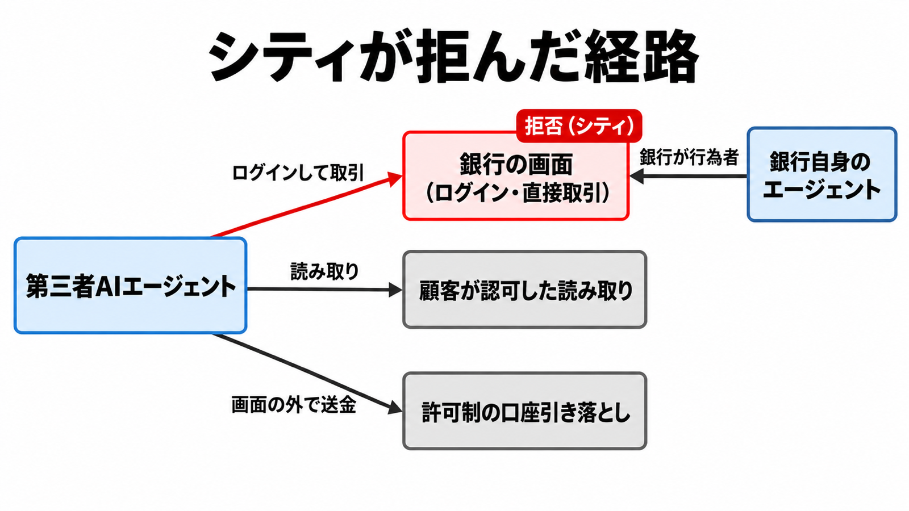
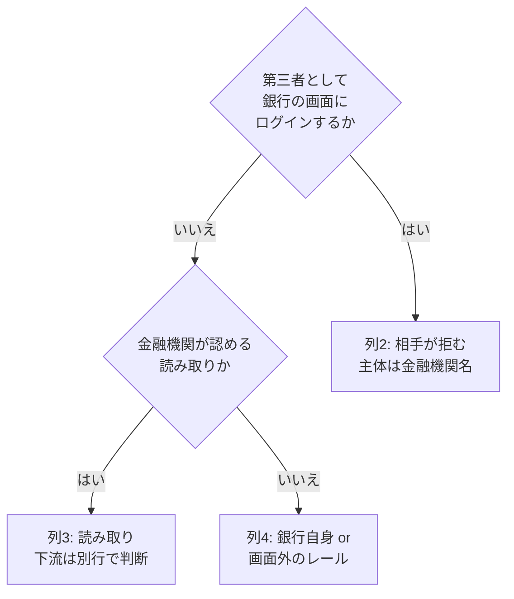

# ダイジェスト: 第三者AIの銀行ログインを権限表の別欄に置く

- 元記事: [notes/zenn/articles/ai-ft-content-f49c8e39-f07f-p1_20261017.md](../../../../../articles/ai-ft-content-f49c8e39-f07f-p1_20261017.md)
- 記事の型: ガバナンス (権限設計・方針の読み方)
- 作成日: 2026-10-17

## ひとことで言うと

シティが拒んだのは「第三者AIが銀行の画面にログインし、そこで取引する経路」です。読み取り・銀行自身のエージェント・画面外の送金とは分けて、口座を持つ金融機関の拒否を、社内の権限表で自社承認とは別の列に書きます。

## 核心ポイント

| # | ポイント | 根拠の種類 | 元記事の節 |
|---|---|---|---|
| 1 | シティの言質は「第三者AIによる口座ログイン」と「デジタルバンキング内での直接取引」の拒否。引用に認証方法の条件は無い | 事実 (FT 公式投稿の引用) | シティが言葉にした範囲 |
| 2 | 「残高が動くかどうか」「認証情報で入った場合だけ」という要約は引用より狭い。ログインそのものも対象 | 解釈 | 引用より狭い読み |
| 3 | 口座に触る経路は、行為者と入口で分かれる。画面ログインと、読み取り・銀行自身のエージェント・許可制の引き落としは別の入口 | 事実 | 口座に触る経路 |
| 4 | 読み取りは「資金が動かない」保証にならない。読んだ情報が銀行の外の次の操作を起動できるため、下流は別の行で判断する | 解釈 | 画面の外のレールと、読み取りの下流 |
| 5 | 三行の無利息預金 約1.59兆ドルは残高の大きさ。この週にエージェントによる流出が起きた記録ではない (3% で約477億ドルは仮計算) | 事実 + 仮計算 | 預金の大きさと利息の仮計算 |

## メンタルモデル

- 拒否 (赤) は「第三者AIエージェント → 銀行の画面」の経路だけにかかっています。
- 読み取りと許可制の口座引き落としは、銀行の画面を通らない別の入口です。
- 銀行自身のエージェントは、行為者が銀行です。シティの拒否文の対象ではありません。

### 権限表の 4 列

| 列 | 問い | 書き方の要点 |
|---|---|---|
| 1. 社内ハーネス | 自社のハーネスが許すか | エージェントを「次の状態の提案まで」に限るならここに書く |
| 2. 金融機関が拒む画面経路 | 口座を持つ金融機関が、第三者の画面ログイン・直接取引を拒むか | 拒否の主体は自社の承認者ではなく金融機関の名前 |
| 3. 金融機関が認める読み取り | その金融機関が認める読み取りか | 認めても「資金が動かない」とは書かない。下流は別行 |
| 4. 銀行自身 / 画面外レール | 銀行自身のエージェント、または許可制の引き落としか | 「金融機関が資金移動を一律に拒む」に入れない |

## 具体例 (元記事にある例)

社内エージェントに、シティの法人口座から仕入先へ送金する案を出させる場合です。

| 列 | この例での書き方 |
|---|---|
| 1. 社内ハーネス | 提案までに限るなら可 |
| 2. シティが拒む画面経路 | エージェントがシティの画面にログインして送金するなら、主体=シティ、結論=拒む、手段=空欄 |
| 3. 読み取り | 残高を見る接続は、提供者名が分かるまで未確認。読めたことを送金の許可にしない |
| 4. 画面外のレール | 許可を受けた事業者の口座引き落としで送るなら、列 2 には入れない |

## 適用と判断

使う場面:
- AIエージェントに金融口座の操作を任せる社内の権限表や承認ルールを作るとき
- 取引先の金融機関の方針変更を、自社の承認ルールと混ぜずに記録したいとき

判断の手順:

列 2 に入れてよい相手 (2026-10-16 時点):

| 金融機関 | 書けること | 根拠の強さ |
|---|---|---|
| シティグループ | 第三者AIのログインと直接取引を拒む。手段は空欄 | FT 公式投稿の引用 |
| JPMorgan Chase | 外部エージェントを無条件には入れない | 決算コールの CEO 発言 (検知の説明は二次情報) |
| Charles Schwab | パスワードを渡して代行させる状態を拒む趣旨 | 二次情報 (テレビ発言の転載) |
| Bank of America | 人が支払いを認可する方向で業界と作業中。遮断済みとは書かない | 二次情報 (The Verge) |

列を更新する条件:
1. シティがログイン検知や API 遮断を公表したら、手段の欄を埋める
2. CFPB 1033 規則の仮差止が解けて支払い開始情報の提供が義務になったら、読み取りの列に口座番号が入り得る
3. 米国の相手が英国型の支払い開始を契約で認めたら、その相手の資金移動を列 2 から列 4 へ移す

## 限界・注意点

- FT 本文は購読壁の内側です。シティの言質は公式投稿の引用までです。
- JPM の「検知したら入れない」、Schwab と Bank of America の立場は二次情報です。
- Wells Fargo・PNC・U.S. Bank が同週に遮断したという一次情報はありません。言質の無い銀行へ広げないでください。
- JPM は将来の安全な接続にも触れています。恒久的に不可能とは読めません。
- 預金と利息の数字は仮計算です。決算の費用項目でも、観測された流出でもありません。

まだ分かっていないこと:
- シティの実装手段 (約款改定 / API 停止 / ログイン検知) と、どの認証をエージェントとみなすか
- 読み取りを残す提供者名・開始日・対象口座
- CFPB 1033 規則の仮差止の主文、英国 regulation 69 の各号
- 資格情報をモデルに見せない設計が、Regulation E の「アクセス手段を渡した」に当たるか (判例なし)

## 参考

- 元記事: [ai-ft-content-f49c8e39-f07f-p1_20261017.md](../../../../../articles/ai-ft-content-f49c8e39-f07f-p1_20261017.md) (一次情報のリンクは元記事の「参考リンク」節)
- [Financial Times の投稿 (2026-10-16)](https://x.com/FT/status/2111195504503595051)
- [Financial Times 記事 (購読壁の内側)](https://www.ft.com/content/f49c8e39-f07f-4177-9948-aabe55e5ed91)
- 図の仕様: [diagram-spec.yaml](diagram-spec.yaml) / 構造化ダイジェスト: [digest.yaml](digest.yaml)
