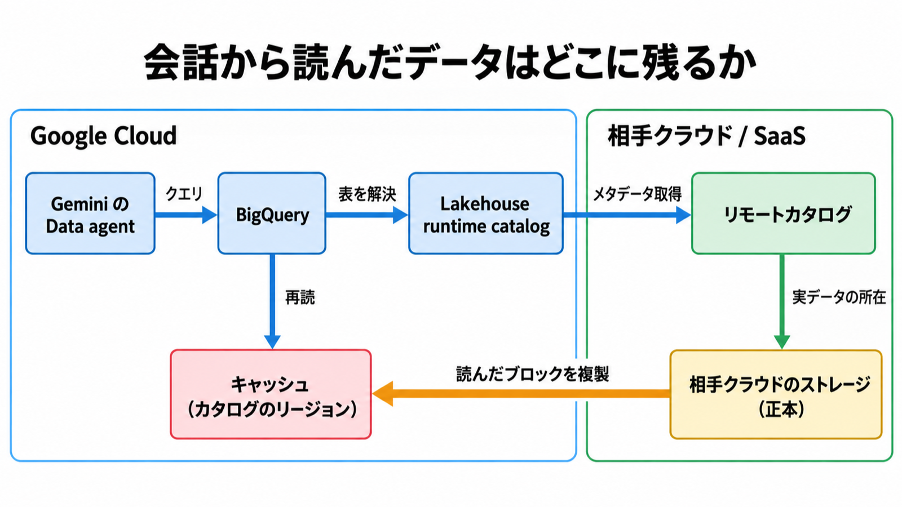

# ダイジェスト: Borderless LakehouseをGeminiの入口にするときの到達範囲

- 元記事: [google-cloud-cloud-google-p7_20261017.md](../../../../../articles/google-cloud-cloud-google-p7_20261017.md) (Zenn 下書き)
- 元記事の根拠: 2026-10-16 の Google Cloud Blog と、2026-10-17 までの公式ドキュメント
- 記事の型: 混合 (仕組みの説明 + 導入前の判断)

## ひとことで言うと

Gemini の Data agent が届くのは、連合したカタログと明示した knowledge source の内側だけ。読んだデータはカタログのリージョンに複製が残る。提供段階はブログの GA 一覧ではなく、各ドキュメントの先頭で確かめる。

## 核心ポイント

| # | 要点 | 判断への効き方 | 根拠の節 |
|---|---|---|---|
| 1 | メタデータはリモートのカタログから取るが、**読んだブロックはカタログのリージョンにキャッシュとして残る** | 「データを動かさない」が正しいのは発見時だけ。レジデンシーの判断に効く | 「キャッシュと専用線」「コピーが残る箇所」 |
| 2 | キャッシュは Google 管理の鍵で、**CMEK は使えない** | CMEK 必須の組織ポリシーが効くとキャッシュが無効になり、クエリだけ走る | 「コピーが残る箇所」 |
| 3 | ブログの「generally available」と、**ドキュメントの Preview 表記が一致しない** | cross-cloud data access・caching・Iceberg V3 は 2026-10-15 時点で Preview。本番サポートを前提にできない | 「ドキュメントが Preview と書く範囲」 |
| 4 | **到達範囲は問題設定より狭い** | オンプレミスのコネクタ、Salesforce の手順、Gemini 画面からのカタログ作成手順は見つかっていない | 「問題設定より狭い到達範囲」 |
| 5 | Data agent は明示した knowledge source (上限 100) を読み取り専用で読む | AlloyDB / Cloud SQL / Spanner では「表の選択はセキュリティ設定ではない」と公式が書く。BigQuery 経路と同じ意味に広げない | 「会話から届く表」「会話 API の上限と、選択の意味」 |

補足 (解釈): egress 料金の「消去」、ローカル同等の性能、Etsy の 60% 高速化は、測定条件のないベンダーの自己記述として扱う (「帯域、性能、顧客事例」)。

## メンタルモデル

- 上段はメタデータの経路。Data agent のクエリは BigQuery → Lakehouse runtime catalog → リモートカタログへ進む。
- 下段はデータの複製。相手クラウドにある正本から、読んだブロックがカタログのリージョンへ写る。同じブロックを再読するときは、このキャッシュを使う。
- 図の仕様: [diagram-spec.yaml](diagram-spec.yaml)。元記事の「業務利用者 → Gemini の会話 → Data agent」は 1 つの要素にまとめた。

## 具体例

元記事が引用するドキュメントの例です (架空の例ではありません)。

- EU の Amazon S3 にあるデータを、`us-east4` に作ったカタログ経由で BigQuery から読む。
- 読んだブロックのキャッシュは `us-east4` に置かれる。
- 正本は EU の S3 に残るが、`us-east4` にも複製がある。

## 適用と判断

使える場面:

- AWS・Azure・SaaS (Databricks Unity Catalog、AWS Glue、Snowflake Horizon、Workday、SAP BDC) の Iceberg 系の表を、BigQuery と Gemini の会話分析から読ませたい
- 取り込みパイプラインを作らずに、エージェントの参照先を増やしたい (ただしキャッシュの複製は残る)

エージェントに渡す前に決める 4 つの境界:

| 境界 | 決めること | 目安・制約 |
|---|---|---|
| 連合する表 | カタログ・namespace・表 | カタログあたり namespace 100 / namespace あたり table 300 / カタログあたり table 10,000。名前は `project.federated_catalog.namespace.table` |
| knowledge source | Data agent が読む表を表名まで | 上限 100。BigQuery クエリは 500 GB of bytes processed まで |
| キャッシュのリージョン | 複製を置いてよいリージョン | CMEK 不可。CMEK 必須の組織ポリシーと衝突しないか確認 |
| プロンプト分析 | 既定で有効な分析を止めるか | 2026-11-23 より前はフォーム、以降は `constraints/gcp.disablePromptAnalytics` |

提供段階は、ブログの GA 一覧ではなく、各ドキュメントのページ先頭の launch stage で判断する。

## 限界・注意点

- cross-cloud data access・caching・Iceberg V3 はドキュメント上 Preview / Pre-GA (2026-10-15 時点)
- Iceberg V3 は BigQuery からは read のみ。新しい V3 型と row lineage は非対応
- Delta Lake のコンソール取り込みはデータのコピーで、ソースの Amazon S3 は非対応
- リモート連合カタログに列レベルの制御を掛ける記述は見つかっていない (確認できたのはテーブル単位)
- クロスクラウドクエリとキャッシュ固有の公開単価は見つかっていない

元記事でも未確定のこと:

- 10 月 16 日より後に、cross-cloud data access と Iceberg V3 のドキュメントが GA に更新されたか
- Gemini の画面から federated catalog を作れるか
- リモート連合カタログに行・列の制御を掛けられるか
- 「bi-directional caching」の公式定義

## 参考

- 元記事 (詳細と全出典): [google-cloud-cloud-google-p7_20261017.md](../../../../../articles/google-cloud-cloud-google-p7_20261017.md)
- [Bringing the borderless Lakehouse into the agentic era with innovations for Gemini](https://cloud.google.com/blog/products/data-analytics/borderless-lakehouse-integrates-with-gemini/) (Google Cloud Blog、2026-10-16)
- [About cross-cloud data access](https://docs.cloud.google.com/lakehouse/docs/about-cross-cloud-data-access)
- [Conversational analytics](https://docs.cloud.google.com/bigquery/docs/conversational-analytics)
- [Quotas](https://docs.cloud.google.com/lakehouse/docs/quotas)
