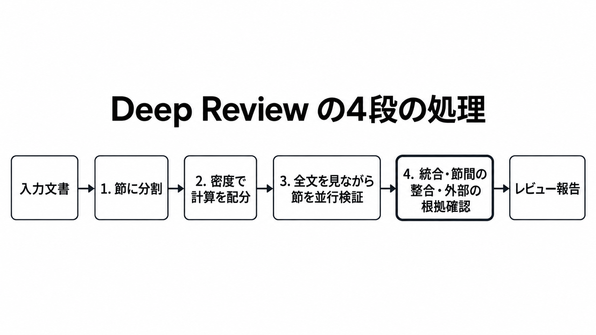
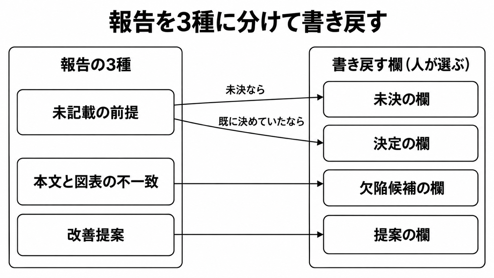

# ダイジェスト: Deep Reviewは設計文書の未記載前提をどう返すか

元記事: [google-deep-review-research-p8_20261017.md](../../../../../articles/google-deep-review-research-p8_20261017.md)

## ひとことで言うと

Google の Deep Review は、文書を節に分けて並行で点検し、節をまたぐ整合と外部の根拠を確かめて報告を返す。設計レビューに使うなら、報告を3種に分けて、採否と書き戻し先は人が決める。

## 核心ポイント

- 離れた節どうしの食い違いは、各節の並行点検のあとの統合段で確かめる。
- 設計文書の未記載前提や図表との一致は、公開ブログが挙げた使い方の例にとどまる。設計資料での検出率と誤検出率は公開されていない。
- 89.7% は前身の Paper Assistant Tool (PAT、Gemini 3.1 Pro) の検出精度で、測定対象は撤回や正誤表に至った数学・計算機科学の論文における数式と証明の誤り 26 論文 29 件、採点は著者の一人が監査した独自採点である。公開製品や設計資料の精度としては使えない。
- 正しい証明を誤りと言う失敗は未解決で、件数は無い。指摘が大部分または全て根拠に基づくと答えた著者は、STOC で 55.8%、ICML で 64.8% で、記事は採否を人に残す。
- 保存の画面文言は、1年保存、学習に使わない、改善へのオプトインの3通りがある。会議向け PAT の「7日で削除」は公開製品の条件ではない。

## メンタルモデル

処理は分割、密度に応じた計算配分、全文を見ながらの並行検証、統合の4段。統合段で節間の整合と外部の根拠を確かめる。報告を受け取ったあとの採否は4段の外にあり、人が担う。

報告は種類ごとに別の欄へ戻し、1つの「仕様の修正」に混ぜない。改善提案を既に決めていた前提として書くと、未決の空白と既決の挙動が区別できなくなる。「提案の欄」は説明用に付けた名前。

## 具体例 (架空)

| 返ってきた指摘 | 種類 | 置く欄 |
|---|---|---|
| キャッシュ無効化が、本文にない「単一リージョン」を前提にしている | 未記載の前提 | 未決の欄 (決定済みなら決定の欄) |
| 構成図はキュー経由なのに、本文は同期呼び出しと書く | 本文と図表の不一致 | 欠陥候補の欄 |
| レート制限を足してはどうか | 改善提案 | 提案の欄 |

## 適用と判断

向く場面:

- 人のレビュー前に、書かれていない前提や本文と図表の食い違いを洗い出したいとき。
- 週2回まで無料なのは Medium の 4 Argon で、超えた分は自分の Gemini API キーで払う (40ページの目安は、Low の 3.8 Flash で約 $3 から、4 Argon の Extra High で $20 まで)。

確認すること:

- 報告を3種に分けてから採否を決めているか。
- 精度を引用するとき、数学・計算機科学の撤回・正誤表論文における数式と証明 (26 論文 29 件) への PAT (Gemini 3.1 Pro) の測定 (89.7%) の範囲にとどめているか。
- 未公開の仕様を出す前に、画面の保存条件 (1年保存、学習に使わない、改善へのオプトイン) を受け入れられるか。

## 限界・注意点

- 画像としてしか残らない図は、プレーンテキストや画像が落ちた大きな PDF では照合できない。20MB を超えるファイルは受け付けない。
- 複数ファイルの同時投入は、告知時点では今後対応。
- 関連研究を探すため Web 検索をすることがある。文書自体は private だと FAQ にあるが、検索クエリに未公開文書の文が含まれるかは公開資料から分からない。
- Drive 経由の Google Docs と Google Slides、および 20,971,520 バイト未満の PDF と PPTX で、図表が検証に残るかは公開資料から分からない。
- 改善へのオプトインの初期値と、「Deep Review の改善」がモデル学習を含むかは、公開資料から分からない。

## 参考

- 元記事: [google-deep-review-research-p8_20261017.md](../../../../../articles/google-deep-review-research-p8_20261017.md)
- Google Research, "Analyzing technical documents with Deep Review" (2026-10-14): https://research.google/blog/analyzing-technical-documents-with-deep-review/
- Jayaram et al., PAT 論文 arXiv:2606.28277v1: https://arxiv.org/html/2606.28277v1
- Deep Review 製品ページ: https://research.google/deepreview/
