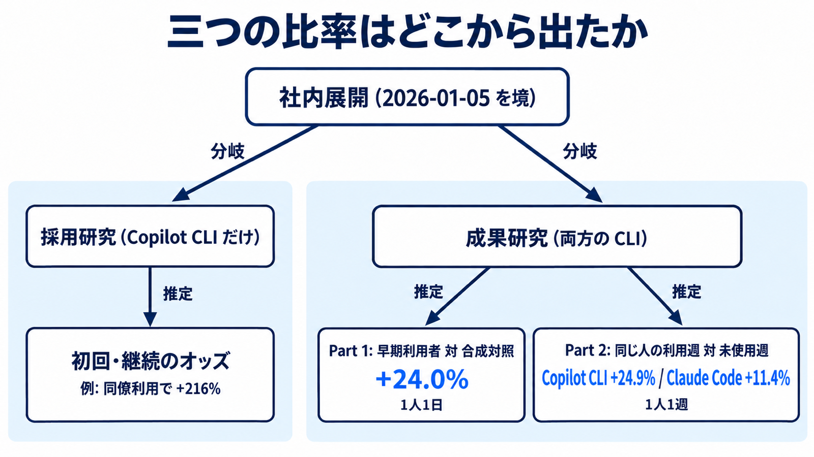

# ダイジェスト: Microsoft社内のCLI測定が推定した三つのマージ済み件数

- 元記事: [notes/zenn/articles/microsoft-cli-itmedia-co-p2_20261017.md](../../../../../articles/microsoft-cli-itmedia-co-p2_20261017.md)
- 一次資料: Murphy-Hill ほか「Adoption and Impact of Command-Line AI Coding Agents」arXiv:2607.01418v1 (preprint、査読前)
- 記事の型: 研究・評価

## ひとことで言うと

Microsoft 社内の CLI コーディングエージェント研究が出した +24.0% / +24.9% / +11.4% は、それぞれ分子・比べる相手・対象の道具が違う別の推定です。「生産性が 24% 上がった」という一つの数ではありません。

## 核心ポイント

1. **研究が 2 本あり、母集団が違う。** 採用研究は Copilot CLI だけを対象に、誰が試して誰が使い続けたかを見ます。成果研究は Claude Code と Copilot CLI の両方を対象に、マージ済みプルリクエストの件数を見ます。(元記事「CLIコーディングエージェントの社内測定とは」「母集団の切り方」)
2. **+24.0% と +24.9% は別物。** +24.0% は早期利用者 (2026-01-05〜11 に使った人) の 1 人 1 日の件数を、非利用者から作った合成対照と比べた値です。+24.9% (Copilot CLI) と +11.4% (Claude Code) は、同じ人の利用週と未使用週を比べた 1 人 1 週の差です。(元記事「三つの比率の定義」)
3. **後者は因果ではなく関連。道具の優劣も分からない。** 2.2 倍 (24.9 ÷ 11.4) は、道具を無作為に割り当てて得た差ではありません。仕事の中身が道具ごとに違った可能性が残ります。(元記事「因果として読める範囲」「件数は価値そのものではない」)
4. **試すかどうかを最も強く左右するのは同僚の利用。** 上司の上司が同じ同僚の 25% 以上が使っていると、初回利用のオッズが +216% になります。ただしこれは確率の 3.16 倍ではなくオッズの係数です。似た人が集まる効果 (homophily) とも分けられません。(元記事「初回利用と継続の係数」「オッズと、4か月の点推定」)
5. **(解釈) 写すべきは数字ではなく切り方。** 試行・定着・早期利用者の反事実・同じ人の利用週・品質を別々の欄にし、自社で観測できない欄は評価に使わない、というのが記事の結論です。(元記事「評価制度に載せる前の分岐」)

## メンタルモデル: 三つの比率はどこから出たか

- 左の系統 (採用研究) が出すのはオッズで、件数ではありません。
- 右の系統 (成果研究) の Part 1 と Part 2 は、比べる相手と時間単位が違います。
- 図の仕様: [diagram-spec.yaml](diagram-spec.yaml)

## 具体例 (元記事にある実例)

ITmedia NEWS の記事は、24% を「使わなかった場合と比べて完了した仕事が 24% 増えた」と説明しています。

| 項目 | 報道の 24% | 論文の +24.0% | 論文の +24.9% / +11.4% |
|---|---|---|---|
| 分子 | 完了した仕事 | 1 人 1 日のマージ済み件数 | 1 人 1 週のマージ済み件数 |
| 比べる相手 | 使わなかった場合 | 非利用者から作った合成対照 | 同じ人の未使用週 |
| 読み方 | 一つの「生産性」 | 早期利用者を合成対照と比べた推定 | 関連 (因果ではない) |

報道の図の説明にある「ツールを使わなかった週と比べて」は、Part 2 の +24.9% / +11.4% にしか当てはまりません。

## 適用と判断

使える場面:

- 社内で AI コーディングエージェントの効果を測る仕組みを設計するとき
- 「生産性 N% 向上」という報道や二次記事を読むとき
- 評価制度や KPI に AI 利用の指標を入れるか決めるとき

判断の基準:

| やりたいこと | 置いてよい条件 | 条件がないときにしないこと |
|---|---|---|
| 試す人を測る | 初回利用の発生率を同僚の利用率と一緒に見られる | 「導入率」という一つの割合にまとめない |
| 使い続ける人を測る | 試行と定着を分けた率が取れる | ライセンス配布数を定着と呼ばない |
| +24% 型の比較 | 合成対照か、それに近い非利用者の系列がある | 全社員の生産性目標に +24% と書かない |
| 利用週の比較 | 人ごとの差を除いた週次データがある | 利用者と非利用者の平均差で代用しない |
| 道具の順位付け | 道具間で仕事の割り当てが揃っている別証拠がある | 「Copilot が 2.2 倍良い」を評価項目にしない |
| 個人評価 | (論文の推定単位と合わないので置かない) | 組織の +24.0% を個人に配らない |

## 限界・注意点

- **件数は価値ではない。** 品質・差し戻し・レビュー待ち時間は測っていません。
- **分子の取り方に偏りがある。** 対象は Azure DevOps の PR だけで、28 日以内にマージされたものだけです。PR を小さく分ければ件数は増えます。
- **早期利用者は自分で使い始めた人。** 採用者だけが受けた出来事 (製品出荷など) は、合成対照では除けません。
- **利用頻度と件数の関係 (週 3 日 +15.0%、週 5 日以上 +50.1%) は原因ではない、と著者自身が書いています。**
- **書き手の立場。** 著者は測定対象の道具の一方を作る会社の社員です。原稿は preprint v1 で、査読済みではありません (「peer-reviewed」と書く二次記事は誤り)。
- **観察は約 4 か月。** 16 週より長い効果の減衰は見えません。

本文から分からないこと:

- 正確な人数、部門別の利用率、トークン費用 (費用対効果は計算できない)
- 窓の中の道具選択が、直後に出た Claude Code から Copilot CLI への移行方針とどれだけ無関係か
- 他社で同じ比較をしたときに、増えるか減るか
- 外部の再解析や反論 (2026-10-17 時点で見つかっていない。見つからないことは、批判が無いことの証明ではない)

## 参考

- 元記事 (詳細はこちら): [microsoft-cli-itmedia-co-p2_20261017.md](../../../../../articles/microsoft-cli-itmedia-co-p2_20261017.md)
- arXiv:2607.01418v1 https://arxiv.org/html/2607.01418
- ITmedia NEWS (2026-10-16) https://www.itmedia.co.jp/news/article/2610/16/2000002277/
- 構造化ダイジェスト: [digest.yaml](digest.yaml)
