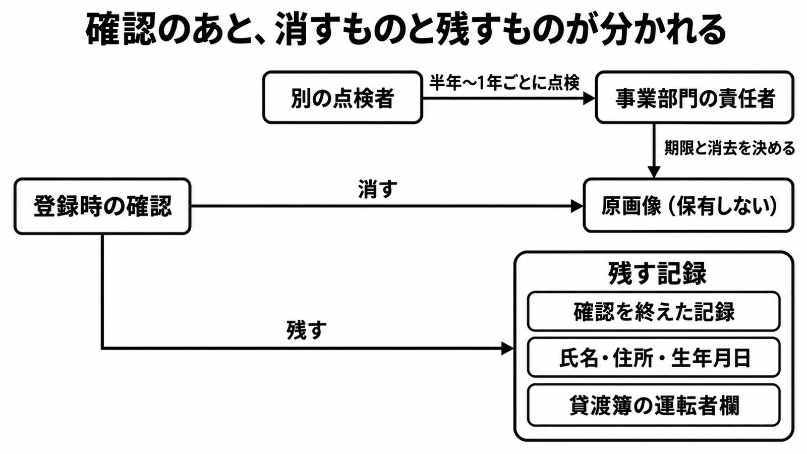

# ダイジェスト: タイムズカー事案から分ける本人確認書類の保管場所と消去

元記事: [タイムズカー事案から分ける本人確認書類の保管場所と消去](../../../../../articles/unitis-jp-24665-p6_20261017.md) (Zenn 下書き)

## ひとことで言うと

本人確認書類は、確認後に消す原画像と、根拠を持って残す記録に分けて扱う。消去の期限は事業部門の責任者が決め、別の人が点検する。

## 核心ポイント

1. **消す対象は原画像だけ**。タイムズカーの第4報 (2026-10-16) が「登録確認後は保有しない」としたのは画像で、氏名・住所・生年月日などの記録は別の根拠で残りうる。
2. **置き場所はサービスに必要かどうかで分ける**。必要なデータは Web から届く区画に置き、保管するだけのデータはオフラインか社内の安全な区画へ移す。クラウドの透過型暗号は、読み取り権限を奪われると元の形で読まれる。
3. **委託してもリスクは一部しか移らない**。eKYC 事業者に預けても、委託先を監督する義務 (個人情報保護法第25条) は委託元に残る。
4. **期限を決める人と点検する人を分ける**。現場任せだと「消すのが怖いから残す」になる。点検は別の人が半年〜1年に1回行う。
5. **即時削除は法の要求ではなく運営会社の選択**。第22条の消去は努力義務で、消す時点を指定していない。

## メンタルモデル

登録時の確認を境に、原画像は消す側、3 種の記録は残す側に分かれる。期限と消去は事業部門の責任者が決め、別の点検者がその運用を定期的に点検する。

## 具体例: タイムズカー事案 (実例)

| 項目 | 内容 |
|---|---|
| 漏えい | 約660万アカウント。うち本人確認書類の画像を含むのは約160万件 |
| 旧ルール | 現会員は会員期間中、退会会員は退会後7年、画像を保有 |
| 新ルール | 登録確認完了後に即時削除。保有中の画像も2026年10月末までに削除 |

## 適用と判断

向く場面:

- 免許証などの画像を受け取るサービスで、保管と消去の手順を作るとき
- eKYC 事業者への委託を検討し、自社に残る責任を整理するとき
- データの棚卸しと、期限の決定・点検の役割分担を決めるとき

確認項目:

- 原画像の置き場所は、Web から届く区画・保管専用の区画・委託先のどれか。
- 法令が原本の保管を求めるか (求めなければ、確認済みの記録か元に戻せないハッシュでの照合を選べる)。
- 期限と消去を決める事業部門の責任者と、それとは別の点検者がいるか。
- 残す記録ごとに期間の根拠があるか (例: 氏名・住所・生年月日は FAQ Q8 が法人税法等により7年)。
- 貸渡しがある事業なら、貸渡し終了から2年残す貸渡簿を、登録確認とは別の起点で管理しているか。

## 限界・注意点

- 約660万件はアカウント数で、免許証画像の件数ではない。
- 同日の FAQ Q8 は「運転免許情報および画像を7年保管」と書いたままで、第4報と食い違う。更新漏れかどうかは公表から読めない。
- バックアップも削除対象という話は報道の伝聞で、第4報の本文には書かれていない。
- 元に戻せないハッシュでも、作り方次第で個人を識別できる状態が残る。
- 未確認: タイムズカーの貸渡しがレンタカー通達の対象か、FAQ Q8 の「運転免許情報」(画像以外) まで消すか。

## 参考

- 元記事: [タイムズカー事案から分ける本人確認書類の保管場所と消去](../../../../../articles/unitis-jp-24665-p6_20261017.md)
- [徳丸浩氏に聞く、タイムズカー事案から考えるユーザーデータ管理 (UNITIS、2026-10-16)](https://unitis.jp/articles/24665/)
- [タイムズモビリティ 第4報 (2026-10-16)](https://share.timescar.jp/news/2026/1016/1826.html)
- [タイムズモビリティ ご質問と回答 (FAQ)](https://corp.timescar.jp/mail/announce/faq.pdf)
- [個人情報の保護に関する法律 第22条・第25条](https://laws.e-gov.go.jp/law/415AC0000000057)
