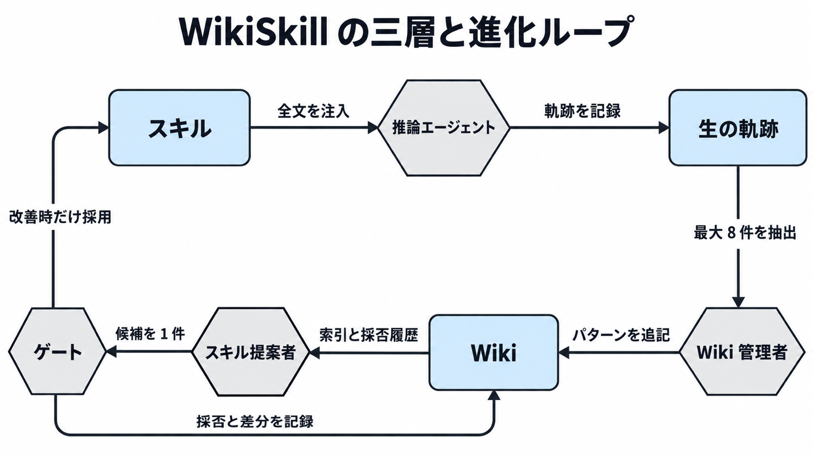

# WikiSkill ダイジェスト

元記事: [エージェントの経験を知識に変えてスキルを育てる WikiSkill の三層構造](../../../../../articles/wikiskill_20261015.md)

## ひとことで言うと

エージェントの実行経験を「生の軌跡・wiki・スキル」の三層に分けて、スキルを育てる手法。スキルは検証点が過去最良を上回ったときだけ採用し、同点も不採用。wiki は不採用でも残す。

## 核心ポイント

- **知識とスキルを別の層に置く**: スキルを巻き戻しても、wiki に溜めた失敗の原因や成功手順は消えない。
- **推論エージェントには wiki を渡さない**: 読むのは Wiki 管理者とスキル提案者。推論にも wiki を渡すと、Gemini-3.5-Flash の 4 ベンチマーク平均は 63.7 から 60.9 に下がった (論文は、軌跡がスキルを育てる材料として弱くなるためと推測している)。
- **採用は検証点が過去最良を上回るときだけ**: 同点も不採用。不採用案の差分は採否履歴に残り、次の提案で同じ修正を繰り返さない。
- **5 モデルすべてで既存のスキル進化手法を上回る**: Qwen-3.5-9B に WikiSkill を付けた平均 47.4 は、スキルなしの Qwen-3.6-27B (39.4) も上回る。
- **スキルは別モデルへ移せるが、逆効果もある**: Qwen-3.5-4B 由来の表計算スキルを載せると、Gemini-3.5-Flash は 50.5 から 18.1 に落ちた。

## メンタルモデル

四角がデータの層、六角形が処理を表す。推論エージェントと Wiki の間には矢印がなく、推論は Wiki を読まない。ゲートからスキルへは改善時だけ戻り、Wiki への記録は採否に関係なく毎回行う。

## 具体例

論文の ALFWorld (家庭作業のシミュレータ) の事例では、反復 0 で繰り返し動作のパターンが Wiki にできたが、そのときの提案は不採用になった。反復 1 で「物を元の場所に戻さない」というスキルが採用された。

## 適用と判断

**向く作業**

- 同じ手続きで繰り返し失敗する作業
- 結果を 0〜1 の得点で自動採点できる作業
- 数学のように、モデルに依存しない手順を使い回したい作業

**導入前に確認すること**

| 確認すること | 満たさないと |
|---|---|
| 検証用のデータで自動採点できるか | 採否を判定できない |
| スキルなしで検証が満点になっていないか | 訓練を 1 回も回さずに止まる |
| 別モデルへ移す前に、移す先のモデルで検証したか | 逆効果に気づけない |
| 論文と比べるなら、3 回平均と採否の条件を揃えたか | 点数を比べても意味がない |

## 限界・注意点

- 検証が 10〜18 件なのは LiveMath、SealQA、ALFWorld で、表計算は 40 件、長文は 24 件。小さい集合では 1 回の採否が揺らぐので、論文は 3 回の平均で対処している。
- 評価したのはスキル全文の注入だけ。スキルが増えたときに正しく選べるかは分からない。
- 同点を捨てるので、すぐ点数が動かない整理はスキルに残らない (知識は Wiki に残る)。
- Wiki を自動で削る仕組みはなく、長く回すと必要になり得る。
- 公式実装は案内されていない。コミュニティ実装は論文の数値を再現する保証がない。

## 参考

- 元記事: [エージェントの経験を知識に変えてスキルを育てる WikiSkill の三層構造](../../../../../articles/wikiskill_20261015.md) (疑似コード、出力形式、ベンチマーク分割、トラブルシューティング)
- 論文: [arXiv:2608.27454](https://arxiv.org/abs/2608.27454) / [HTML 全文 v1](https://arxiv.org/html/2608.27454v1)
- 系譜: [Karpathy, LLM Wiki](https://gist.github.com/karpathy/442a6bf555914893e9891c11519de94f)
