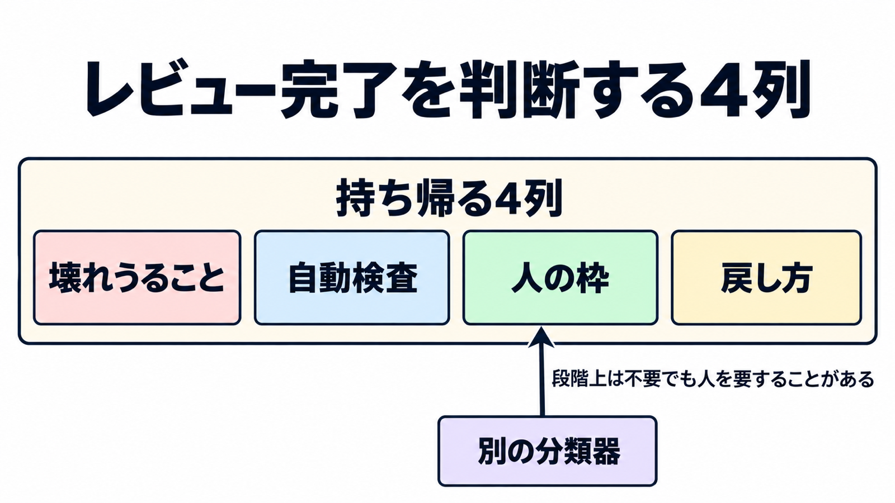

# ダイジェスト: Claude Codeチームはレビュー完了の基準を「人が読んだか」から外した

元記事: [claude-code-claude-dev-solving-p1_20261018.md](../../../../../articles/claude-code-claude-dev-solving-p1_20261018.md)

## ひとことで言うと

Claude Code チームは、レビュー完了の基準を「人が読んだか」から「何が壊れ、どの検査が捕まえるか」へ移した。人の承認は、変更のリスクに応じて残している。

## 核心ポイント

- リスク段階は変更の内容が決め、職位は入力にしない。人の承認は Low は不要、Medium は 1 人、High は 2 人。Low が不要なのは、自動レビューとセキュリティが緑で、著者が信頼リスト(軽い経路を使える著者の一覧)内のときだけで、リスト外は人が 2 人目に要る。
- 段階を選ぶ分類器とは別に、段階上は不要でも人を要するかを問う分類器がある。エージェントの承認は人の枠に入らない。
- 2026年6月から9月の「マージが2倍超、revert 割合が40%超減」は自己申告で、件数の始点と終点、revert の定義、インシデント率が無い。別の説明もありうる(変更を小さく割った、低リスクの docs や copy が増えた、戻さず後から直す形に寄った、戻しを速くした)が、記事はそれらを分けておらず、レビュー方式だけの成果にはしない。
- Anthropic が製品として提供する Code Review(社内の運用と区別して、以下、公開の Code Review)のチェックは、指摘があっても失敗で終わらず、マージを止めない。止めるなら、自前の CI がチェック出力の `bughunter-severity` 行の `normal`(Important の指摘の件数)が 1 以上のとき失敗させる。
- 2026年10月15日時点では、revert やインシデントが動いたときに承認を厳しくする仕組みはまだ無い。本文は、ゼロ人マージ(人の承認なしのマージ)をこれ以上広げる前にその仕組みが欲しい、と書いている。

## メンタルモデル

持ち帰る単位は4列である。壊れうること、それを捕まえる自動検査、人の枠、戻し方。

公開の Code Review を入れても、社内の、低リスクなら人の承認を省く運用が自動で手に入るわけではない。

## 具体例

元記事が、公式の3段階を4列に落とした例。

| 壊れうること | 自動検査 | 人の枠 | 戻し方 |
| --- | --- | --- | --- |
| docs、copy、社内限定、flag の背後の追加 | 自動レビューとセキュリティが緑 | Low かつ信頼リスト内なら不要。リスト外は人2人目 | 再マージ。flag が無い変更は戻し方を PR に書く |
| 通常の製品変更。caching、auto-updater、system prompts | テスト、ビルド、自動レビュー | 人1人。エージェントに書かせた PR は、指示した人がその一人に数える | flag、revert、段階公開。数分で戻せる前提 |
| 課金、CI の workflow、コードの所有者が敏感と列挙したパス | セキュリティレビューを含む自動検査 | 常に人。High のパスは人2人 | 承認は特定のコミットに結びつく。システムが保証できない新しいコミット(エージェントの push など)が乗るとやり直し |

## 適用と判断

向く場面:

- 人のレビューを、全件を読む既定から、自動検査が捕まえない種類へ移すとき。
- 公開の Code Review を、指摘を PR に付ける層として入れ、マージ停止は自前の CI に置くとき。
- 低リスクを自動検査だけで通すかを、信頼リストと戻し方とセットで決めるとき。

確認すること:

- 職位を段階の入力にせず、段階上は不要でも人を要する判断を残しているか。
- エージェントの承認を、必要な人の承認に数えていないか。
- 6月から9月の倍率と revert 割合を、レビュー方式だけの成果にしていないか。
- `bughunter-severity` の行が無い完了を、指摘ゼロではなく判定無しとしているか。
- revert とインシデントが動いたときに承認を戻す仕組みが無い間、人の承認を省く範囲を広げていないか。

## 限界・注意点

- 公開の Code Review は diff と周囲のコードを読むだけで、ビルドも実行もしない。実行で確かめる層は製品の外に置く。
- Zero Data Retention、HIPAA 構成、顧客管理の暗号鍵では使えず、BAA の対象でもない。処理は Anthropic の管理環境で動き、セルフホスト環境では動かない。
- 記事が埋めていないのは、revert の定義と絶対数、インシデント率、ゼロ人承認の割合と分類器の誤分類、一般提供後の1回あたりの費用である。

## 参考

- 元記事: [claude-code-claude-dev-solving-p1_20261018.md](../../../../../articles/claude-code-claude-dev-solving-p1_20261018.md)
- Addy Osmani, Morgan Westlee Lunt, Qing Wang. [How the Claude Code team does code review](https://claude.dev/blog/solving-code-review-at-anthropic/). 2026-10-15.
- Anthropic. [Code Review is now generally available](https://claude.com/resources/articles/code-review-is-now-generally-available). 2026-10-15.
- Anthropic. [Code Review](https://code.claude.com/docs/en/code-review). Claude Code Docs. 2026-10-18 取得.
- Anthropic. [Code Review costs and usage](https://code.claude.com/docs/en/code-review-costs). Claude Code Docs. 2026-10-18 取得.
