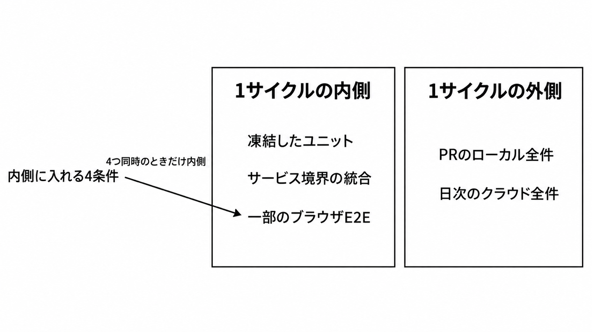

# ダイジェスト: エージェントの1サイクルに入れるE2Eの範囲

元記事: [e2e-future-architect-github-p5_20261018.md](../../../../../articles/e2e-future-architect-github-p5_20261018.md)

## ひとことで言うと

エージェントの1サイクルに入れるブラウザE2Eは、画面に出て、デプロイを待たず、必要な一部だけを回し、失敗を人のレポートへ残せるものに限る。全件はPRと日次の外に置く。

## 核心ポイント

- 武田の記事が扱うのは、画面から入りサーバ経由でデータベースへ届くWebのE2Eを、デプロイ待ちなし、並列、HTMLレポート、トレースのリンクで短く回す基盤である。APIの直叩きとモバイルは定義の外にあり、実行は実装中のローカル再実行、PRのGitHub Actions上のローカル全件、developに対する毎日02:00のクラウド全件の3段である。
- 本数の中心をブラウザE2Eへ移したとは扱わない。1サイクルの内側の既定は、実装エージェントが書き換えられないユニットと、サービス境界の統合である。
- GitHub Actionsの4コアで約160件が約13分、その半分以上が環境構築、という数字は著者の自己申告で、全件を1サイクルの内側に置くことを難しくする。ローカルE2Eの検出がクラウド日次を大きく上回ったという記述も自己申告で、件数や内訳は公開されておらず、一般の所要時間や検出率としては使えない。
- 期待値の編集、プロダクト側の検証の無効化、失敗が人に残る前にパッチかskipへ寄りえるPlaywrightのhealerは、内側の外に出す。緑は、直したことの証明にはならない。

## メンタルモデル

1サイクルの内側は、凍結したユニット、サービス境界の統合、4条件を満たす一部のブラウザE2Eである。外側は、PRのローカル全件と、毎日02:00のクラウド全件である。全件のブラウザE2Eは内側に置かない。

## 具体例 (架空)

| 変更 | 1サイクルの内側に入れるもの |
|---|---|
| 画面のボタン文言を変える | 凍結したユニットとサービス境界の統合。4条件を満たすときだけ、その画面のブラウザE2Eも入れる |
| 画面が無い課金Webhookの成否を変える | 凍結したユニットとサービス境界の統合。ブラウザE2Eと画面の証拠だけでは局所化できない |
| 全画面の回帰を1サイクルで回したい | 入れない。PRのローカル全件と日次のクラウド全件に残す |

## 適用と判断

向く場面:

- コーディングエージェントにWebの実装を任せ、1サイクルへ入れる確認の境界を決めるとき。
- 画面に出る変更について、デプロイを待たず一部のブラウザE2Eを再実行できる基盤があるとき。
- 全件のブラウザE2EをPRと日次に残し、内側はエージェントが書き換えられない確認にしたいとき。

確認すること:

- 変更が画面に出るか。
- 同じテストを、クラウドへのデプロイを待たずに再実行できるか。
- 全件ではなく、その変更に必要な一部だけを回せるか。
- 失敗した画面、データベースの前後、トレースを、期待値を直す前に人へ残せるか。
- 実装エージェントが、期待値を編集したり、プロダクト側の検証を無効化したり、テスト自体を書き換えたりできないか。

## 限界・注意点

- 結論がひっくり返るのは、公開された比較で、凍結したユニットとサービス境界の統合よりブラウザE2E中心の方が、欠陥の取りこぼしと待ち時間の両方が小さいと示されたとき、または全件が1サイクルに収まる時間で安定して終わる測定が出たときである。
- 前提の「広がりつつある」は、計測された移行ではない。本数の中心を移すべきだという比較実験は、記事が参照した範囲には無く、これは無いことの証明ではない。
- 画面が無い変更、APIの直叩き、課金Webhookの成否は、ブラウザE2Eと画面の証拠だけでは局所化できない。
- ユーザー行で分離できない外部アカウント、シーケンス、グローバル設定は、名前付きlockで直列にし、その資源の並列は落ちる。ファイル内まで並列にするには `fullyParallel: true` が要り、既定は false で、`workers` だけではファイル内は順に実行される。
- 随時実行の所要時間、ローカルとクラウドの検出件数、武田の記事のシステムのトレースがX-Rayの既定サンプリングを通るか100%送出か、凍結したユニットと一部のE2Eを同じサイクルで回した待ち時間は、公開されていない。この欠測は、本数の中心を移す判断は止めず、内側に全件のブラウザE2Eを置く判断だけを止める。

## 参考

- 元記事: [e2e-future-architect-github-p5_20261018.md](../../../../../articles/e2e-future-architect-github-p5_20261018.md)
- 武田大輝. E2E テストのフィードバックループを小さくするためのプラクティス. フューチャー技術ブログ. 2026-10-16. https://future-architect.github.io/articles/20261016a/
- Playwright. Parallelism. https://playwright.dev/docs/test-parallel
- Playwright. Agents. https://playwright.dev/docs/test-agents
- Mike Wacker. Just Say No to More End-to-End Tests. Google Testing Blog. 2015-04-22. https://testing.googleblog.com/2015/04/just-say-no-to-more-end-to-end-tests.html
