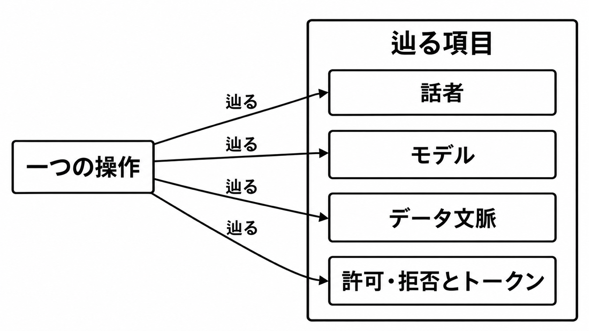

# ダイジェスト: Itaúのia.iとIARAを設計レビューでどう読むか

元記事: [ita-iara-openai-index-itau-p7_20261018.md](../../../../../articles/ita-iara-openai-index-itau-p7_20261018.md)

## ひとことで言うと

Itaú の公開事例は、顧客の会話 ia.i とモデル統制の IARA を組にして語る。設計レビューでは、一つの操作に話者、モデル、データ文脈、許可または拒否とトークンが結び付くかを見る。

## 核心ポイント

- ia.i は顧客向けの会話層で、口座から保険までの相談を一つの会話にまとめ、必要なら人へ渡す。発売時点の銀行側説明では、取引として通る中心は Pix である。
- IARA は社内方針に沿ったモデルアクセスを担い、トークンあたりのコスト、応答の正確性、Responsible AI 方針を同時に扱う。事例が用途として名指しするのは、法務の文書読解である。
- 行員の支援は、顧客の会話と同じ知能の層に乗ると書かれている。監査ログの共有は、その文面には無い。
- 約 30 万人は初回提供、約 7,000 万人は Customer DNA が金融文脈を持つ人数で、ia.i の利用者数ではない。9 月の 300 万人は 7 月時点の予定で、2026 年 10 月 18 日時点の実績は確認できていない。
- 「3 倍の時間、最大 2 倍の速度、最大 3 倍の会話効果」は行内利用への期待であり、測定済みの結果としては書かれていない。ポルトガル語記事の「最大 3 時間」は、英語事例の「3 倍の時間」と同じ文の翻訳として扱わない。

## メンタルモデル

完了と見る条件は、一つの操作へ四つの項目が結び付くことである。この四つは、公開事例の読みから立てた確認項目であり、IARA が公開した列名ではない。

## 具体例

| 読み方 | 公開記録が支えること | レビューで足す問い |
|---|---|---|
| 一つの基盤 | 会話の前に、編成とガバナンスの層がある | 名前が IARA でも無名でも、チャネルの操作がその層まで辿れるか |
| ルータは共有し、監査キーは別 | モデルの振り分けは語られる。監査キーの共有は語られない | 顧客の ia.i と行員の支援が、別の台帳のまま終わっていないか |

## 適用と判断

向く場面:

- ベンダー事例が、会話体験とガバナンスの層を組にして全社展開を語るとき。
- 顧客向けと行員向けを、同じ知能の層としてリリース判定するとき。
- 人数、倍率、効率を、別の報告へ転記するとき。

確認すること:

- 記帳側の主キーと会話側の主キーが結ばれているか。
- OpenAI 事例の法務 9,000 万件超と、会見報道の 4,300 万文書を、同じ母数にしていないか。
- 二次記事が書くマネーロンダリング防止の遮断を、OpenAI 事例本文の事実として使っていないか。
- 初期テストの満足度 87.5% を、全顧客展開後の品質として読んでいないか。
- 生成 AI 支出の 65% 減を、金融の copilot に開かれている人の割合（別の 65%）として読んでいないか。

## 限界・注意点

- 効率 20% から 80% は幅だけで、どの工程と比べたかは事例に無い。生成 AI 支出の 65% 減は、単位コストの前年比とは書かれていない。
- IARA が止める操作の一覧は、公開事例に無い。
- 誰の識別子、モデル、データ文脈、許可または拒否、トークンが同一レコードに入るかは、未公開である。
- 顧客データと従業員データが分離しているか混在しているかも、公開資料では確認できていない。
- ICTi の Pix 記録の図は、製品内部を表さないと図の説明が書いており、ログ仕様へ転記できない。

## 参考

- 元記事: [ita-iara-openai-index-itau-p7_20261018.md](../../../../../articles/ita-iara-openai-index-itau-p7_20261018.md)
- [OpenAI, “How Itaú is building generative AI for its entire customer base” (2026-10-16)](https://openai.com/index/itau-generative-ai)
- [Feito.Itaú, “Itaú lança ia.i” (2026-07-28)](https://feito-itau.cloud.itau.com.br/itau-iai-superapp-inteligencia-artificial/)
- [Mobile Time, Henrique Medeiros, ia.i の copiloto (2026-07-27)](https://www.mobiletime.com.br/noticias/27/07/2026/itau-copiloto-ia-i-ai/)
- [Mobile Time, Henrique Medeiros, 生成 AI の費用 (2026-07-27)](https://www.mobiletime.com.br/noticias/27/07/2026/itau-custo-ia-generativa/)
