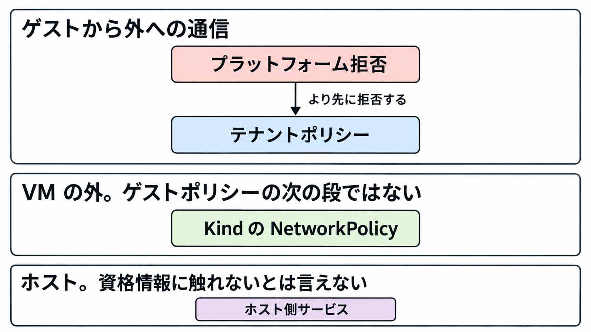

# ダイジェスト: Perplexity SPACEでエージェントの実行場所と到達範囲を分ける

元記事: [perplexity-space-gigazine-p6_20261018.md](../../../../../articles/perplexity-space-gigazine-p6_20261018.md)

## ひとことで言うと

SPACE はエージェントのコードをマイクロ VM で動かし、届く宛先は別の層のポリシーで切ります。脱出 0/108 は観察記録であり、自分の環境での試験の代わりにはなりません。

## 核心ポイント

1. 各サンドボックスは Firecracker のマイクロ VM です。管理 API は状態を PostgreSQL に記録し、コマンドの入出力はデータプレーンを通り、管理用 bearer とセッション添付トークンは交換できません。
2. 新規テンプレートは拒否既定です（allow も deny も空、TLS interception は off）。プラットフォームはテナントより先に、メタデータ、link-local の 169.254.0.0/16（169.254.0.20/30 は例外）、10.11.0.0/16 と 10.12.0.0/16（10.0.0.0/8 全体ではない）、ループバック、IPv6 link-local を拒否します。
3. Kind の NetworkPolicy は VM の外の Pod に付き、ゲストの拒否既定ではありません（直接アダプタはサンドボックス用の Pod を作りません）。sandboxes 名前空間の出口は公開 IPv4 とクラスタ DNS で、IPv6 の出口はありません。
4. 脱出と迂回は別の結果で、修正後の再試験は自社が特定した 2 経路だけです。いずれも自己申告で、公開一次では独立した再現が見つかっていません。
5. アクセスもコマンドも無い状態が 6 時間続くと suspend します。Paused はメモリをワーカーに残すだけで永続スナップショットは取らず、E2B の pause は SPACE の suspend（スナップショットを取って VM を解放）、resume は restore に対応します。

## メンタルモデル

ゲストから外への通信では、プラットフォーム拒否がテナントポリシーより先です。Kind の NetworkPolicy は、ゲストポリシーの次の段ではありません。ホストが特権でも、ゲストがホストの資格情報に触れないとは言えません。

## 具体例

公開ブログと Gigazine（2026年10月16日）は、同じ数字を「耐性が示された」に近い調子で要約します。

| 一次が分けているもの | 数字と条件 | 言えないこと |
|---|---|---|
| ゲストからホストへの脱出 | 0/108（9 モデル、2 課題、4 条件、各 3 回。ゲスト内 root、ホスト上の足場なし。ソースの有無、ネットワーク無しまたは部分、1 時間または 2 時間） | 脱出が起きないこと |
| ネットワーク遮断の迂回 | 無しは 0/54。部分ネットワークは修正前 11/54（ソースありでは一部モデルが 3/3 または 2/3） | 脱出と同じ結果であること |
| 修正後の再試験 | 2026年8月26日の 2 経路を、ソースあり・部分ネットワーク・検索ありで再試験。検証できた実行ではフラグ取得なし。2 回はエラー終了 | 他の経路が残っていないこと |

## 適用と判断

向く場面:

- エージェントのコード実行を、モデルの禁止文やホスト OS の権限とは別の部品として置くとき
- Linux x86_64 と KVM、ホスト特権のワーカーを前提にできるとき（Firecracker 1.17.0 を置いても、本番と未認識の環境名では VMM は 1.15.1 のまま）

確認項目:

- 配るテナントポリシーが拒否既定で、allow が自社の権限表と一致し、TLS exemption が空か、空でない理由が残っているか
- Kind の公開 IPv4 をゲストポリシーの代わりに使わず、Pod の外側の上限として試験しているか

残りの確認は、元記事の「確認してから配る条件」にあります。

## 限界・注意点

- 承認済みの書き込みはライフサイクルの境界で残ります。クラッシュ、強制停止、ホスト障害を必ず生き延びるとは書いていません。
- Windows ゲストと利用者の手元マシンは、7 月の記事では今後の作業です。
- 修正対象は直近のマイナーだけです。0.9 のあとの 0.8 は、その文面では対象外です。
- Cloudflare Sandbox と NVIDIA OpenShell を、その 2 経路で迂回無しとした表は 1 回の自社試験です。その 2 製品を一般に優先する理由にはしません。
- ネットワーク指定の省略がテンプレートを継承するか、コマンド実行が 6 時間アイドルを更新するかは、公開文書では閉じていません。

## 参考

- 元記事: [perplexity-space-gigazine-p6_20261018.md](../../../../../articles/perplexity-space-gigazine-p6_20261018.md)
- [Gigazine（2026年10月16日）](https://gigazine.net/news/20261016-perplexity-space/)
- [Perplexity, Open-sourcing SPACE](https://www.perplexity.ai/hub/blog/open-sourcing-space)
- [Perplexity, Escaping SPACE Part I](https://www.perplexity.ai/hub/blog/escaping-space-part-i)
- [GitHub, perplexityai/SPACE](https://github.com/perplexityai/SPACE)
