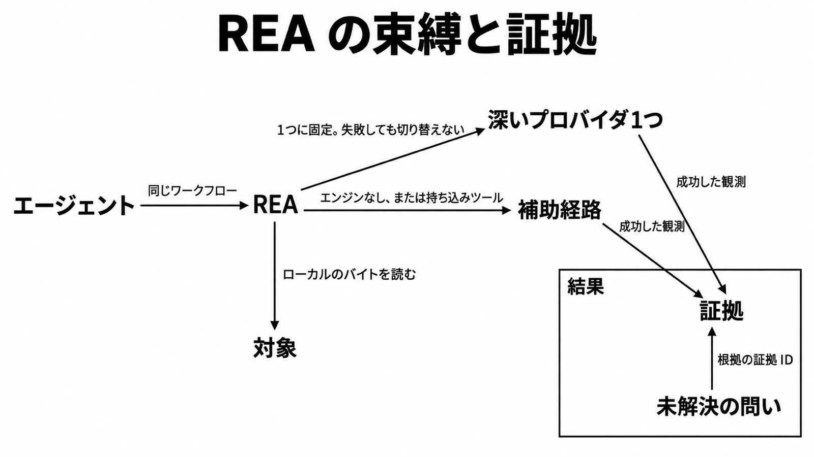

# REA ダイジェスト

元記事: [ソースのないアプリをエージェントに逆解析させるREAの構造と証拠モデル](../../../../../articles/rea_20261018.md)

## ひとことで言うと

ソースの無いソフトを、1つの MCP と CLI で調べるローカル基盤。深いネイティブ解析はエンジン1つに固定し、結果は証拠と未解決の問いとして残す。

## 核心ポイント

- **深いネイティブ解析はエンジンを1つに固定する**: Hopper、Ghidra、IDA のうち、対象をサポートする候補が1つなら自動で選び、複数なら明示して選ぶ。失敗しても別のエンジンへは切り替えない。
- **JavaScript と .NET の静的読取は、そのエンジンを起動しない**: Electron の関係や PE/CLI のメタデータはファイルを読むだけで返る。ファームウェア、パケット、信号は、呼び出し元が入れるツールに依存する。
- **結果は観測・導出・推論を分け、未解決の問いを残す**: 成功した観測の ID は意味内容のダイジェストで、表示名とパスは計算に入らない。未解決の問いは、その証拠 ID を根拠にできる。
- **MCP に渡すパスは絶対パス**: 6.0.0（2026-10-08）以降の契約で、CLI は相対パスも使える。
- **対象のバイトは利用者の手元に留まる**: 残る先は、利用者が持つファイルと、利用者が起動した観測先。

## メンタルモデル

左のエージェントから REA へ入り、REA は対象のバイトを読む。深いプロバイダは 1 つだけで、補助経路とは矢印が分かれている。結果の枠では、未解決の問いが証拠を指す。

## 具体例

CLI ガイドの例では、Obsidian の JavaScript 証拠が 334 MB になり、summary view に切ると約 10 KB になる。完全な証拠はファイルに残し、エージェントにはビューだけを渡す。

## 適用と判断

**向く作業**

- ソースの無いネイティブや Electron を、エージェントと端末で同じ手順で調べたい
- デコンパイラを起動せず、JavaScript / Electron か .NET のメタデータだけ読みたい
- 再構成の主張を、証拠 ID と未解決の問い付きで残したい

**導入前に確認すること**

| 確認すること | 満たさないと |
|---|---|
| 深い逆コンパイルが要るなら、Hopper、Ghidra、IDA のどれかを自分で用意できるか | 疑似コードまで届かない |
| Node.js が 22.19 以上の 22 系、24.11 以上の 24 系、または 26 以上か | engines の範囲外で起動できない |
| Linux で Ghidra や静的 JavaScript などを使うなら、procps 互換の ps が REA の PATH にあるか | 子プロセスの前に拒否される |
| 履歴ソースを取り込むなら Linux か macOS か | ネイティブ Windows は unsupported_host になる |
| 使いたい操作が、接続中サーバの tool list にあるか | setup 時の版にピンされた登録のまま、新しい技能とずれる |

## 限界・注意点

- オプションなしの `rea doctor` は、任意エンジンの不在も含めて healthy を決める。目的の作業ができるかは、provider や client でスコープを切って見る。
- 公開版は `npm view rea-agents dist-tags.latest` で確認する。
- スナップショットは、対象バイト、操作、パラメータ、プロバイダ、設定が一致する成功結果を再利用する。変更操作とカーソル依存はキャッシュから外れ、メタデータ書き込みを送ると応答が失敗してもそのセッションのキャッシュは無効になる。
- モデル提供者への送信範囲は、接続したエージェント側の契約に従う。記事はエージェントごとの送信範囲を固定していない。

## 参考

- 元記事: [ソースのないアプリをエージェントに逆解析させるREAの構造と証拠モデル](../../../../../articles/rea_20261018.md)（導入、コマンド、終了ステータス、文書と実装のずれ）
- [morluto/rea](https://github.com/morluto/rea)（`rea-agents@6.5.0`、Release は 2026-10-14）
- [src/domain/evidence.ts](https://github.com/morluto/rea/blob/main/src/domain/evidence.ts)
- [src/domain/residualUnknown.ts](https://github.com/morluto/rea/blob/main/src/domain/residualUnknown.ts)
- [CLI and Evidence](https://github.com/morluto/rea/blob/main/docs/cli.md)
