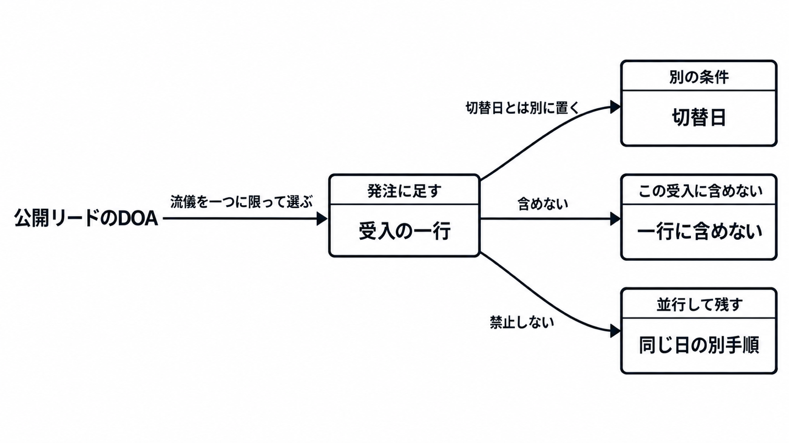

# ダイジェスト: AI前提のレガシー刷新で再浮上するデータ中心アプローチの発注範囲

元記事: [ai-xtech-nikkei-atcl-nxt-p6_20261019.md](../../../../../articles/ai-xtech-nikkei-atcl-nxt-p6_20261019.md)

## ひとことで言うと

リードの手法名は1980〜90年代のDOAだけである。一つの使い方に限り、人と生成AIが同じ名前で参照する項目名、値を決める属性、正本のシステムを、画面とバッチの切替日とは別に固定する。

## 核心ポイント

- 2026年10月19日の日経クロステックの公開リードは、生成AIを前提にしたレガシー刷新の要点として、1980年代から90年代の DOA（データを先に置き、機能を導く手法）を置いている。有料の2ページ目は未読なので、誰の発言かは割り当てられない。
- 公開本文は「データ中心」を、マスタ統合、語彙、系統（ジョブがどのデータをどう通ったかの記録）のどれかには分けていない。語彙のうち同じ名前で参照する項目名は受入に入れ、全社のマスタ統合と全社用語集の完成と系統は入れない。
- 足す一文は登壇者の引用ではない。発注者が選ぶのは、DOA のうち参照キーの関数従属性（項目の値が、別の属性の組から一意に決まる関係）に近い読みと、正本を一つ指す範囲だけである。
- 9月8日の第46回 ITイノベーターズ会議の公開プログラムには、現行を等価な Java 実行系へ先に移す手順、進化し続けるアーキテクチャ、コード解析から入る手順がある。受入の一行はこれらを禁止せず、切替判断のチェックを一つ増やす。
- 英語の data-centric AI（学習用のデータを体系的に作る規律）は、日本の DOA と同じ対象ではない。ベンダーが「データ中心」と言うときは、DOA、MDM（共有マスタの均一性を保つ規律）、用語集、系統、学習データの data-centric AI のどれかを書かせる。

## メンタルモデル

足すのは、一つの使い方に限った項目名、値を決める属性、正本のシステムだけである。全社のマスタ統合、全社用語集、系統、意味の凍結（意味をその後変えないこと）は含めない。

## 具体例

元記事が発注範囲に足す一文を、固定する中身、含めない中身、禁止しない手順に分けたもの。

| 固定する | 含めない | 禁止しない |
| --- | --- | --- |
| 一つの使い方に限り、人と生成AIが同じ名前で参照する項目の、項目名、値を決める属性、正本のシステム | 全社のマスタ統合、全社の用語集、系統グラフ、意味をその後変えないこと、全社共有を前提にする流儀、T字形ER、三要素分析法 | 実行系への移設、進化し続ける設計、コード解析 |

## 適用と判断

向く場面:

- 生成AIを前提にしたレガシー刷新で、公開リードの「データ中心」を受入条件に落とすとき。
- 画面とバッチの切替日とは別に、項目の正本を切替判断の文書へ足すとき。
- ベンダー提案の「データ中心」が、どの手法を指すかを書かせるとき。

確認すること:

- 対象ユースケース（切り替える一つの使い方）の名前を空欄にしていないか。
- 全社のマスタ統合、全社用語集、系統グラフ、意味の凍結、全社共有を前提にする流儀を、この受入に含めていないか。
- 公開リードに無いマスタ、語彙、系統、切替日を、CIO や CDO の合意として発注書へ写していないか。
- 有料本文が未読であることを理由に、受入を一行も足さない、としていないか。

## 限界・注意点

- 2ページ目は未読なので、推奨の確度は中程度に留める。「AI Ready」（次ページ見出しの断片）の割り当て、決定項や正本への発言の有無（無かったとは断定しない）、「AIフレンドリー」の定義、リミニストリート（登壇企業）の「AI-Ready化」が見出しと同じ対象かは、未解決である。
- 本文が系統または全社マスタを、この会議の「データ中心」だと明示していたら、この一行は会議の要旨ではなく発注者の限定だ、と注記を強める。
- 対象が一つの使い方に収まらず、領域をまたぐ正本の衝突が切替の障害なら、マスタ統合の検討は別行で要る。
- エージェントが参照する主材料が項目の正本ではなくログと手順書なら、アクセンチュアの公開概要が挙げるログ、文書、有識者知識を、正本と同じ受入条件の別行に置く。
- 企業名つきで「DOA の企業データモデルが刷新を止めた」公開事例は、参照した範囲では未確認である。確認できないことを、失敗が無いことの証明にはしない。

## 参考

- 元記事: [ai-xtech-nikkei-atcl-nxt-p6_20261019.md](../../../../../articles/ai-xtech-nikkei-atcl-nxt-p6_20261019.md)
- [鈴木慶太「AI前提のレガシー刷新、データ中心アプローチが意外な復活」日経クロステック、2026-10-19](https://xtech.nikkei.com/atcl/nxt/column/18/03788/100700002/)
- [日経BP「ITイノベーターズ会議」第46回プログラム](https://events.nikkeibp.co.jp/event/2026/nxt2026itiall/)
- [ITmedia「データ中心アプローチ」2011-09-09](https://www.itmedia.co.jp/im/articles/1109/09/news134.html)
- [IEEE Spectrum, Andrew Ng on data-centric AI](https://spectrum.ieee.org/andrew-ng-data-centric-ai)
