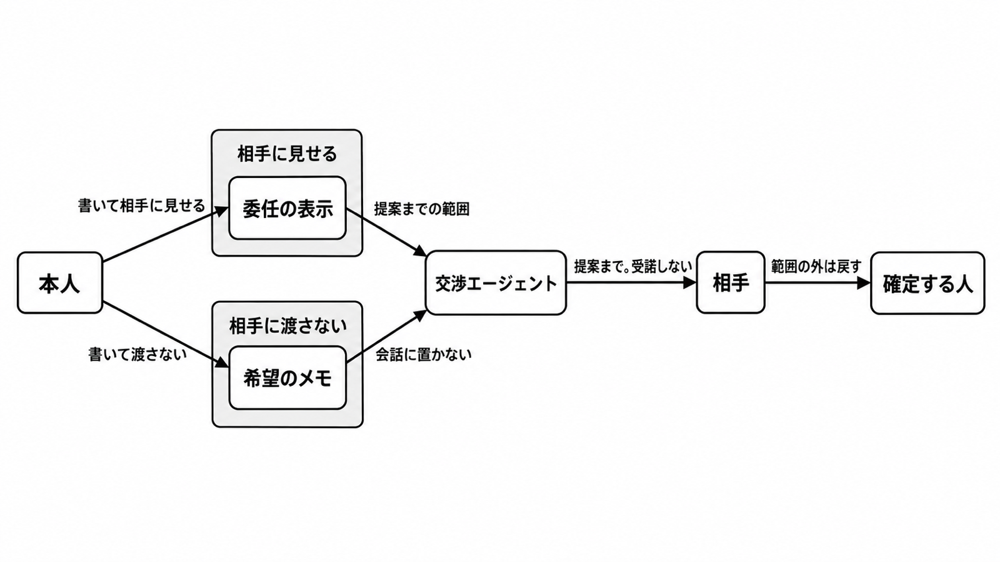

# ダイジェスト: Anthropicが弁護士に相談したエージェント取引で委任と希望を分ける

元記事: [anthropic-ft-content-f7c26ac0-p5_20261019.md](../../../../../articles/anthropic-ft-content-f7c26ac0-p5_20261019.md)

## ひとことで言うと

人のために条件を話すエージェントには、相手に見せる委任と、渡さない希望と、名前のある人の確定を分ける。ツールの許可表（実行できる操作の一覧）は、相手から見た権限にならない。

## 核心ポイント

- Financial Times（2026-10-18）は、Anthropic が人のためのエージェント取引の交渉を弁護士に相談していると報じた。取得できた段落は交渉の仕方と人に戻す時機に読め、一件ごとの承認窓口だとは読めない。
- 記録は三つに分ける。相手に見せる委任の表示、渡さない希望のメモ（希望価格と撤退線を含む）、人に残す受諾である。
- Project Deal（社員のエージェントが実物を売買した実験）では、「攻撃的に交渉せよ」で売れた品はおよそ6ドル高かったが、希望価格差を除くと約+0.95ドル（p=0.275）に縮み、売却確率の差は5.2ポイント（p=0.43）で、指示の独立した効果は確認できず、高い希望価格との関連は残るが、希望価格は操作していない。画面が会社の交渉役に見えるなら、社内の指示の上限は信ずべき正当な理由（民法110条）を消さず、消費者向けも事業者向けの約款も「上限の内側なら確認不要」とは書いていない。
- Deal は社員69人・受け渡し186件・総額4,000ドル超、Swap（社員が本を持ち寄り、エージェントが交換）である。どちらも顧客の代理交渉の製品発表ではなく、Deal は法の枠組みはまだ無く、途中で人の承認を取らない設計を配備から外している。
- 賃金の変更、署名する法律文書、個人への法務の助言は、利用方針の改訂（2026-11-12発効予定）を待たず、確定前の人を必須にする。約款が事業者間の価格交渉のすべてに一件ごとの人の確定を求めている、とまでは読めない。

## メンタルモデル

見せる紙は提案まで、渡さない紙は希望価格と撤退線で、範囲の外は名前の付いた人に戻す。

希望価格を見せる紙に書くと、引き出さなくても撤退線が読まれる。会話に置くと引き出されうる。

## 具体例

元記事の三行。高リスクは、賃金の変更、署名文書、個人への法務助言に近い。

| 記録 | 相手に渡すか | 書くもの |
| --- | --- | --- |
| 委任の表示 | 渡す | 本人の氏名か商号、話してよい相手、提案で止めること、外れたら人に戻す条件、有効期限 |
| 希望のメモ | 渡さない | 希望価格、撤退線、譲れない条項の中身 |
| 確定 | どちらの紙にも載せず人に残す | 高リスクの受諾 |

## 適用と判断

向く場面:

- 希望価格を、見せる紙に書くか、相手との会話に置くかを決めるとき。

確認すること:

- 委任の表示は提案までで、公開する額を撤退線にしていないか。
- 希望価格と撤退線を、相手との会話に入れていないか。
- ツールの許可を、相手から見た権限にしていないか。
- 画面が会社の交渉役に見えるとき、社内の指示の上限だけで相手の信頼を切れると読んでいないか。
- 賃金、署名文書、個人への法務助言を、2026-11-12 より前から人の確定にしているか。

## 限界・注意点

- 全文は購読の内側（2026-10-19）で、後半が個別案件に触れていないとは言えず、Anthropic が発表するかも分からない。
- 交渉エージェントが民法99条の代理人（権限内なら本人に直接効く）に当たるか、会社間の価格交渉が現行方針（2025-09-15、個人や消費者向け）や2026-11-12以降の高リスクに入るかは、未決着である。
- Swap では、交渉の方針の差より、本人の希望をエージェントが写し損なうことの方が大きい。希望の聞き取りが中央値216語と短いときは、権限の紙より先に、エージェントの決定の見本を本人に見せる。
- Deal は自己選択の社員の試験でギフトカード付き、一般人口を代表しないのは Swap の留保である。法律意見ではなく、相談先の事務所名は抜粋に無い。
- 権限がある旨を表示した本人は、その範囲の行為に責任を負う。相手が範囲外に権限が無いと知り、または過失で知らなかったときは、民法109条ただし書でその責任が外れる。

## 参考

- 元記事: [anthropic-ft-content-f7c26ac0-p5_20261019.md](../../../../../articles/anthropic-ft-content-f7c26ac0-p5_20261019.md)
- Cristina Criddle, Financial Times. [Anthropic turns to lawyers to help AI agents strike deals](https://www.ft.com/content/f7c26ac0-f5f2-443a-86b2-39d62f7920a9). 2026-10-18. 全文は購読の内側。
- Anthropic. [Project Deal](https://www.anthropic.com/features/project-deal). 2026-04-24.
- Anthropic. [Project Swap](https://www.anthropic.com/research/project-swap). 2026-09-24.
- Anthropic. [Updating our Usage Policy](https://www.anthropic.com/news/2026-usage-policy-update). 2026-10-08.
