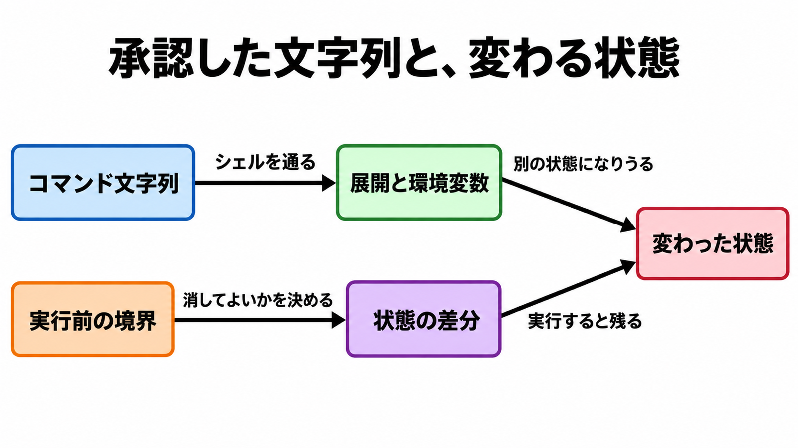

# ダイジェスト: 人間の承認を増やしても本番データベース削除は止まらない

元記事: [atmarkit-itmedia-co-jp-ait-p1_20261019.md](../../../../../articles/atmarkit-itmedia-co-jp-ait-p1_20261019.md)

## ひとことで言うと

人間が承認しているのは、多くの場合コマンドの文字列である。本番データベースの削除を止める地点は、その回数ではなく、消してよい状態と消してはいけない状態の境界である。

## 核心ポイント

- 文字列は、シェルの展開と環境変数を通ったあとで、実行後に残る状態（ファイル、行、スキーマ、資格情報）になる。
- Docker が6つに分けた事故のうち、文言と状態がずれるのは、展開でパスが変わるファイル操作の一部、直前の環境でコマンドの意味が入れ替わる型、導入時に別の処理を呼ぶ追加手順の一部である。それとは別に、会話の「するな」では止まらない型と、承認より前に資格情報や機密がエージェント側へ移る型がある。
- 個別の権限確認は、Claude Code の利用データで97%が承認され、大半は安全な定型とみられる。危険コマンドを人間が止めた割合はセッション前半で約17%、それ以前の確認が50回以上あると約5%で、計画の承認（拒否39%）とは別であり、「承認を増やすと必ず悪化する」は個別の権限確認に限る。
- 自分のコードベースではない有償テスター1,053人の実験では、確認画面の文言を危険なコマンドに1件差し替え、人間が止めた割合は13.6%、自動モード（操作前の分類器が不可逆・破壊的・環境の外への操作を止める許可の仕方）が止めた割合は89%で、承認してもその処理は走らせていない。自動モードは状態の境界の代わりにせず、分類器の見逃しが12%から7%へ下がったのは合成攻撃の値で、実トラフィックの見逃し率ではない。
- 実行前に見るのは、展開後のパス、直前の環境変数、新しいスキル定義である。削除・上書き・適用と破棄を許す条件は、会話ではなく、必ず聞く規則、分類器より前の拒否、デプロイ境界、資格情報を渡さないことに置く。

## メンタルモデル

上の経路では、文字列が展開と環境変数を通ると別の状態になりうる。下の経路では、実行前の境界が状態の差分について消してよいかを決め、実行すれば変わった状態に残る。

## 具体例

Cursor 2.3 未満の自動実行（Claude Code の自動モードとは別）かつ許可リストのとき、シェル組み込みが承認なしに環境変数を変えられる（CVE-2026-22708）。Docker は、環境変数を書き換えたあとで `git branch` を承認すると、許可したコマンドの意味が入れ替わる、と説明している。この番号で本番データベースが消えたとは、NVD にも GitHub Advisory にも書いていない。

## 適用と判断

向く場面:

- コーディングエージェントに、削除や本番への適用をどこまで任せるかを決めるとき。
- 権限の確認を増やすか、実行前の状態の境界を置くかを選ぶとき。

確認すること:

- 承認しているのがコマンドの文字列か、消える行・ファイル・スキーマ・外へ出る送信か。
- 削除、上書き、インフラの適用と破棄を、会話の「するな」とは別の、実行前の条件にしているか。
- 展開後のパス、実行直前の環境変数、新しく入ったスキル定義を、確認回数とは別に見ているか。
- 本番の資格情報を、開発セッションの主体に渡していないか。
- 実行後の復元とトークン失効を置き、エージェントの「戻せない」を判定に使っていないか。

## 限界・注意点

- 状態差分の承認が公開された本番削除を止めた検証は無く、拒否規則やサンドボックスが特定の本番削除を止めた検証も公開記録には無い。
- ＠ITの見出し「11回止めたのに本番DBが消えた」の11回は、削除直前の回数としては確認できず、別の報道は架空データについての発言として伝えている。
- Cost Explorer の13時間停止は、エージェントが本番を削除した確立事例としては読めない。Amazon はアクセス制御の誤設定で、報道が言う AI が原因ではない、と書いている。
- Anthropic の尺度（0は戻せる操作、10は会社全体の不可逆な被害）で深刻度7以上の、頼んでいない有害操作の割合は、人がそのつど承認する手動で6.3%、自動モードで2.4%である。分母は同社の安全パイプラインが印を付け、データ利用に同意したアカウントをモデルで採点し直したセッションで、全セッションではない。
- Claude Code の自動モードの設定は、会話だけの境界は文脈の圧縮で消えると書き、頻度は書いていない。

## 参考

- 元記事: [atmarkit-itmedia-co-jp-ait-p1_20261019.md](../../../../../articles/atmarkit-itmedia-co-jp-ait-p1_20261019.md)
- ＠IT、雨輝ITラボ（リーフレイン）、平田修（編集）「[11回止めたのに本番DBが消えた](https://atmarkit.itmedia.co.jp/ait/articles/2610/18/news004.html)」（2026-10-18）
- Docker「[Coding Agent Horror Stories](https://www.docker.com/blog/ai-coding-agent-horror-stories-security-risks/)」（2026-05-18）
- Anthropic「[Auto mode is now the default in Claude Code](https://claude.com/resources/articles/auto-mode-default-in-claude-code)」（2026-08-07）
- NVD「[CVE-2026-22708](https://nvd.nist.gov/vuln/detail/CVE-2026-22708)」（公開 2026-01-14）
