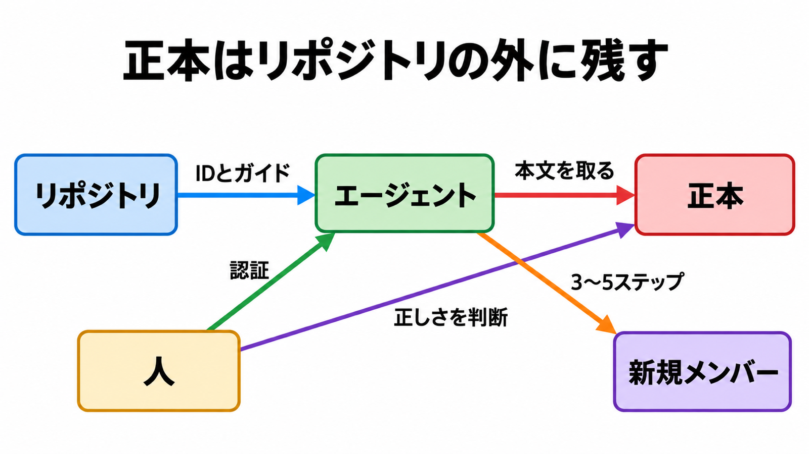

# ダイジェスト: 手順本文をリポジトリに置かないオンボーディング

元記事: [github-engineering-dena-2026-p9_20261019.md](../../../../../articles/github-engineering-dena-2026-p9_20261019.md)

## ひとことで言うと

DeNAの設計は、手順本文をコピーせず、正本のIDとガイド（ゴール、押さえる点、完了判定）と出力の型だけを置く。実行時にエージェントが本文を取り、認証と正しさの判断は人に残す。

## 核心ポイント

- リポジトリが持つのは正本のID（見出し位置を含まない、ページやファイルの識別子）、ガイド、出力の型だけである。エージェントはコネクタ（ブラウザ認証1回で外部文書を読む仕組みであり、自前のMCPサーバは全員の手元で同じ準備が要るので採っていない）で正本（Confluence と Google Drive に残す本文）を取る。
- 転記をやめたのは、コピーした瞬間から同じ情報が2か所にあり、正本の更新にリポジトリが追随しないからである。ガイドに見出しの位置を書かないのは、Confluence の見出しが変わると参照が切れるからである。
- 次にやることを案内する出力が安定したのは、モデルの性能ではなく、スキル（エージェントが実行時に読む指示）へ、結論だけを示しスキップの理由や進捗の推測は聞かれたときだけ返す出力の型を書いたからである。複数画面のスクリーンショットが前提の手順はリンクにとどめ、それ以外は3〜5ステップの正常な手順だけを書き、分岐は書かず詰まったら聞く一文を添える。
- 責任の線は、認証は人、手順の要約はエージェント、教材の正しさの判断は人、である。コマンドで終わる環境構築は人の承認のうえでエージェントが実行し、ブラウザ操作・申請・第三者への依頼は人に渡し、自動化できると書いた一部は手を動かしたあと人手へ戻している。
- 版が動く仕様書は、ファイル名の版表記で最新の承認済みを選ぶ。承認後に編集が入るので、更新日時が新しい方が最新とは限らない。

## メンタルモデル

リポジトリは正本のIDとガイドをエージェントへ渡し、出力の型もリポジトリに置く。エージェントは正本の本文を取り、新規メンバーへ3〜5ステップを示す。人は認証し、正しさを判断して正本側を直す。

## 具体例

人を入れる前に、著者はエージェントへ新規メンバー役をさせて初日のシナリオを頭から6周通し、最後の1周でも次を見つけたが、実行された事故とは書いていない。

| 見つかったこと |
|---|
| 番号順だと、多要素認証より先にVPN接続の確認が来る |
| テンプレートの相対パスが1階層浅く、チェックリストのリンク44件が切れていた |
| 落としたスクリプトに `sudo rm -rf` が13行あり、手順の文言は禁止パターンに一致せず止まらなかった |

## 適用と判断

向く場面:

- 手順・仕様・質問の置き場がツールごとに分かれ、同じ説明を人が繰り返しているチーム。
- 正本が Confluence と Google Drive にあり、コネクタで取れるとき。
- 完了を資料の本数ではなく、新規メンバーが開ける正本の範囲と、開けないときの担当者への戻りで見たいとき。

確認すること:

- リポジトリに置くのが、正本のIDとガイドと出力の型だけか。
- 未登録の正本を推測で埋めず、担当者へ所在を確認する文を返すか。
- コネクタが、claude.ai のサブスクリプションログインで初日に使えるか。
- 次の受け入れの前に、圧縮した3〜5ステップを正本の表と条件分岐へ突き合わせるか。
- 禁止コマンドの文字列一致だけで、取得したスクリプトの実行を許していないか。

## 限界・注意点

- 「約1か月」や「環境構築は爆速」は導入前後の同じ測定ではなく、利用者は2026年8月の中途1名で、所要時間の内訳も完了の判定手順も記事にない。初日と2週間の差は、仕組みを作る前の環境構築のばらつきである。
- 取得が成功しても本文が揃ったとは限らない。古い編集形式の表は落ち、十数万文字のページは節に絞って取り、Claude Code の版は記事にないので現行文書の別の上限と同じ不具合としては扱わない。
- claude.ai に追加したコネクタは、サブスクリプションログインのときだけ読まれ、APIキーなどが有効なあいだは以前ログインしていても読まれない。Claude の Team と Enterprise（組織向けの契約）ではその組織の管理者が追加し、追加できないと ID だけの設計は初日に止まり、棄却した自前MCPをセットアップの手間込みで比較し直す。
- 回答が正本と一致するかを見る担当と周期は記事になく、鮮度点検の間隔もない。欠落に気づいたのは、使った本人の指摘である。
- リポジトリのURLは記事になく、2026-10-19の検索でも analyst-onboarding を名に含む公開リポジトリで、記事のツリーと一致するものは見つかっていない。別名か非公開かは、この検索からは分からない。

## 参考

- 元記事: [github-engineering-dena-2026-p9_20261019.md](../../../../../articles/github-engineering-dena-2026-p9_20261019.md)
- 勝野侑馬（u-tan）. 「オンボーディングをAIエージェントに任せたら、もはや別ゲーだった」. DeNA Engineering. 2026-10-07. https://engineering.dena.com/blog/2026/10/ai-agent-onboarding/
- Anthropic. Connect Claude Code to tools via MCP. 2026-10-19 参照. https://code.claude.com/docs/en/mcp
- Anthropic. Extend Claude with skills. 2026-10-19 参照. https://code.claude.com/docs/en/skills
