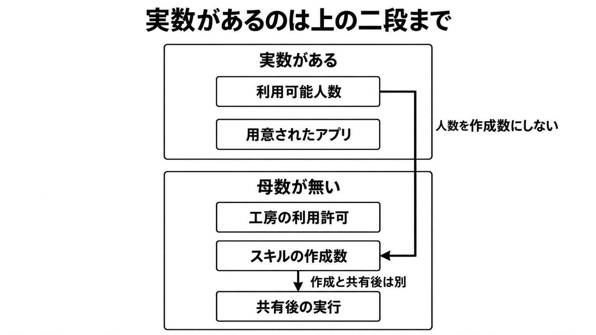

# ダイジェスト: 源内で職員が作ったスキルを何件と数えるか

元記事: [xtech-nikkei-atcl-nxt-column-p7_20261019.md](../../../../../articles/xtech-nikkei-atcl-nxt-column-p7_20261019.md)

## ひとことで言うと

源内（政府職員向け生成AI）のスキル（実行できる業務の一式）は、利用可能人数、用意されたアプリ、工房（個人専用の開発環境）の利用許可、作成数、共有後の実行に分けて数える。2026年10月19日の実数は、利用可能人数とアプリの稼働までである。

## 核心ポイント

- 約18万人は大規模実証の対象、約16万人は2026年8月下旬時点で利用可能とされた人数である。スキルを作った人数でも、実行した人数でもない。
- 府省庁の業務で稼働する行政実務用RAG（行政の業務向けアプリの一種）は20以上である。約30種類はデジタル庁内の内製、40種類以上は使えるアプリ、と別の書き方があり、20以上と合わせて一つの本数ではない。
- 1万から数万件は、作成済みの件数ではない。説明資料が規模感の推測と見出しを付けた推計である。
- 源内マーケットプレイス（職員が作ったスキルを、組織を越えて共有する仕組み）は企画・構想で、まだ動いていない。審査を通った件数は公開資料に無く、仕組みが無い段階のゼロは定着の失敗の数ではない。
- 作成、組織内での利用、政府横断の共有、基盤の変更は、別々の承認として読む。源内基準（利用者・管理者・開発者の役割を分ける文書）の目次と審査の検討は、承認が分かれることを示しているが、実装で既に分かれているとは書けない。

## メンタルモデル

図の「工房の利用許可」は、何人に作る許可があるか、という段である。作成済みの件数とは別であり、下の枠は公開された実数が無いという意味で、作成数がゼロという意味ではない。

## 具体例

| 置き方 | 元にした数 | 置いた件数 |
|---|---|---|
| 法律・制度の業務 | 法律 約2,100件 | 6,000件 |
| 課・室の業務 | 課長・室長クラス 約4,000人 | 4,000件 |

一つの法律から複数のスキルが生じ、複数の法律を一つのスキルにまとめることもある。

## 適用と判断

向く場面:

- 政府や自治体の生成AIで、職員が作った件数を政策の指標にするとき。
- 利用可能人数や用意されたアプリの本数を、スキルの作成数へ読み替える報道を読むとき。
- 共有の仕組みが無い段階のゼロを、定着の失敗として書くとき。

確認すること:

- 数える段が、利用可能人数・用意されたアプリ・工房の利用許可（人数は未公表）・作成数・共有後の実行のどれか。
- 1万から数万を、作成済みの件数として使っていないか。
- 約16万人を、利用可能人数・作成者・実行者のどれとして読んでいるか。
- 20以上、約30種類、40種類以上を、同じ母数にしていないか。
- ウェブの読み取り、個人領域からの外部通信、MCPやAPIの無断送信を、一つの禁止にまとめていないか。

## 限界・注意点

- 「専門的知識は不要」は、操作を自然言語で行えるという説明の範囲である。工房は個人専用サーバー上の環境で、ファイル操作とコマンド実行を含み、生成結果の最終確認は職員自身が行う。
- 大分市の Oita GENAI は、2026年10月1日から自治体の閉域網の上で源内の公開OSSを使う生成AIである。エージェントチャット（チャットから検索やスキル作成を組み合わせる環境）、工房、スキルの庁内共有は市の発表に無く、国の工房の稼働開始ではない。
- エージェントチャットと工房が、どの府省庁の何人に、いつから試験提供されたかは、これらの公開資料には無い。日経クロステック（2026年10月6日）の有料本文は、元記事の時点で購読なしには開けていない。
- ウェブの読み取りを止めているとまでは書いていない。説明会FAQの「外部通信は不可」と、工房の画面イメージの「任意サイトを直接読む」が同じ環境の同じ口を指すか、またMCPやAPIの制限が工房だけかは、資料からは決まらない。
- 源内のログインに使う共通サービスで、漏えいした可能性がある個人情報は約24.6万件である（公表は2026年9月11日）。源内のプロンプトやスキルが漏れた、という記載はこの公表に無い。

## 参考

- 元記事: [xtech-nikkei-atcl-nxt-column-p7_20261019.md](../../../../../articles/xtech-nikkei-atcl-nxt-column-p7_20261019.md)
- [デジタル庁「ガバメントAI『源内』」（最終更新 2026-10-15）](https://www.digital.go.jp/policies/genai)
- [デジタル庁「エージェントチャット 導入編」](https://www.digital.go.jp/policies/genai/agentchat-introduction)
- [デジタル庁「源内OSS Ver 2.0の計画に関する全国オンライン説明会」（2026-09-18）](https://www.digital.go.jp/news/e525db0b-eac1-49e2-9ef4-6d2e24208498)
- [先進的AI利活用アドバイザリーボード第3回 WG 実施報告 PDF（2026-09-29）](https://www.digital.go.jp/assets/contents/node/basic_page/field_ref_resources/162953b0-3dc0-46a6-a24c-0e3a335e0495/7545ff68/20260929_meeting_ai-advisory_outline03.pdf)
