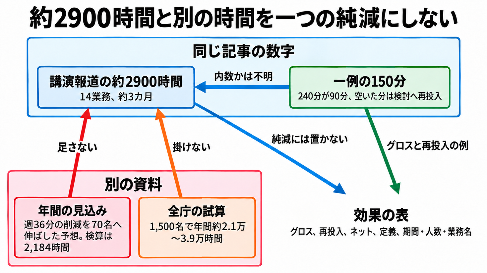

# ダイジェスト: 世田谷区の生成AI試行が示した約2900時間の数え方

元記事: [ai-2900-itmedia-co-jp-business-p3_20261020.md](../../../../../articles/ai-2900-itmedia-co-jp-business-p3_20261020.md)

## ひとことで言うと

約2900時間は、講演を伝える記事が置く14業務・約3カ月の合計である。確認や検討へ戻した分を引いた残りとしては、開いた公開資料から認定できない。

## 核心ポイント

- 約2900時間は、2026年8月27日の講演を2026年10月19日のITmediaが伝えた数字である。区の「DXの取組みの見える化」、3月30日の区長会見、9月16日の定例会会議録には、14業務も約2900時間も無かった。
- 一例の150分は、整理から検討への移動であり、その人のその案件の総労働時間が150分減ったこととは別である。約2900時間の内訳に入るかは、記事に書いていない。
- 2026年3月26日の導入発表にある年間約2,000〜2,600時間は、業務ツールの利用ログではなく、対話型AI（人が一つの生成AIと都度対話する使い方）の1人あたり週約36分の削減を70名へ伸ばした予想である（70人×週36分×52週＝2,184時間は、その幅に入る）。約3カ月を13週と置いた同じ検算は546時間で、約2900時間とは別の集計であり、その桁の差は誤りの証拠にはできない。
- 同じ導入発表の、約150課×各10名の1,500名で年間約2.1万〜3.9万時間は、70名の試行結果ではなく、約2900時間を掛けない。東洋経済オンラインの事例スライドにある広報紙の校正（年間約54時間）は、約2900時間と足し引きしない。
- 確認と修正の負担が増えていることは、講演者の定性的な認識である。増えた時間も修正回数も、記事には無い。

## メンタルモデル

約2900時間、一例の150分、年間の見込み、全庁の試算は別の箱である（図の内数は、150分がその合計の内側に入るかを指す）。

効果の表では、元の作業から減った時間をグロス、確認、修正、差し戻し、再生成、内容検討へ戻した時間を再投入、その差をネットと呼ぶ（純減は、確認や検討へ戻した分を引いた残りであり、ネットと同一ではない）。同じ行に、定義（自己申告か、標準時間×件数か、ログか）と、期間、人数、業務名を置く。

## 具体例

計画の整理は240分から90分になり、空いた150分は検討へ戻した。グロスも再投入も記事上は150分で、この1件のネットはゼロに見える。150分が約2900時間の内訳に入るかは不明なので、この1件を14業務全体のネットには広げない。

## 適用と判断

向く場面:

- 自治体やベンダーの「削減時間」を、自分の成果表へ載せるとき。
- 生成AIの試行で、効果測定の票に何を置くか決めるとき。
- 講演で語られた時間を、全庁の人数へ掛けてよいか判断するとき。

確認すること:

- その時間は、元の作業から減った時間か、確認や検討へ戻した分を引いた残りか。
- 自己申告か、標準時間×件数か、ツールのログか、が書いてあるか。
- 期間、人数、業務名が、その時間と同じ行にあるか。
- 週36分の年間見込み、全庁の試算、別媒体の業務時間を、約2900時間へ足したり掛けたりしていないか。
- 確認、差し戻し、再生成の増分を、時間か少なくとも有無と件数で票に持っているか。

## 限界・注意点

- 約2900時間の式、14業務の一覧、その人数に試行の70名が含まれるか、約3カ月の開始日と終了日は、開いた資料に無い。
- 同じ記事のアンケートは、伴走（担当課の職員が各課に入り、使い方を提案する支援）のあとで指示の出し方と成果物の品質が上がった、という別の問いであり、確認時間の増分を集計した調査ではない。
- 9月16日以外の会議録はこの確認範囲に無く、登壇スライドの原本が残っているかも開いた資料に無い。読めた会議録では、約2900時間は会議での応答の成果指標になっていない。
- 総務省の令和7年度調査は、自治体の回答例を並べ、見込みと実績が混ざる。削減時間は監査済みの全国統計ではなく、世田谷区の約2900時間はその調査時点より後で資料に無い。
- 式と確認時間を引いたネットが公開され、そのネットに再投入が残っていないと分かるなら純減として扱え、確認の増分がグロスに対してごく小さいと測られたならネットはグロスに近い。どちらも、開いた資料には無い。

## 参考

- 元記事: [ai-2900-itmedia-co-jp-business-p3_20261020.md](../../../../../articles/ai-2900-itmedia-co-jp-business-p3_20261020.md)
- ITmedia ビジネスオンライン、濱川太一「[世田谷区の生成AI試行](https://www.itmedia.co.jp/business/articles/2610/19/news064.html)」（2026-10-19。 [2ページ目](https://www.itmedia.co.jp/business/articles/2610/19/news064_2.html)）
- [Genspark株式会社の導入発表](https://prtimes.jp/main/html/rd/p/000000007.000176655.html)（2026-03-26。年間約2,000〜2,600時間の出典。Gensparkは、目的を伝えると調査から資料作成まで進める業務ツール）
- 世田谷区「[DXの取組みの見える化](https://www.city.setagaya.lg.jp/01000/18436.html)」、[区長記者会見（令和8年3月30日）](https://www.city.setagaya.lg.jp/02002/32072.html)、[2026年9月16日定例会の会議録](https://www.city.setagaya.lg.jp/documents/29172/20260916teireikaiud.pdf)
- 総務省「[自治体における生成AI導入状況（令和7年度）](https://www.soumu.go.jp/main_content/001070295.pdf)」（令和8年4月24日版）
