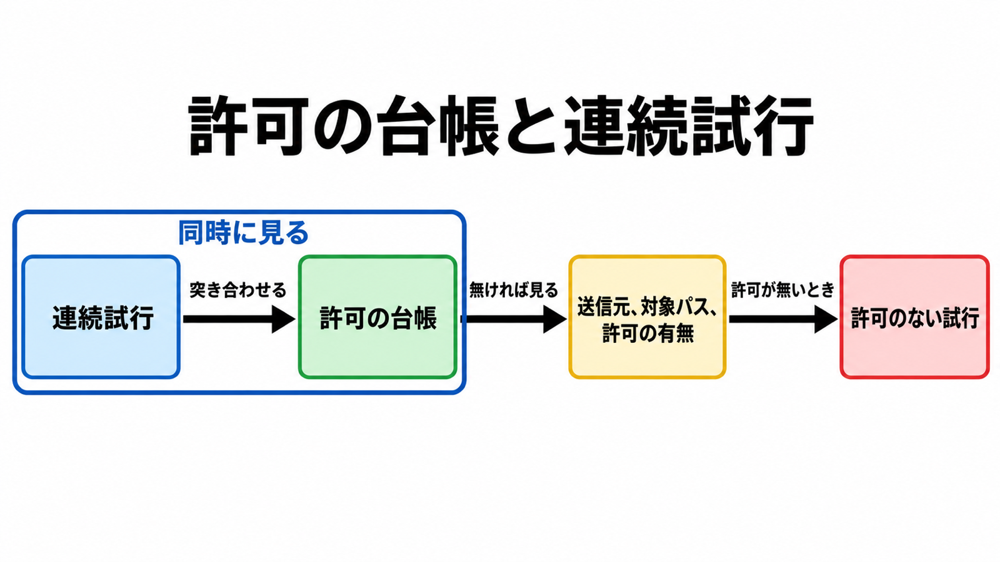

# ダイジェスト: 日本企業向け侵害の攻撃元で確認された自律型診断ARTEX

元記事: [artex-gmo-cybersecurity-p1_20261020.md](../../../../../articles/artex-gmo-cybersecurity-p1_20261020.md)

## ひとことで言うと

GMOサイバーセキュリティ byイエラエは、2026年10月19日、日本企業向け侵害の攻撃元でARTEXの使用を確認したと書く。防御の単位は製品名ではなく、許可の台帳と、そこに無い連続試行（周期と継続がある一連）である。

## 核心ポイント

- ARTEX（LLMを接続して使う自律型ペネトレーションテストのオーケストレーション）では、操作者が目標と範囲を渡し、planner（意図へ切る役割）が意図を切り、worker（1件ずつ実行する役割）が実行する。結果は資産図（会社に属する共有の台帳）と探索図（タスクの目標、意図、事実、発見）へ書き戻され、承認ゲート（実行前の人の承認）と認証済みタブの取り込み（操作者自身がログイン済み画面の通信を手元へ入れること）は、公開面の列挙（外から見える資産を集めること）とは別経路である。
- 2026年10月19日の増分は、前回のツール名のない推定から、攻撃元インフラ上のARTEX使用確認へ進んだことである。調査したインフラの標的は約20社、うち9社が同業種で、観測範囲ではほぼ日本のみである。確認した標的のうち、2026年9月から10月に漏えいの公表を出しているのが8社で、約20社の内数かは本文だけでは確定できない。
- この公開本文の結論に含めないのは、同じ記事の後半で挙がる、AIを使った攻撃インフラ6台の全部がARTEXであること、韓国の金融機関キャンペーンと同一犯であること、日本側が認証後まで進んだことである。6台の各台をARTEXとは書いていない。韓国との「同じ手口」は推察である。
- 公開資料の到達は三層に分かれる。外部の公開面から始まる資産、操作者が渡した認証済み通信、足がかりの先（侵入のあと、対象上での実行や、さらに奥のホストへ進む範囲）である。日本の事案がどの層かは、GMOの本文に無い。
- 防御で見る単位は製品名でもUser-Agentでもない。許可の台帳と、台帳に無い連続試行（周期と継続がある一連）を同時に見る。台帳に無いものは先に調べ、送信元、対象パス、許可の有無が分かり、許可が無いときだけ、許可のない試行とする。

## メンタルモデル

左の枠で連続試行と許可の台帳を同時に見る。台帳に無ければ、送信元、対象パス、許可の有無を調べ、許可が無いときだけ右端になる。

## 具体例

正規の診断として台帳に残す代表は、対象（ホスト、パス、環境）と承認者である。ほかの項目は元記事の防御の節にある。

## 適用と判断

向く場面:

- 公開記事が、自律型ペネトレーションテストの名前を攻撃元インフラに結びつけたとき。
- 診断に似た連続試行を、攻撃として残すか正規の診断として残すか決めるとき。
- 製品名やUser-Agentだけを検知条件にする提案を見るとき。

確認すること:

- 公開本文が「使用を確認」と書いているか、「同じ手口」や「推察」と書いているか。
- その確認が、公開面、認証済み通信、足がかりの先のどれに対応するかが本文にあるか。
- 連続試行の送信元が、その期限の許可の台帳にあるか。
- 対象パスが、許可した公開面の中か、ログインしないと届かないAPIか。
- 製品名やUser-Agentを、単独の決定条件にしていないか。

## 限界・注意点

- 公開本文に、個々のリクエストと各社の侵害結果を結ぶログは無い。読者が追えるのは、調査主体による確認の表明までである。
- 6台のうちARTEXと確認できた台数、前回記事の数百IPと続報のインフラが同じ送信元かは、閉じていない。前回の数百IPは特定事案の説明ではない、と記事自身が断っている。
- 製品名も単一のUser-Agentも、使用や侵害成功の決定的証拠にはしない、と元記事が引くAhnLabは書く。別名の再配布とは、製品名や画面を変えて配り直した版のことであり、GMOが観測したホストがそれらの版だった証拠ではない。
- 試行間隔だけを攻撃とみなすと、正規の診断と死活監視に当たる。台帳への書き忘れも、不一致だけでは攻撃と閉じない。
- 製品のREADMEは利用を、所有するか明示的に認可された対象に限ると書く。これは、日本向けインフラがどの機能を使ったかの記録ではない。

## 参考

- 元記事: [artex-gmo-cybersecurity-p1_20261020.md](../../../../../articles/artex-gmo-cybersecurity-p1_20261020.md)
- GMOサイバーセキュリティ byイエラエ、福森「[相次ぐ不正アクセスの攻撃元の多くがAIであることを確認](https://gmo-cybersecurity.com/blog/20261019/)」（公開 2026.10.19）
- 同「[相次ぐ不正アクセスに備える３つのポイント](https://gmo-cybersecurity.com/blog/20261014/)」（URL `/blog/20261014/`、ページ上の公開日 2026.10.15）
- CrowdStrike Intelligence「[Unknown Threat Actor Uses AI-Driven ARTEX to Target South Korean Finance](https://www.crowdstrike.com/en-us/blog/unknown-threat-actor-uses-artex-to-target-south-korean-finance/)」（一覧上の公開 2026-10-07）
- [BaaRai/ARTEX README](https://github.com/BaaRai/ARTEX/blob/main/README.md)（英語訳ミラー、AGPL-3.0、pushedAt 2026-10-18）
