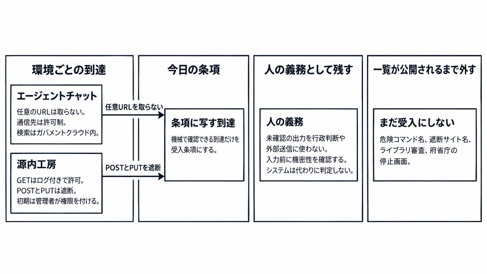

# ダイジェスト: ガバメントAI源内のエージェント環境と源内基準第1版を読む

元記事: [itmedia-co-jp-2610-2000002428-p3_20261021.md](../../../../../articles/itmedia-co-jp-2610-2000002428-p3_20261021.md)

## ひとことで言うと

ガバメントAI源内（政府職員向けの生成AI利用環境）の基準第1版は、二つの利用環境の到達範囲と、利用者、管理者、開発者の遵守事項である。受入試験の完成した判定表ではない。

## 核心ポイント

- エージェントチャット（源内のWeb画面）は任意URLを取らず通信先を許可制にし、検索はガバメントクラウド（政府共通クラウド）内で閉じる一方、源内工房（職員の個人環境で、庁外Webの調査やコマンド実行ができ、初期の権限は管理者が付ける）はGETをログ付きで許可しPOSTとPUTを遮断する。チャットの「検索はクラウド内」を工房の条項へ写すと、検索語句が庁外に出ることと矛盾する。
- スキル（業務手順や判断基準を、エージェントが実行できる形にしたもの）は、チャットでも工房でも作れる。府省庁横断の源内ライブラリでは、導入資料のデモの「自由に共有できる」が、基準本文の「無条件の政府内共有は適切ではない」と一致しない。
- 守る主体は、利用者、工房を開く各府省庁の管理者、源内を企画し開発し運用する源内開発者である。今日条項に写せるのは、図の「環境ごとの到達」の中身である。
- 人の義務として残すのは、確認と承認、入力前の機密性確認、権利利益に影響する業務の利用制限であり、システムが代わりに判定するとは書いていない。未確認の出力は行政判断、通知、外部送信に使わず、機密性3、特定秘密、重要経済安保情報は入力しない。
- 危険コマンド名、遮断サイト名、ライブラリ審査、府省庁の停止画面（検討段階で、管理者の報告を受けたデジタル庁が止める）は、一覧か手続が出るまで受入条件にしない。世界初（高度なコーディングエージェント相当の環境を、専門職員に限らず一般職員の日常業務で使える政府共通基盤として約18万人規模で入れる取組、という同庁の自己申告）と約18万人は、導入完了の合格線ではない。

## メンタルモデル

「環境ごとの到達」の中身が、今日の条項に写す到達である。二つの矢印は通信の違いだけを示す。

## 具体例

約18万人は、令和8年5月の実証規模、2026年度中の利用予定、10月20日からの導入開始という、別の時点を指す。

## 適用と判断

向く場面:

- 源内や同型の政府共通の生成AIを、調達仕様の受入条件に写すとき。
- 地方公共団体が、源内OSS（Ver.1.0は公開済み。チャットと工房を含む2.0は無償公開予定）を参照実装として仕様に置くとき。

確認すること:

- チャットの任意URL不可と、工房のGET許可（POSTとPUTは遮断）を、一つの「庁外に出ない」にまとめていないか。
- 工房は初期状態で使えず、管理者が権限を付ける、と書いてあるか。
- 確認、承認、入力前の機密性確認、権利利益に影響する業務の利用制限を、システムが判定する機能として書いていないか。
- 一覧も手続も無いまま、危険コマンド名や停止画面を合否にしていないか。

## 限界・注意点

- 工房のGETは、検索に必要なGETの許可、全サイト可（POSTとPUTは不可）、任意サイトは原則可能で源内開発者が危険性が高いと判断した宛先だけ遮断、の三通りに読める。遮断先の一覧は第1版に無い。
- 比較表①（別紙1のチャットと工房の比較）は、プロンプトインジェクション対策と、工房の個人情報・認証情報の検出を「完全な機能ではない」と留保する。比較表②も同じ別紙で頁が画像中心で、表②だけを完成した対策として写すと表①の留保が落ちる。
- 世界初の自己申告の対象国と時点、庁内で工房がどこまで動いているか、源内OSS 2.0のライセンス名、行政通則法AI利活用ガイドライン（仮称。法律の名前ではない）の確定文は、第1版から決まらない。
- 将来の接続（APIはシステム間、MCPは外部ツール、A2Aはエージェント間の連携）は、今日の通信制限とは別である。
- OSSだけでは安全にならない、と基準本文は書き、ホスト方式（デジタル庁が直接提供する方式）以外の事故責任はデジタル庁が負わない。基盤のSageMaker StudioとClaude Codeを不受理にすると、基準が示す工房自体が不合格になる。

## 参考

- 元記事: [itmedia-co-jp-2610-2000002428-p3_20261021.md](../../../../../articles/itmedia-co-jp-2610-2000002428-p3_20261021.md)
- [デジタル庁「AIエージェント利用環境の提供開始と源内基準の公表」（2026-10-20）](https://www.digital.go.jp/policies/genai/agent-safety-standard)
- [源内基準 第1版（2026-10-20）](https://www.digital.go.jp/assets/contents/node/basic_page/field_ref_resources/b033337d-dad1-4493-9316-d929597e4667/9bbaf559/20261020_policies_genai_guideline_02.pdf)
- [源内基準の策定・公表について（概要、2026-10-20）](https://www.digital.go.jp/assets/contents/node/basic_page/field_ref_resources/b033337d-dad1-4493-9316-d929597e4667/4c25aead/20261020_policies_genai_guideline_01.pdf)
- [デジタル庁「ガバメントAI『源内』」](https://www.digital.go.jp/policies/genai)
