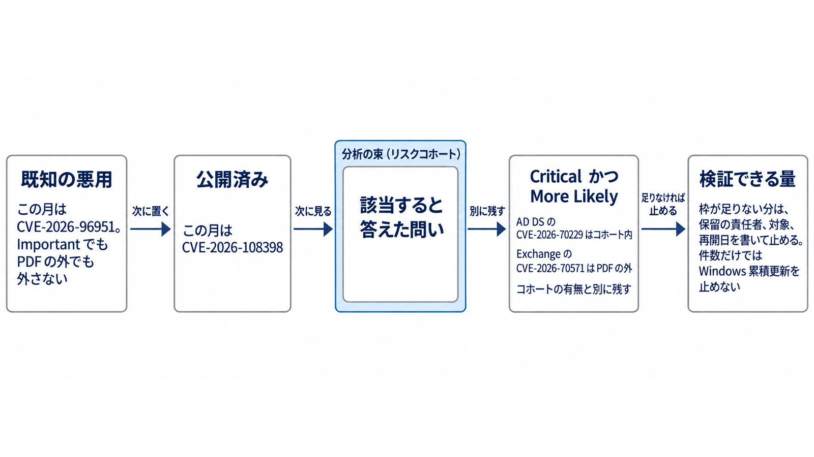

元記事: [2026年10月のMicrosoft月例とリスクコホート](../../../../../articles/microsoft-1407-xtech-nikkei-p10_20261021.md)

## ひとことで言うと

月例は、数える定義で件数が分かれる。
**リスクコホート**（同じ環境の問いを共有する、暫定のCVEの束）は、どのパッケージを先に配るかの代わりにはならない。

## 核心ポイント

- リスクコホートの問いは、「外から届くリモートデスクトップはどれか」のような環境への質問である。
  Security Update Guide（更新の公開サイト）にはコホートとCVEの関係が出ておらず、一つの更新が束のすべてのCVEを直すとも書いていない。
- Tenableの1,407件、リリースノート見出しの1,453件、CVRF（機械可読の更新文書）で、注記タイトルがMicrosoftかつ最古の改訂日が2026-10-13の1,408件と、注記タイトルがMicrosoftの全件1,456件は、母集団が違うので引き算しない。
  コホートは、ブログ表が15個で1,118件、PDFが1,119件である。
- 2026年10月にCISA KEV（既知の悪用カタログ）へ入ったMicrosoftのCVEはCVE-2026-96951だけで、コホートPDFに無い。
  公開済み（Publicly disclosed）のCVE-2026-108398（.NET Framework）は悪用が確認されておらず、これもPDFの外である。
- 分析順を下げるのは、製品、役割、機能が環境に無いとき（役割が無くても Windows の累積更新からは外れない）、問いの答えが「その経路は無い」とき、クラウドのFAQが緩和済みで作業が無いときである。
  「その経路は無い」ときは、悪用済み、公開済み、認証不要、経路が違うもの、Critical、Exploitation More Likely は残し、届かない束は分析順を下げ、パッケージを分割できる製品だけ配る順も下げ、配らない判断へは広げない。
- 配る順は、既知の悪用、公開済み、該当すると答えた問いを見る、Microsoftの深刻度が Critical かつ Exploitation More Likely（悪用される可能性が相対的に高い区分）、検証できる量である。
  この月の Critical かつ More Likely は、AD DS（Active Directory Domain Services）のCVE-2026-70229（コホート内）とExchangeのCVE-2026-70571（PDFの外の別パッケージ）であり、コホートはKEVの代わりでも更新を止める許可でもない。

## メンタルモデル

## 具体例

CVE-2026-96951（Windows Shell）は Important、Exploitation Detected（悪用を確認した区分）で、コホートPDFには無い。
CVSS 3.1 は 8.8（ネットワーク到達、条件は低い、権限不要、利用者の操作が必要）で、内容はインターネット由来のファイルに付く印の回避である。
KEVへ2026年10月13日に追加され、期限は2026年10月16日、2026年10月21日時点では過ぎており、この期限の拘束は BOD 26-04（連邦文民行政機関向けの更新期限の指令）の話である。

## 適用と判断

向く場面:

- 月例の件数見出しだけで、配る順を決めようとしているとき
- Windowsの累積更新と、Exchange など別パッケージが混在するとき
- 役割や機能が環境に無いCVEを、パッケージを配らない判断へ広げようとしているとき

確認項目:

- 件数の差を引き算して、配る判断に使っていないか
- コホート所属を、既知の悪用や Exploitation Detected の包含と読んでいないか
- 検証の枠が足りない更新は、保留の責任者、対象パッケージ、再開日を書いて止めているか
- 件数が多いことだけでは、Windows の累積更新を止めていないか
- FAQが「緩和済み、利用者の作業は無い」と書くクラウドCVEを、顧客の検証キューに足していないか

## 限界・注意点

- 確認した公開資料の範囲では、コホートの撤回告知は見つかっていない。
  見つからないことは、撤回が無いことの証明にはならない。
- 2026年9月のリモートデスクトップ不具合への対処は、新しい累積更新を入れることであり、累積更新を止める理由にはならない。
- SharePoint、SQL、Exchange について、PDFから外れているCVEの総数は確定していない。
  個別に確認したのは、Exchange の CVE-2026-70571 がPDFに無いことまでである。

## 参考

- [元記事](../../../../../articles/microsoft-1407-xtech-nikkei-p10_20261021.md)
- [MSRC “Using risk cohorts to prioritize security updates”](https://www.microsoft.com/en-us/msrc/blog/2026/10/using-risk-cohorts-to-prioritize-security-updates/)
- [コホートPDF](https://cdn-dynmedia-1.microsoft.com/is/content/microsoftcorp/microsoft/msrc/images/partner-images/2026cves.pdf)
- [Tenable 2026年10月](https://www.tenable.com/blog/microsofts-october-2026-patch-tuesday-addresses-1407-cves-cve-2026-96951)
- [CISA KEV の CVE-2026-96951](https://www.cisa.gov/known-exploited-vulnerabilities-catalog?field_cve=CVE-2026-96951)
