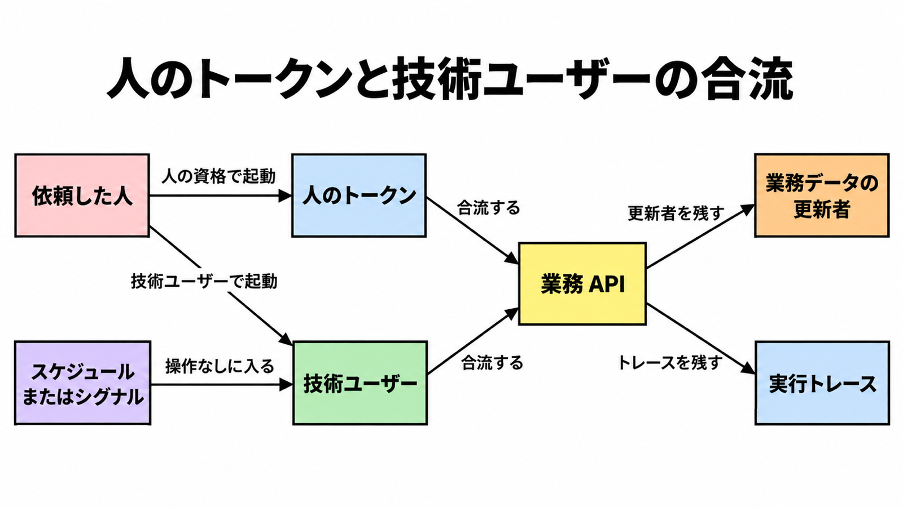

# ダイジェスト: SAP・Oracle・Salesforceのエージェント経路で見積と承認と取消の主体を分ける

元記事: [sap-oracle-salesforce-saas-p2_20261021.md](../../../../../articles/sap-oracle-salesforce-saas-p2_20261021.md)

## ひとことで言うと

SAP、Oracle Fusion、Salesforce は、画面の外から業務 API を起動できる。見積、承認、取消に相当する操作を誰の資格で実行するかは、入口ごとに公式が分けている。

## 核心ポイント

- 見積書専用の API 名は特定できていない。比べているのは別の業務データで、SAP は受注、Oracle は購買、Salesforce は会話セッションである。
- 人のトークン（その人の資格）と、技術ユーザー（人ではない実行主体の総称で、実体は製品で分かれる）が、同じ業務 API に届く。人の操作なしの入口は、スケジュール（時間かカレンダー）とシグナル（業務イベント）である。
- 人間の代理（人の資格の範囲で動くこと）を、三社の既定とは書けない。自己代理（人の文脈なしに動くこと）は、SAP の検索インデックス（Help 本文とは別）が将来リリースと書く。
- 人間の承認（実行前に人が止める関門）は、資格とは別である。Oracle の外部 REST では Require Human Approval を選んだときだけ実行前の確認があり、26C の Human Approval ノードと同一の設定だとは書かれていない。
- 更新者（業務データに残る更新の主体で、人とは限らない）と実行トレースは別記録で、依頼者と実行者の二欄は製品が保証しない。自社では操作ごとに四欄（依頼した人、実行したエージェント、更新者、トレースの ID）を書く。

## メンタルモデル

依頼した人は人のトークンか技術ユーザーを起動し、スケジュールまたはシグナルは操作なしに技術ユーザーへ入る。どちらも業務 API に合流し、更新者と実行トレースは別記録である。

## 具体例

| 製品 | 取消に相当する操作 | 実行時に公式が名指す主体 |
|---|---|---|
| SAP | 取消の専用アクションは未特定。近いのは、受注を拒否する理由（任意の更新項目）を書くこと。承認は別操作で、Release は承認、Reject はその承認の拒否。受注の承認を外から扱うサービスは、差戻しと取下げを持たない | 検索インデックス（Help 本文ではない）。現行は人間の代理。自己代理は将来 |
| Oracle | 購買オーダーの取消は、項目の汎用更新とは別の cancel。取消理由の文字列は、必須とは書かれていない | ワークフローの式が返す User Name は、実行を開始した認証ユーザー。スケジュール時にその式へ入る主体は未記載 |
| Salesforce | 会話を閉じる操作だけが確認できた。レコード取消の専用パスは未特定 | bypassUser は true ならエージェントに紐づくユーザー、false ならトークンのユーザー。Employee（社員向け）はログイン中の本人。検証なしの Service（顧客対応。どの確認が無いかは検索インデックスに無い）は EinsteinServiceAgent User。Employee、検証なしの Service、bypassUser が true のときは、同一ユーザーとは書かれていない |

## 適用と判断

向く場面:

- 三社の画面外の経路を、自社の見積、承認、取消の API 契約へ写す前。
- 「既定は人間の代理」の一文で、主体の表を埋める提案を見るとき。

確認すること:

- その操作の実行主体が、人のトークンか、人ではない実行主体か、文書に名指しされているか。
- 金額、在庫、雇用、対外の約束を変える承認を、人間の作業項目として残すと契約に書いてあるか。
- 取消が、状態の汎用的な更新とは別のアクションか。
- 画面だけの必須を、入力規則、二重の権限検査（呼び出し側と対象の人の両方を見る検査）、承認ノードのどれかへ写し、ページレイアウトの必須が API に乗らないという Salesforce の検索インデックスの読みを、SAP と Oracle へ広げていないか。
- 依頼者と更新者を、片方の最終更新者だけで答えていないか。

## 限界・注意点

- 日経クロステックの会員本文は未取得である。
- 検索インデックスと書いた記述は、Help 本文で裏を取っていない。
- SAP で呼び出し元の人を後段へ伝えたときの伝票の更新者、Oracle のスケジュールとシグナルで式に入る主体、Employee 経路で最終更新者が依頼者のまま残るかは、未記載である。
- 差戻しと取下げが無いのは、受注の承認を外から扱うサービスだけで、SAP の承認全体ではない。
- 自己代理が Help 本文の現行仕様になったとき、またはスケジュールの主体が技術ユーザーで業務データの更新者もそのユーザーだと文書が変わったときは、四欄の初期値を作り直す。

## 参考

- 元記事: [sap-oracle-salesforce-saas-p2_20261021.md](../../../../../articles/sap-oracle-salesforce-saas-p2_20261021.md)
- [日経クロステック（本文は会員限定）](https://xtech.nikkei.com/atcl/nxt/column/18/03802/101900001/)
- [SAP Joule Agents Compliance Brief 1.0（PDF）](https://www.sap.com/docs/download/2026/06/526001c1-567f-0010-bca6-c68f7e60039b.pdf)
- [Oracle のワークフロートリガー](https://docs.oracle.com/en/cloud/saas/fusion-ai/26c/aiaas/configure-workflow-triggers.html)
- [Salesforce Agent API](https://developer.salesforce.com/docs/ai/agentforce/guide/agent-api.html)
