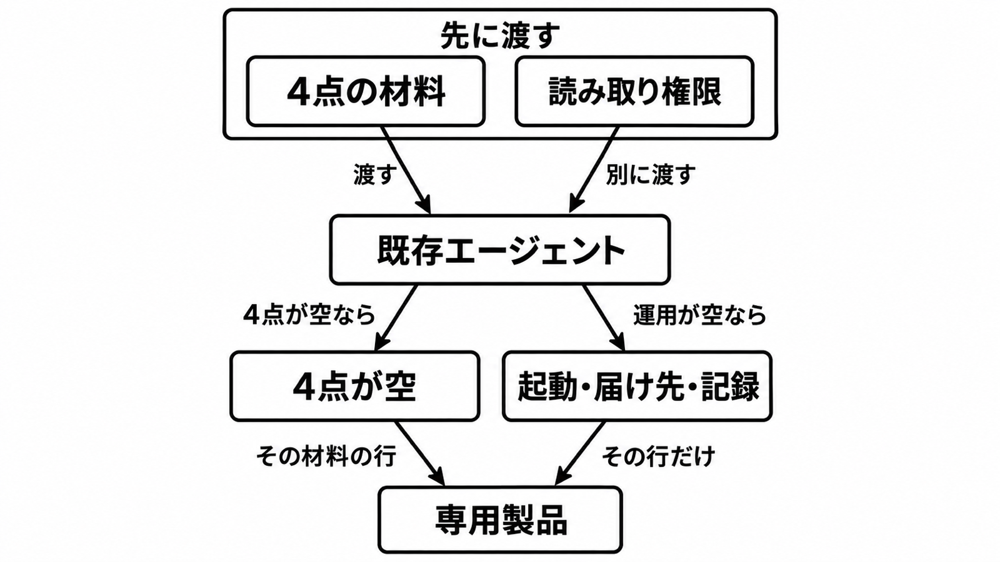

# ダイジェスト: AI SREを評価する前に、既存エージェントへ調査文脈を渡す

元記事: [ai-sre-cncf-io-2026-before-p4_20261022.md](../../../../../articles/ai-sre-cncf-io-2026-before-p4_20261022.md)

## ひとことで言うと

専用の AI SRE を比べる前に、既存のコーディングエージェントへ 4 点の材料と、Secret を読めない権限を渡して測る。まず見るのは、渡せなかった材料と、残った起動・届け先・記録である。

## 核心ポイント

- 2026年10月21日、CNCF ブログの Roy Libman（クラスタの状態を渡す製品 Radar の責任者）は、障害調査を専用の AI SRE（調査をモデルに任せる製品や手順）から始めず、Claude Code、Codex、Cursor へ先に材料を渡す、と案内している。
- 渡す調査文脈（先に渡す材料）は 4 点で、壊れている障害の順位、Event（短時間だけ残る出来事の記録）が消えたあとの変更の時系列、リソース同士の関係、秘匿値を伏せたエラーログである。実行してよい範囲は 4 点の外で、記事の例は組み込み view（Secret を読めない読み取り権限）である。
- 同じ Claude Code、SREGym（公開の障害診断ベンチマーク）の 50 故障、3 ノードの EKS（Amazon の Kubernetes）、各 1 回の自己申告では、shell と kubectl が正解 45・平均 191 秒、Radar の読み取り専用 MCP が 4 点を返し kubectl を塞いだ側が正解 46・平均 64 秒である（平均は正解も不正解も含む。64 秒は view を渡した秒数でも、製品の順位でもない）。2 分以内の正解と 5 分以内の正解は、shell 側が 60%・78%、4 点を返した側が 86%・90% である。
- 4 点が空の行と、材料を渡したあとも空の起動・届け先・記録を、まず製品に見る。許可コマンドが空なのは権限の問題で、製品の行にしない。

## メンタルモデル

図の「運用」は、起動・届け先・記録である。

## 具体例

記事の 1 例では、shell 側がツール呼び出し 58 回・701.6 秒でリリース情報の Secret をデコードして終わり、Radar 側は 7 回・34.8 秒だった。4 点との対応と、変更の有無は書かれていない。

## 適用と判断

向く場面:

- Kubernetes の障害調査を、専用の AI SRE の比較表から始めようとしているとき。
- ベンダーが示した正解数の 1 件差を、購入理由にしようとしているとき。

確認すること:

- staging の直近 2〜3 件を、4 点を渡す条件と渡さない条件で比べ、試行を 3 回にし、2 分と 5 分の時間差と、各回の時間と診断を残すか。
- 調査の身元（調査に使う主体）が、Secret の取得と、コンテナの中でのコマンド実行を持たないか。
- 修復の実行が、調査の身元とは別の身元に残るか。
- 人が気づく前の調査開始、インシデントのチャネルへの届け、誰の身元としての記録が、材料を渡したあとも空か。
- 正解数の 1〜2 件差や、条件の違う実験の製品順位を、購入の起点にしていないか。

## 限界・注意点

- 50 件は開発者自身の各 1 回で、OS とハードウェアの故障を含まない。独立した再現は未確認で、無いとは別である。
- 2 条件は、4 点のどれが効いたかを分けていない。故障の注入はデプロイの数分後なので、変更の時系列を持つ接続の側に有利である。view とランブック（実行してよい手順の文書）だけで同じ秒数になるとは記事は示していない。
- 読み取り専用と呼ばれるものは、組み込み view、接続の read-only フラグ、製品の画面と REST で別物である。調査プロンプトが変更を許すかは、これらとは別である。記事は実験にそのフラグを使ったとは書いておらず、フラグは画面と REST の書き込みを止めない。
- 30 分では、材料を渡した側が 92%、shell 側が 90% まで寄る。時間に困っていなければ、材料を製品として買う理由は薄い。
- 診断側は Claude Sonnet 5、採点側は Claude Opus 5 という表記で、カードとは未照合であり、合格側が Secret の中身を見たかも決まらない。Secret の中身が要るときは文脈の測定を続け、Secret を読む手順を評価に足し、調査ループの行は買い替えが目的のときだけ見る。

## 参考

- 元記事: [ai-sre-cncf-io-2026-before-p4_20261022.md](../../../../../articles/ai-sre-cncf-io-2026-before-p4_20261022.md)
- Roy Libman「[Before you evaluate an AI SRE, give your existing agent context](https://www.cncf.io/blog/2026/10/21/before-you-evaluate-an-ai-sre-give-your-existing-agent-context/)」（CNCF Blog, 2026-10-21）
- [Radar の公開リプレイ mcp-vs-kubectl](https://radarhq.io/benchmark/mcp-vs-kubectl)（ベンダー。記事が案内する同じ系列）
- [SREGym 論文 HTML](https://arxiv.org/html/2605.07161v3)（arXiv:2605.07161v3）
- [Radar の MCP 文書](https://github.com/skyhook-io/radar/blob/main/docs/mcp.md)（main）
