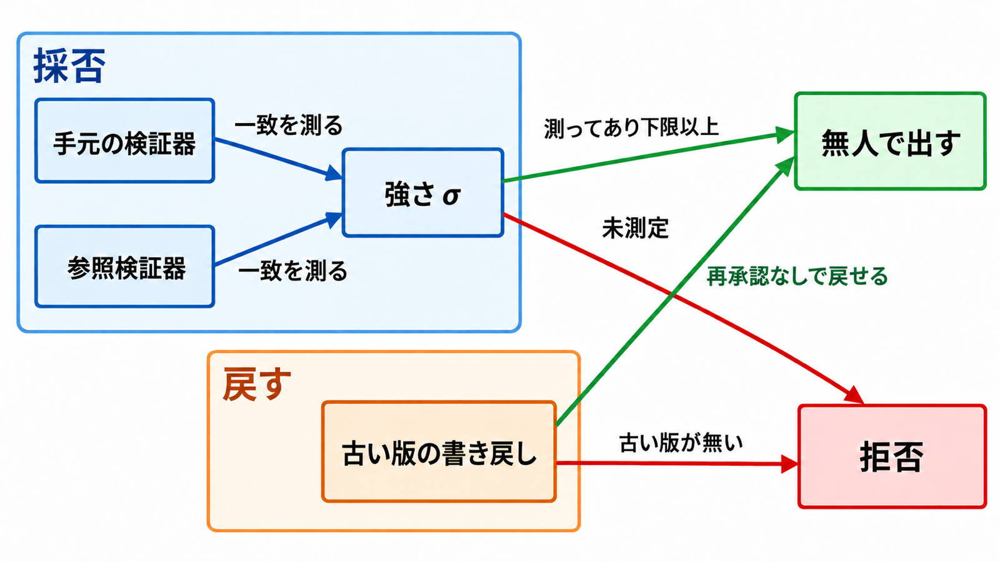

# ダイジェスト: 配備済みエージェントの無人自己改修を回復可能性と検証器の強さで区切る

元記事: [arxiv-abs-2610-27465-p8_20261022.md](../../../../../articles/arxiv-abs-2610-27465-p8_20261022.md)

## ひとことで言うと

Wang と Qi は、配備済みエージェントの無人の自己改修を、古い版へ書き戻せるかと、検証器の強さを参照との一致で測ってあるか、の両方で区切る。

## 核心ポイント

- **無人の自己改修**は、自分の実行記録から変更を作り、人が書かず、検証器（出してよいかを決める仕組み）を通す1ステップである。推論途中の直しと人が書いた修正は含まず、編集対象は重み、システムプロンプト、ツールの定義、スキル（中身の分類はこの論文に無い）である。
- **強さ σ** は、手元の検証器と信頼できる参照検証器の一致を、Matthews 相関（合否の一致を、多い側の割合に引っ張られにくい係数）で −1 から 1 まで表す。自分に付けた点数ではなく、常に同じ答えなら σ = 0 である。
- **再承認の要否 g** は古い値へ書き戻すだけなら 0、作り直して同じ検証器に通すなら 1 で、**復元の一致 ρ** は戻したあと合否が前と同じ課題の割合である。**公開中の影響 β** は載っているあいだに合否が変わった課題の割合で、用意した課題の外の返金は含まない。
- 無人で出してよいのは、g = 0 かつ σ を測ってあり下限以上、の両方だけである。下限の数値はこの論文が固定せず、未測定なら欠けた条件を残して拒否する。
- 論文の要約が言う 17% は、採用した変更 4 件のうち試験が残った 3 件で合否が変わった割合（0.24、0.28、0.24）が、何もしないときの 0.08 をまとめて 0.17 超えた幅である。本番の返金率ではなく、1 件の引き算でもない。

## メンタルモデル

採否の枠は手元と参照の一致を強さ σ にし、戻す枠は古い版への書き戻しである。両方を満たすときだけ右の「無人で出す」へ進み、欠けると「拒否」へ進む。

## 具体例

保存したプロンプトの書き戻しは、試験 20 課題で何もしないときとの差が 0.000、何もしないときの一致は 0.95、幅 ±0.05 に収まるかの検定の p は 0.007 だった。作り直した取り消し 3 本は検証器が拒否し、仮に入れると訓練 30 課題で一致 0.98 よりまとめて 0.16 低い。拒否の根拠にした訓練合格率の差は、有意でない。

## 適用と判断

向く場面:

- 人を著者にしない変更の種類を、自分のエージェント基盤で先に決めるとき。
- 重みの更新を、戻せるという理由だけで無人にする提案を見るとき。

確認すること:

- 著者らの置き方では、強さを測ってあればプロンプト、ツール定義、スキルは無人側、重みは戻せて（g = 0）も人の承認、チェックポイントの無い再学習（g = 1）は無人にせず、学習データから行を除く機能は検証器が無いのでオフのまま出す。
- 重みを人に残すのは戻せるからではなく、更新前に多様性（種課題がどれだけ違って並ぶか）を採点する判定器が、いちばん多い種課題の割合を消しても同じ点数を返し、エラーも出ないためである。
- 強さを参照との一致で測り、モデル、プロンプト、依頼形式が変わった検証器は未測定として拒否し、出力形式や温度が実際に効いているかも見る。
- 元記事の線では、公開中に返金、送信、本番への書き込みが起きうるなら、成果物を戻せても人の承認に残す。論文の図は、その外部効果があってもプロンプト、ツール、スキルを無人側に置く。
- 0.41、0.56、0.49 は σ の下限としてコピーせず、ゲートが 60、30、15 回で平均するときの、合否を間違えない検証器が選ぶ候補に対する劣り幅が増え始める位置であり、最良と平均の差が測定のばらつきより小さい候補では同じ手順でも閾値は推定できない。

## 限界・注意点

- 最後まで通した試験はプロンプト改訂だけである。ツール、スキル、重みは未試験で、場所は本番ではなく τ²-bench（会話でのツール利用を課題単位で合否にする公開ベンチマーク）である。敵対的なエージェントは対象外である。
- 合格から不合格が 20、不合格から合格が 18 で、平均の合格率はほとんど動かない。
- 弱い検証器が悪い変更を選ぶ傾きは、この候補の集まりでは区間が 0 を含み、片側 p = 0.23 である。airline（τ²-bench の課題領域）は最良と平均の差を測定のばらつきで割ると 0.62 で、閾値を推定できない。
- 自然言語の合否を見る判定器の σ = 0.70 は、課題を単位に抜き直すと区間が [0.36, 1.00] になる。参照が不合格とした実行を合格とした 4 件は、1 課題の 4 試行である。
- 本番の返金、送信、データベース更新を β で測った値、ツールとスキルの ρ と β、参照がプログラムで書けないとき σ を未測定に戻す頻度は、この論文に無い。ワークショップ採択は 2026-10-22 の公式一覧では未確認である。

## 参考

- 元記事: [arxiv-abs-2610-27465-p8_20261022.md](../../../../../articles/arxiv-abs-2610-27465-p8_20261022.md)
- Wang, D. and Qi, P. Recoverability and Verifier Strength: Two Measured Preconditions for Unattended Agent Self-Improvement. arXiv:2610.27465v1, 2026-10-20. [概要](https://arxiv.org/abs/2610.27465)
