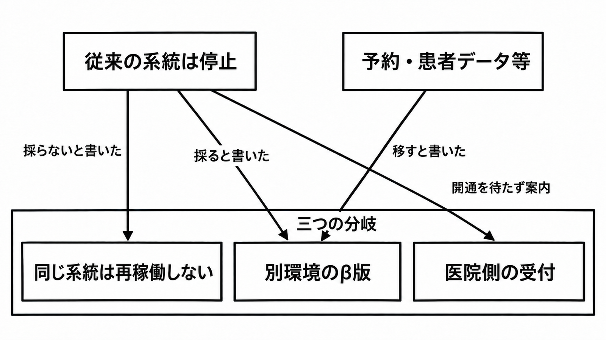

# ダイジェスト: 侵害されたアットリンクを再稼働せず別環境へ移す案内の読み方

元記事: [itmedia-co-jp-2610-2000002413-p9_20261022.md](../../../../../articles/itmedia-co-jp-2610-2000002413-p9_20261022.md)

## ひとことで言うと

メドレー（アットリンクの提供者）は、止まったアットリンクを再稼働せず別環境へ移すと案内した。10月22日10時、別環境の開始は遅れ、目処は無い。手順を書く側は、医院側の代替を、その開始とは別に書く。

## 核心ポイント

- アットリンク（@link）は、予約、受付、患者向けアプリを一つの提供として扱う医療機関向けの業務支援である。2026年10月20日23時の公式案内（アットリンクの告知ページ）は、これまでの系統（提供していた環境）を再稼働せず、別環境の「@link クラウド β版」へ予約・患者データ等を移すと書いた。
- 2026年10月22日10時の同じページは、朝7時以降としていた別環境の提供開始が不具合で遅れ、目処は立っていないと書いた。不具合の内容は書いておらず、朝7時はその完了時刻ではない。
- 787件は、漏えいが確定した医療機関数ではない。2026年10月15日の適時開示（株式会社メドレーの開示文書）は、漏えいの対象となる可能性のある医療機関は、最大で、アットリンク等を利用している全医療機関（787件）だと書いている。
- 器（別環境）を新しくする案内と、移すデータが健全であることは別である。公式が移すと書くのは予約・患者データ等までで、known good（汚染されていないと扱えるバックアップの世代）とも、不正に作られた ID の無効化とも書いていない。
- 手順を書く側は、被害範囲が確定する前から、同じ系統へ戻す案と別環境へ移す案を両方残す。メドレーが再稼働しないと決めたことは、再稼働しないことが常に正しい証明には使わない。

## メンタルモデル

図の一つ目は同じ系統を起動する分岐で、この事案の公式は採らないと書き、あとの二つは別環境のβ版と医院側の受付である。β版へ予約・患者データ等を移すと書いたことは、そのデータが健全だと書いたことではない。患者が使うアプリと Web の予約は、10月22日10時も停止のままである。

## 具体例

はらメディカルクリニックの告知（Wayback、ページ更新 2026年10月17日）は、電話集中を避けるため別システムを転用して臨時予約サイトを作ったと書いている。同じページは、アットリンクを電子カルテとは別に、予約と受付に使っていると書いている。

## 適用と判断

向く場面:

- 委託先の予約受付が止まったとき、医院の手順を先に書く担当。
- 別環境への移行案内を、移すデータの健全性と分けて読む担当。

確認すること:

- 運用マニュアル、予約一覧、電話、臨時予約、患者が聞く先が、別環境の開始とは別に名指しされているか。
- 委託先だけが持つ資料と、医院が見られる運用情報が、拡大防止、原因究明、対外説明で事前に分かれているか。

## 限界・注意点

- 2026年10月22日時点の公式には、移行項目の閉じた一覧、旧環境を止めたか消したか、院内機器を含むか、漏えいの有無が無い。
- NIST SP 800-61 Rev. 2（インシデント対応のガイド）の Appendix G は、一から作り直すか known good から戻すかの文であり、別環境へ移す決定そのものではない。この分岐が後継の Rev. 3 に残るかは、この記事は判断しない。
- 告知が言うオンプレミス型とクラウド型の区別が、製品ページの院内サーバ（@linkパッケージ）と医療機関ごとのクラウド（@link STC）の区別と同じかは、告知だけでは閉じない。β版がどちらの設置向けかも書いていない。
- 厚生労働省の「医療情報システムの安全管理に関するガイドライン」第7.0版は、侵害された系統を起動するな、とは書いていない。書いているのは、代替、ネットワークの分離、バックアップが既に影響を受けている可能性、不正 ID の無効化、非常時の役割分担である。
- 2026年10月21日の別告知は、PHP の脆弱性を理由に一部製品を止めたと書いている。10月22日10時時点の同じページは対策を終えたものから再開したと書き、そのページにアットリンクの記載は無く、原因が同じだとは公式は書いていない。

## 参考

- 元記事: [itmedia-co-jp-2610-2000002413-p9_20261022.md](../../../../../articles/itmedia-co-jp-2610-2000002413-p9_20261022.md)
- [株式会社メドレー「当社サービス『アットリンク』への不正アクセス及びサービスの一時停止に関するお知らせ」2026年10月15日](https://ssl4.eir-parts.net/doc/4480/tdnet/2895027/00.pdf)
- [アットリンクの公式案内（最終更新の表示 2026年10月22日10時）](https://at-link.net/information/%e3%82%a2%e3%83%83%e3%83%88%e3%83%aa%e3%83%b3%e3%82%af%e3%81%b8%e3%81%ae%e4%b8%8d%e6%ad%a3%e3%82%a2%e3%82%af%e3%82%bb%e3%82%b9%e3%81%8a%e3%82%88%e3%81%b3%e3%82%b5%e3%83%bc%e3%83%93%e3%82%b9%e3%81%ae/)
- [同じページの Wayback（最終更新の表示 2026年10月20日23時）](https://web.archive.org/web/20261021050957/https://at-link.net/information/%e3%82%a2%e3%83%83%e3%83%88%e3%83%aa%e3%83%b3%e3%82%af%e3%81%b8%e3%81%ae%e4%b8%8d%e6%ad%a3%e3%82%a2%e3%82%af%e3%82%bb%e3%82%b9%e3%81%8a%e3%82%88%e3%81%b3%e3%82%b5%e3%83%bc%e3%83%93%e3%82%b9%e3%81%ae/)
- [NIST SP 800-61 Rev. 2](https://nvlpubs.nist.gov/nistpubs/SpecialPublications/NIST.SP.800-61r2.pdf)
- [厚生労働省「医療情報システムの安全管理に関するガイドライン」第7.0版 システム運用編](https://www.mhlw.go.jp/content/10808000/001716295.pdf)
