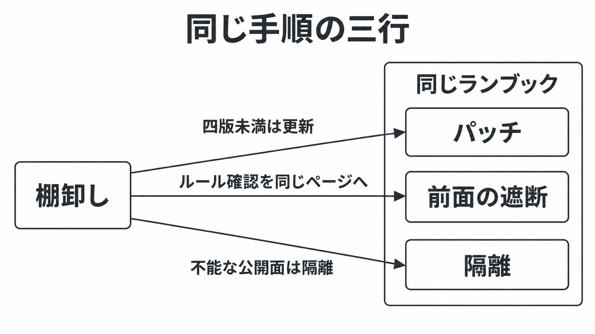

# ダイジェスト: OpenAIが提案した協調開示とPHPの致命的欠陥二件を手順に落とす

元記事: [openai-oss-openai-index-of-p1_20261022.md](../../../../../articles/openai-oss-openai-index-of-p1_20261022.md)

## ひとことで言うと

インターネットにPHPを出すシステムの発注側は、更新、入口の遮断、直せない系統の隔離を、同じ三行に同時に書く。点数と範囲は出典ごとに残す。

## 核心ポイント

- 二件（CVE-2026-109618 と CVE-2026-109619）は、ログインしていない外部がサーバで命令を実行できる欠陥として公開済みで、点数も範囲も同じである。
- 採点方式 4.0 の点数は 9.2（攻撃は複雑で、追加の攻撃要件がある）、別のデータベースが主として置く方式 3.1 は 9.8（攻撃は複雑でない）で、一方だけを深刻度にしない。
- 割当主体（php）が影響ありとするのは、8.2、8.3、8.4、8.5 の各系列で 8.2.35、8.3.36、8.4.27、8.5.12 未満だけである。一部ブログはおおよそ 5.4 から修正直前までと書き、php.net は 8.1 以前を通常更新の対象外とし、7.4、8.0、8.1 の最小ソース修正は別物とする。
- 五段階（上流の修正、影響組織が動く時間、政府との調整、下流の更新準備、公開後の案内）は提案であり、実施済み手順にはしない。OpenAI は連合を率いたと書き、修正の主導はPHPの保守側だとも書く。
- 三行は、パッチ（8.2 から 8.5 を四つの修正版以上へ更新し、処理中のプロセスを再起動する）、前面の遮断（入口のルールが自社で投入済みか）、隔離（更新も切り戻しもできない公開面を外すか止める）で、前の完了を待たない。遮断は更新完了の代わりにしない。

## メンタルモデル

棚卸しは、版、受け方（実行環境が示す方式名）、イメージの出どころである。四版は上の四つの修正版である。三行へ同時に割り当て、前の完了は待たない。

## 具体例

| 行 | 完了条件 | この案件で揃わなかった点 |
| --- | --- | --- |
| パッチ | 8.5.12、8.4.27、8.3.36、8.2.35 以上にし、処理中のプロセスを再起動する | 第三者配布元 Remi は公開日に未更新、と php.net と EU の告知が書く |
| 遮断 | 自社のルールが、ベンダーの一次で投入済みだと確認できる | 遮断を使う顧客だけ 2026-10-21 03:02 UTC に投入。更新は別だと Cloudflare が書く |
| 隔離 | パッチも切り戻しもできない公開面を外すか止める | 8.1 以前に通常の点リリースは無く、最小修正は別物である |

## 適用と判断

向く場面:

- インターネットに PHP を出す発注側が、今日の手順を一枚に書くとき。
- 更新、遮断、隔離を別の担当に分けているとき。

確認すること:

- 8.2 から 8.5 で四つの修正版未満は更新、7.4 と 8.0 と 8.1 は最小のソース修正の検討、更新も切り戻しもできない公開面は隔離に残しているか。
- 遮断ルールの識別子を一次情報で取り、更新担当と同じページに置き、更新完了の代わりにしていないか。
- 9.2 と 9.8、および 8.2 から 8.5 と 5.4 以降を、それぞれ両方残しているか。
- 悪用が載る一覧に無いことや、出した側の声明が未確認の先行イメージ（公開枠より前の修正入りイメージ）を、完了にしていないか。
- 全系統が四つの修正版以上で再起動済み、サポート終了と自前イメージがゼロだと分かるまで、隔離の行を消していないか。

## 限界・注意点

- アプリからメモリ制限を戻せない置き方や、PHP 8.5 で呼び出し履歴を出さない設定は、露出を下げる例であり、更新の代わりにしない。プロセスへ課す別の資源制限は、その代わりにせず、脆弱な割当失敗を起こしうると公式が書くので緩和にしない。
- 常駐方式（処理を常駐プロセスへ渡す）は、完全な実証は無いという告知と、アプリケーション経路で確認したという PHP Foundation の文が両方あり、三行の対象から外さない。
- 公開前の通信の変化は侵害の成立確認ではなく、悪用の有無は見た時点の記録である。「攻撃者より先」は OpenAI の「知る限り」であり、2026-08 より前に攻撃者が到達経路を持っていたかは未確認である。
- 動く見本の手順は元記事に無い。判断は影響の種類、前提、修正版で足る。

## 参考

- 元記事: [openai-oss-openai-index-of-p1_20261022.md](../../../../../articles/openai-oss-openai-index-of-p1_20261022.md)
- OpenAI. [Coordinated disclosure of critical vulnerabilities](https://openai.com/index/coordinated-disclosure-of-critical-vulnerabilities). 2026-10-21.
- [CVE-2026-109618](https://cveawg.mitre.org/api/cve/CVE-2026-109618) と [CVE-2026-109619](https://cveawg.mitre.org/api/cve/CVE-2026-109619)（割当主体は php）。
- [PHP Foundation](https://thephp.foundation/blog/2026/10/21/todays-php-security-release-and-how-were-strengthening-php-security/). 2026-10-21.
- [php.net の 8.2.35 公開記事](https://www.php.net/archive/2026.php#2026-10-21-1).
