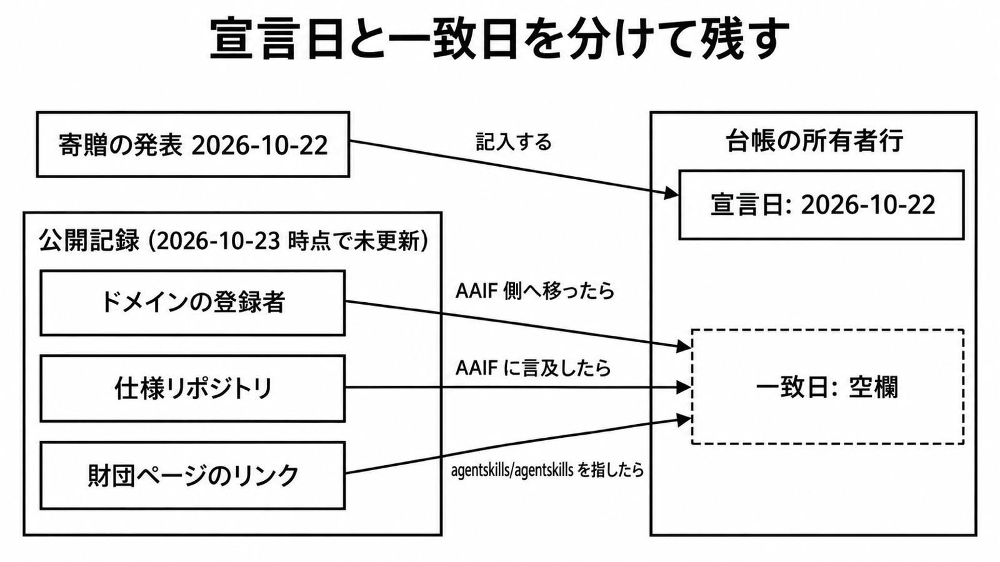

# ダイジェスト: AnthropicがAgent SkillsをAgentic AI Foundationへ寄贈した

元記事: [anthropic-agent-skills-agentic-p1_20261023.md](../../../../../articles/anthropic-agent-skills-agentic-p1_20261023.md)

## ひとことで言うと

Agent Skills の Agentic AI Foundation (AAIF) への寄贈を Anthropic が 2026-10-22 に発表したが、翌日の公開記録は未更新だった。台帳では発表日と記録が変わった日を分ける。スキルは形式と権限を別に審査する。

## 核心ポイント

- Agent Skills は AI エージェントに仕事の手順を渡すフォルダ形式で、先頭の YAML (frontmatter) に名前と説明、後ろに Markdown の手順を書いた `SKILL.md` が必須である。エージェントは起動時に名前と説明だけを読み、使うと判断したら本文を、手順が指したら同じフォルダのファイルを読む。
- AAIF は Linux Foundation 傘下の財団である。発表は寄贈物に、標準、名称とロゴ、GitHub organization `agentskills`、ドメイン `agentskills.io` を挙げた。
- 2026-10-23 時点で、仕様リポジトリ `agentskills/agentskills` は AAIF に触れていなかった。財団ページに表示される GitHub リンクも、Anthropic 組織に残る例示リポジトリ `anthropics/skills` を指していた。
- 「100 万スキル・約 2.8 億回」は、skills.sh (スキルを掲載するレジストリ) の掲載数と 2026 年 8 月までの延べインストール数で、上位 1.2% のスキルが回数の 94% を占める。Anthropic は「70 以上のプラットフォーム」と書くが、仕様リポジトリに申請制で載る、スキルを組み込んだ製品の一覧は 46 件である。
- 仕様に合う形式と実行権限は別に見る。frontmatter の実験的な任意欄 `allowed-tools` は、Claude Code では、スキルを起動したターンのあいだ列挙したツールを確認なしで使わせる許可で、列挙外の禁止ではない。

## メンタルモデル

台帳とは、スキルの件数や置き場所を数えて自分で残す記録で、その先頭に仕様の所有者の行 (図の「台帳の所有者行」) を置く。図の宣言日は発表日のことで、一致日は左下の 3 つの公開記録が変わったら埋める。

## 具体例

`agentskills.io` は寄贈物に挙げられたが、発表翌日の WHOIS (ドメインの登録情報) では、登録組織は Anthropic PBC のままだった。掛かっている移転ロックはレジストラのもので、移転を拒否した証拠ではない。

## 適用と判断

向く場面:

- Agent Skills の採用数や仕様の所有者を、台帳や記事に書くとき。
- 外部で公開されたスキルを Claude Code などに入れるか判断するとき。

確認すること:

- 仕様の所有者の行に、発表日 2026-10-22 と、3 つの公開記録が一致した日 (空欄から開始) を分けて書いたか。
- 形式の検査 (参照ライブラリ skills-ref の `validate` と、`SKILL.md` 500 行未満の推奨) とは別に、シェル・ファイル・ネットワークを確認なしで使わせるかを見たか。
- スキルを置く場所は仕様が決めないので、使う製品の文書で確かめたか (仕様の統合ガイドが勧める `.agents/skills/` は、Claude Code の読み込み場所の一覧に無い)。

## 限界・注意点

- 発表は Anthropic・Google・OpenAI ほかのエンジニアが個人として保守すると書くが、氏名が出ているのは Anthropic 側の 2 名だけである。
- 提案を採択する手順とセキュリティ手引きは、発表自身が「始める案」と呼んでおり、仕様リポジトリの公開ツリーにも無い。
- 公開スキルの危険度は、Snyk の自社スキャン (3984 スキル中 critical 534 件) の数字で、仕様の欠陥件数ではない。仕様自体の CVE は 2026-10-23 時点で確認できていない。
- GitHub organization の owner 権限がいつどの法人へ移るか、名称とロゴの商標が誰の名義かは未確認である。
- Claude Code では、信頼していないフォルダで対話なしに実行 (`-p`) しても、そのリポジトリのスキルの `allowed-tools` が効く。文書は、リポジトリに入ったスキルが自分へ広いツール権限を与えられると警告している。

## 参考

- 元記事: [anthropic-agent-skills-agentic-p1_20261023.md](../../../../../articles/anthropic-agent-skills-agentic-p1_20261023.md)
- Anthropic「[Donating Agent Skills to the Agentic AI Foundation](https://www.anthropic.com/news/donating-agent-skills-to-the-agentic-ai-foundation)」(2026-10-22)
- Agentic AI Foundation「[Agent Skills: Sharing Team Expertise Across AI Agents](https://aaif.io/blog/agent-skills-sharing-team-expertise-across-ai-agents)」(2026-10-22)
- [Agent Skills specification](https://agentskills.io/specification)
- Claude Code Docs「[Extend Claude with skills](https://code.claude.com/docs/en/skills)」(2026-10-23 取得)
