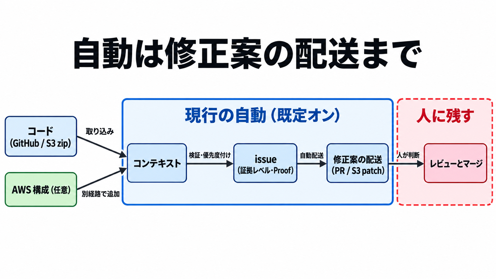

# ダイジェスト: コード脆弱性の検出から修正案の配送までを行うAWS Continuum

元記事: [aws-pr-continuum-aws-amazon-p7_20261023.md](../../../../../articles/aws-pr-continuum-aws-amazon-p7_20261023.md)

## ひとことで言うと

AWS Continuum のコード脆弱性機能は、検出の検証から修正案の配送までを自動で行い、マージは人に残る。issue ごとに証拠の強さが違うので、証拠の種類・却下条件・直してよい範囲を導入前に分ける。

## 核心ポイント

- 選んだ GitHub.com リポジトリか同一アカウントの S3 zip と、任意の collector（AWS 構成を読む収集）から、コンテキスト（コードと構成を検出が参照できる形にまとめたもの）を作る。finding（脆弱性の候補）を検証・優先度付けしたものが issue になる。
- 修正案は既定で自動配送され、GitHub なら pull request、S3 なら `continuum-patches/` 配下の patch になる。
- 証拠レベル（コンソールが issue に付ける区分）と Proof（示される根拠の種類）は issue ごとに違い、実行して確かめられる根拠が無い issue もある。Static proven と source analysis だけの issue を、サンドボックスで再現済みとは読まない。
- 自動マージは現行機能ではなく、News Blog は自動適用を将来形とし、GitHub App は自分ではマージしないと書く。修正の自動適用について文書にある現行の制御は配送のオン／オフ（`patchCreationPolicy`）だけで、What's New の Learn / Enforce mode（提案と承認の段階 / guardrail 内で自律させる段階）を指定する操作は無い。
- AWS 自身の計測 CyberGym-E2E（C/C++ の OSS 920 タスク）で、パッチ後も機能テストを保てた率は 89.0%、ベンチマークが選んだ脆弱性を直した率は 37.8% である。顧客環境で意図した欠陥が直る率には使えない。

## メンタルモデル

自動の枠は既定でオンの範囲である。issue に付く表示は、人の枠を飛ばしてよい許可ではない。

## 具体例

料金ページの例では、100 万行・脆弱性 100 件・1 件 1 CIU（推論の課金単位。1 CIU = 10 USD）の仮定で合計 1,200 USD になる。料金は、保護する行数に対する月額のコンテキスト料と推論料の 2 つでできている。

## 適用と判断

向く場面:

- GitHub.com か S3 上のコードについて、検出だけでなく修正案（GitHub なら pull request、S3 なら patch）まで受け取りたいとき。
- 導入可否を、検出精度の宣伝文句ではなく受入条件と権限の設計で決めたいとき。

確認すること:

- issue ごとに証拠の種類（静的解析だけ / サンドボックスで再現 / 実行できる根拠なし）を分けて記録するか。
- 誤検知として却下する条件を、マージ権限を持つ人とは別のチェックにしているか。
- 直してよい範囲（触ってよいパス、依存更新の取得元ドメイン、設定、テスト）を先に決めたか。
- 最初の pull request で、作者のログイン、対象ブランチ、CI をスキップするかを記録するか。
- 1 つの environment（リポジトリを束ねる単位）に 10 リポジトリ超、GitHub と S3 以外の取り込み、N. Virginia と Oregon 以外の Region のどれかを前提にするなら、account team に確認したか。

## 限界・注意点

- 1 件が何 CIU になるかと端数の丸めは公開されていない。料金ページの例はどれも 1 件 1〜2 CIU の仮定で、コード脆弱性機能の無料枠も料金ページでは確認できない。
- 保管はリクエストの起点になった Region だが、推論は地理的区域の中で Region 外でも処理され得る。サービス改善のための収集は現時点で無いが、将来はあり得る。
- FAQ の「学習に使わない」は別機能（ペネトレーションテスト）の見出し下の文で、コード脆弱性機能の同じ文はこの FAQ には無い。
- PR を作る GitHub のログイン、GitHub App の permission 一覧、対応言語、Learn / Enforce と `patchCreationPolicy` の対応、公開リポジトリへの PR を拒むかは、公開文書で確定していない。

## 参考

- 元記事: [aws-pr-continuum-aws-amazon-p7_20261023.md](../../../../../articles/aws-pr-continuum-aws-amazon-p7_20261023.md)
- [AWS News Blog: AWS Continuum for code vulnerabilities is now generally available](https://aws.amazon.com/blogs/aws/aws-continuum-for-code-vulnerabilities-is-now-generally-available/)（2026-10-22）
- [What's New](https://aws.amazon.com/about-aws/whats-new/2026/10/aws-continuum-for-code-vulnerabilities-is-now-generally-available/)（2026-10-22）
- [User Guide: Viewing issues](https://docs.aws.amazon.com/continuum/latest/userguide/cv-viewing-issues.html)
- [AWS Continuum 料金](https://aws.amazon.com/continuum/pricing/)（2026-10-23 取得）
