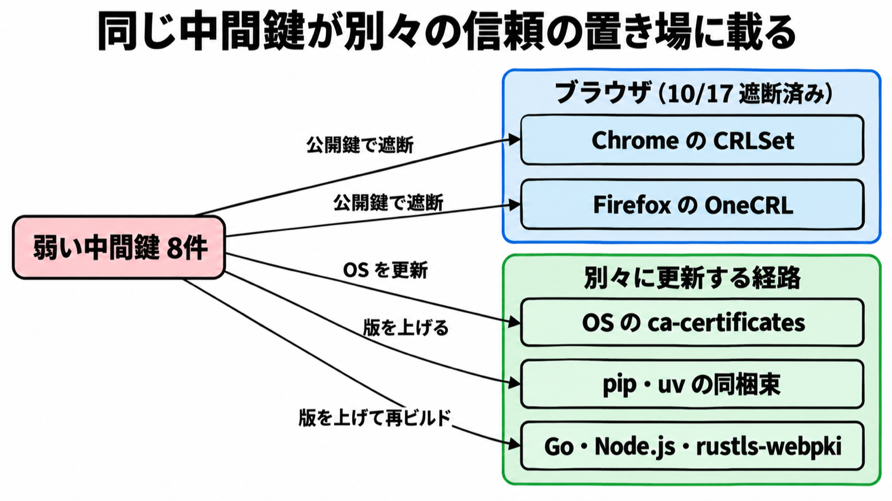

# ダイジェスト: eMudhraの中間CA8件で秘密鍵が復元できる条件と開発ツールの更新先

元記事: [emudhra-ca8-cloudflare-emudhra-p6_20261023.md](../../../../../articles/emudhra-ca8-cloudflare-emudhra-p6_20261023.md)

## ひとことで言うと

認証局 eMudhra の中間 CA 8 件は、公開の証明書から秘密鍵を復元できる。Chrome と Firefox (標準設定) は 10-17 に遮断済みだが、開発ツールの多くは別の経路なので、経路ごとに更新する。

## 核心ポイント

- 2025-04-30 に作られた中間 CA 8 件 (TLS 用 6、コード署名用 2) は、楕円曲線の秘密鍵にあたる整数が 256 未満で、鍵を復元できる、と Google は書く。TLS の暗号方式が壊れた話ではない。
- Chrome と Firefox は、配布する遮断リスト (CRLSet と OneCRL) で 10-17 に対象の公開鍵を遮断した。開発ツールが参照する信頼ストアは、これとは別のファイルである。
- Google によれば、対象の中間に署名したのは eMudhra のルート emSign ECC Root CA - G3 で、Google はこれを 10-27 朝 (米国太平洋夏時間) に Chrome Root Store から外す予定である。配下の正規の証明書も Chrome で動かなくなるので、Google は Chrome Root Store に含まれる別の階層へ移すよう求める。
- pip が読む同梱の CA 証明書の束 (certifi) は、OS の更新では置き換わらない。影響のある emSign のルートを外すには、pip を 26.2.2 以上へ上げ、certifi パッケージを 2026.10.19 にし、venv を作り直し、コンテナイメージはレイヤーキャッシュ無しで作り直す。
- 「悪用は確認されていない」は、Cloudflare は自社サービスの範囲、Google は TLS 用 6 件と公開ログ (CT) を強制するクライアントの範囲で言っている。2025-04-30 から遮断までに何が起きたかは未確定である。

## メンタルモデル

この中間鍵を信頼するかは、図の経路ごとに別々に決まる。ブラウザの遮断は、ほかの経路を置き換えない。

## 具体例

OS の ca-certificates を更新したコンテナでも、pip が 26.2.2 未満なら同梱 certifi の経路は残る。同じコンテナの OpenJDK が Debian や Ubuntu のパッケージなら、OS の証明書更新で足りる。

## 適用と判断

向く場面:

- pip・uv・Go・Node.js・Rust・Java で TLS 接続するビルド環境・実行環境を持つとき。
- emSign の TLS 証明書を使うか、受け取るとき。

確認すること:

- 経路ごとに修正版へ上げたか (uv 0.13.4 以上、Go 1.27.3 / 1.26.10、Node.js 22.23.4 / 24.22.1 / 26.12.1、rustls-webpki 0.103.16 以上。0.104 系は alpha.8 以上)。
- Go や Node.js を上げたあと、実行ファイルを再ビルドしたか (再ビルドしない実行ファイルには修正が入らない)。
- Java は、OpenJDK が名指ししたディストリ (Debian・Ubuntu・RHEL・Fedora など) なら OS の証明書を、単体導入・FreeBSD・Homebrew ならランタイムを影響版より新しいビルドへ更新したか。
- 自社の証明書の鎖をたどり、終点のルートが emSign ECC Root CA - G3 なら 10-27 の前に移したか (発行者の表示名だけでは、このルートと同一かを決められない)。
- 証明書エラーを、検証の無効化で通していないか。

## 限界・注意点

- 8 件からサイトやソフトウェアに載せる証明書は出ていない、インフラ侵害は無い、という記述は eMudhra の自己申告である。弱い鍵が生まれた根本原因も調査中である。
- コード署名用の 2 件は Microsoft が信頼する、と Mozilla のバグ報告 (Bug 2083449) は書く (元記事は Microsoft の告知本文を未読)。署名を検証する環境では、ブラウザの HTTPS 遮断とは別に Microsoft 側の信頼を確かめる。
- 2026-10-23 時点で Bottlerocket、Composer、Erlang の certifi、Godot は修正待ちだった。

## 参考

- 元記事: [emudhra-ca8-cloudflare-emudhra-p6_20261023.md](../../../../../articles/emudhra-ca8-cloudflare-emudhra-p6_20261023.md)
- Google. [Protecting Chrome and Android Users from Compromised eMudhra Intermediate CA Certificates](https://blog.google/security/protecting-chrome-and-android-users-from-compromised-emudhra-intermediate-ca-certificates/). 2026-10-20.
- Mozilla Security Blog. [Protecting Firefox users](https://blog.mozilla.org/security/2026/10/20/protecting-firefox-users-following-the-compromise-of-emudhra-intermediate-certificates/). 2026-10-20.
- [Mozilla Bugzilla Bug 2083449](https://bugzilla.mozilla.org/show_bug.cgi?id=2083449).
- Python discuss. [Information for Python users](https://discuss.python.org/t/information-for-python-users-regarding-emudhra-emsign-ca-certificate-security-incident/109576). 2026-10-20.
