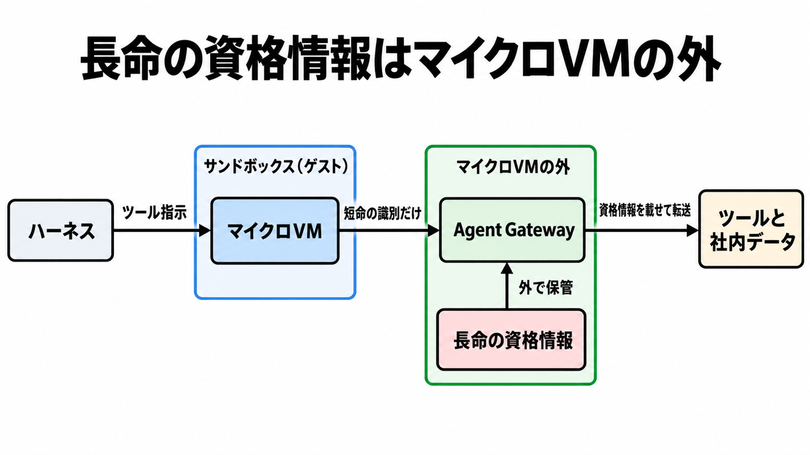

# ダイジェスト: Agent Compute EngineはセッションごとのマイクロVMを渡す計算サービス

元記事: [google-cloud-agent-compute-p2_20261023.md](../../../../../articles/google-cloud-agent-compute-p2_20261023.md)

## ひとことで言うと

Google Cloud の ACE（Agent Compute Engine）は、セッションごとのマイクロVMでツールを動かす計算サービスで、顧客向けはプレビュー予告の段階である。実行の隔離、到達と資格情報、処理中のモデル保護は別々に設計する。

## 核心ポイント

- ACE は、モデルを呼び次の行動を決める「ハーネス」と、コード・シェル・ブラウザを実行する「サンドボックス」を分ける。サンドボックスはセッションごとのマイクロVMで、標準のネットワークインタフェースを持たず、入出力は VM の外のプロキシを通る。
- ACE の解説記事によると、長命の資格情報（OAuth のリフレッシュトークンやサービスアカウント鍵）はマイクロVMに置かず、外向き通信の関門である Agent Gateway が VM の外で通信に載せる。VM に渡すと書かれているのは送り手を識別する短命の証明書とトークンで、元記事は、盗める資格情報が皆無とまでは読めないとする。
- 発表は統制を実行面全体へ広げる計画を示すが、Gateway の製品ドキュメントが現在提供と書く Google 管理のゲートウェイは、Agent Runtime と Gemini Enterprise 向けだけである。GKE・Cloud Run・他クラウドは coming soon（近日提供）で、ACE は対応先の表に無い。
- 処理中の重みとプロンプトをホスト管理者やクラウド事業者から守る Confidential G4（GPU の機密計算）は、同日に一般提供になった別製品で、両者の記事は互いを結び付けていない。ACE、Agent Gateway、Confidential G4 が一つの製品境界として出たとは読めない。
- 「最大 10 倍の計算密度」などの数値は、ACE ではなく、Kubernetes 上のオープンソース実行系 Agent Substrate についての Google の自己申告である。比較対象の定義も試験手順も示されていない。

## メンタルモデル

図は ACE の解説記事が書く設計上の経路で、Gateway の製品ドキュメントが ACE 向けに提供済みと書く経路ではない。

## 具体例

記事の仕分け表を 3 行に縮めたもの（2026年10月23日時点）。

| 境界 | 文書が支える今日の置き場 |
| --- | --- |
| 実行の隔離 | 契約して使える ACE は未公開（予告のみ）。先に試すなら Agent Substrate（ACE と同じく待機中のエージェントを退避して密度を上げる考えの実行系。隔離は gVisor かマイクロVM） |
| 到達と資格情報 | Agent Runtime と Gemini Enterprise 向けの Google 管理のゲートウェイ |
| 処理中のモデル | Confidential G4 |

## 適用と判断

向く場面:

- Google Cloud 上で、エージェントのツール実行や外部接続の置き場を決めようとしているとき。
- ACE の発表を受けて、本番の移行時期や容量の見積りを考えているとき。

確認すること:

- 今日ポリシーを強制できる面を、Agent Runtime と Gemini Enterprise 向けのゲートウェイに限って記録したか。
- ACE への本番移行を、リージョン・課金単位・SLA・公開 API・アイデンティティの対応表が公開されるまで保留しているか。
- 密度の数値を、見積りの入力から外したか。
- エージェントの廃棄手順に、IAM バインディングの手削除と、作り直したときの許可の付け直しを入れたか。

## 限界・注意点

- 2026年10月23日の取得では、ACE の公開ドキュメント、料金、SLA、クォータのページに本文が無い。リージョンや単価は確認できない。
- Agent Identity（エージェントに主体を付ける仕組み）では、エージェントを消しても IAM バインディングが残り、同名で作り直すと別の principal になる。
- 監査はハーネス、Gateway、Agent Identity でそれぞれ単位が違い、Agent Substrate では系譜の記録が呼ぶ側の責任になる。一つの証跡で「誰が何をして、どこで拒否されたか」まで揃うとは書かれていない。
- Agent Substrate を先に使う場合、GKE で全顧客に提供される版は非本番向け（本番は許可された顧客のみ）で、上流の実装は pre-1.0 のため後方互換が保証されない。
- 不明点: 実行中のセッションから権限を剥がし、拒否と承認を同じ監査に残す手順が、ACE と Gateway のどちらに実装されるか。

## 参考

- 元記事: [google-cloud-agent-compute-p2_20261023.md](../../../../../articles/google-cloud-agent-compute-p2_20261023.md)
- [Introducing Agent Compute Engine and expanded agent governance](https://cloud.google.com/blog/topics/ai-infrastructure/introducing-agent-compute-engine-and-expanded-agent-governance/)（Google Cloud Blog, 2026-10-22）
- [Inside Agent Compute Engine](https://cloud.google.com/blog/topics/ai-infrastructure/agent-compute-engine-deep-dive)（Google Cloud Blog, ページ表記 2026-10-23）
- [Agent Gateway overview](https://docs.cloud.google.com/gemini-enterprise-agent-platform/govern/gateways/agent-gateway-overview)（Google Cloud Documentation, Last updated 2026-10-22 UTC）
- [Confidential G4 with NVIDIA Blackwell is GA](https://cloud.google.com/blog/topics/ai-infrastructure/confidential-g4-gpus-are-ga)（Google Cloud Blog, 2026-10-22）
