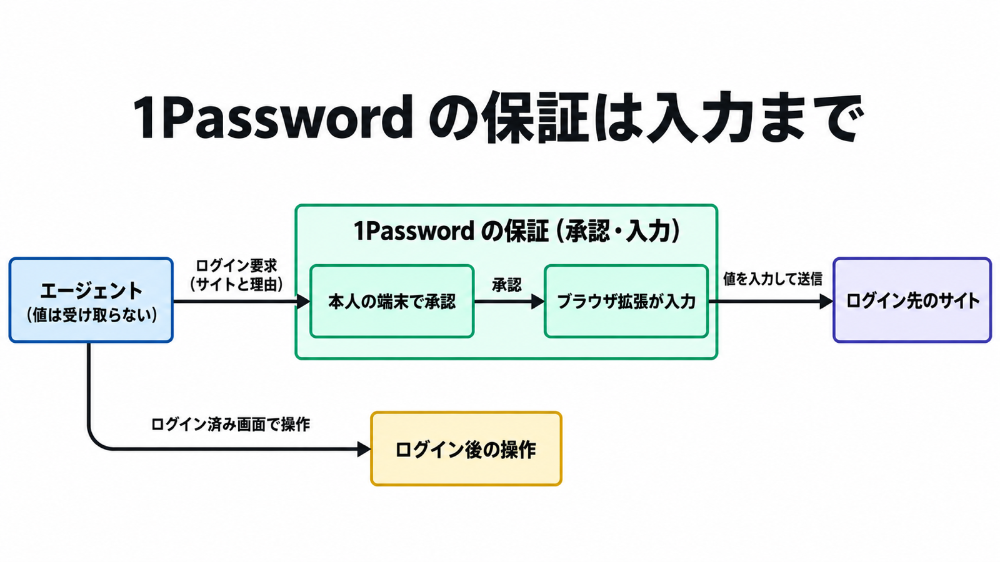

# ダイジェスト: 1Password for Agentsとは何か、個人向けAIエージェントのサインインを仲介する仕組みと注意点

元記事: [1-password-for-agents_20261024.md](../../../../../articles/1-password-for-agents_20261024.md)

## ひとことで言うと

1Password for Agents は、個人向け AI エージェントのログインで、パスワードをエージェントとモデルに渡さずにフォームへ入れる仕組みである。保証は入力までで、ログイン後の操作は含まない。

## 核心ポイント

- 本人が自分の端末で、保存したログイン情報の使用を承認すると、1Password のブラウザ拡張がフォームへ値を入れる。公式の説明では、エージェントとモデルは値を受け取らない。
- 承認を求められる頻度は、連携によって変わり得る。連携先（1Password とつなぐエージェント製品）向けのガイドでは、1 回の承認が 30 日残り、その間は本人が不在でも同じログインを入力し直せる。
- ログイン後にエージェントがアカウント内で何をするかは、1Password の保証の外である。入力中はページ上に値があり、それをモデルに読ませないのは連携先の義務である。
- 発表日（2026-10-22）に順次提供とされた相手は、個人向けエージェントの Muse（Meta）と Grok Bot（SpaceXSI）だけである。Claude Duet（Anthropic）などほかは近日提供である。
- コーディングエージェントや無人の定期実行に API キーを渡す用途は別物である。1Password の既存機能（Environments、`op run`、Service Account など）で考える。

## メンタルモデル

図の枠が 1Password の保証する範囲で、ログイン後の操作は枠の外にある。

## 具体例

| 経路 | 秘密の行き先 | 人の承認 |
| --- | --- | --- |
| for Agents | ブラウザのフォーム。相手のコードやモデルには返さない | 初回の承認。ガイドでは 30 日残る |
| Environments と `op run` | ローカルのファイルやプロセスの環境変数 | デスクトップアプリでの認可 |
| Service Account と SDK | 呼び出し側のプロセスに値が返る | トークンを渡せば、その権限内は無人で読める |

## 適用と判断

向く場面:

- 対応済みのエージェントに個人の Web ログインを任せるとき。パスワードをチャットに貼る代わりになる。

確認すること:

- 自分のアカウントが、ガイドの対象である米国の 1password.com の Individual か Families か（日本のアカウントが含まれるかは未確認）。
- 使いたい相手が提供済みかを、その相手の連携ページで確かめたか。
- 渡すログインが、本人の Personal か Private のボルト（保存データの入れ物）にあるか（共有ボルトはガイドの範囲外）。
- 使うブラウザが Chromium 系か。
- ログイン後にそのアカウントで何をされ得るかを、承認の前にタスクとサイトで判断したか。

## 限界・注意点

- ガイドでは、接続（本人が 1Password を相手製品につなぐこと）の取り消しは、相手製品の側から接続全体を切る形だけである。1Password アプリ内やログイン単位の取り消しは、ローンチ時点で無い。
- ローンチ時点では、入力を呼び出せる鍵（短命の access token と、拡張の呼び出しに要る integration key）は、エージェントが動かすブラウザ上に置かれる。
- 同じ接続の複数エージェントは 1Password から区別されず、タスク間の分離は相手製品の実装次第である。
- 承認リンク（本人が 1Password アプリで開く承認依頼）に出る目的や理由は、相手製品が書いた主張である。その内容はローンチ時点では符号化しただけで読め、エンドツーエンドでは暗号化されていない。
- 未確認: Muse と Grok Bot が、ガイドの 30 日の承認と、相手製品側からの切断をそのまま実装しているか。

## 参考

- 元記事: [1-password-for-agents_20261024.md](../../../../../articles/1-password-for-agents_20261024.md)
- 1Password. [Introducing 1Password for Agents](https://1password.com/blog/1password-for-ai-agents). 2026-10-22.
- [Build with 1Password Agentic Autofill（Partner preview）](https://www.1password.dev/agentic-autofill/partners.md)
- [Partner FAQ](https://www.1password.dev/agentic-autofill/partners/faq.md)
- [製品ページ](https://1password.com/personal-ai-agent-integrations)
