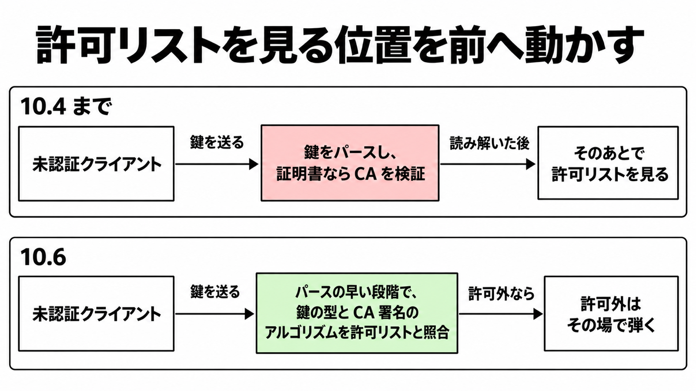

# ダイジェスト: Claudeで「晒す必要のないコード」を減らす攻撃対象領域削減の初期研究

元記事: [anthropic-attack-surface-reducti_20261024.md](../../../../../articles/anthropic-attack-surface-reducti_20261024.md)

## ひとことで言うと

欠陥を一つずつ直す代わりに、外部から届く必要のないコードを認証や設定の関門の後ろへ動かす、Anthropic の初期研究。OpenSSH では修正として取り込まれたが、件数や割合はまだ研究投稿の自己申告である。

## 核心ポイント

- 攻撃面（攻撃対象領域。外部の入力が届いて実行されうるコードや設定の範囲）を狭めると、未知の欠陥も含めて到達しにくくなる。手段は、ゲート（認証や明示的な設定など、そのコードへ進む関門）の後ろへ動かすこと。
- 25 の OSS を対象に、次の三つの問いを Claude に 1 つずつ別々の実行で調べさせる。既定構成で届くが意図した機能は使わないコード、認証やプロトコルの状態を確かめる前に走る複雑なコード、同時に有効にすると制御が黙って弱まる設定である。
- OpenSSH 10.4 では、既定で無効な署名方式 ML-DSA-44 の処理約 4,500 行（投稿によれば既定の sshd の認証前コードの約 16%）が、未認証のクライアントから到達できた。許可リスト（受け付ける鍵の型やアルゴリズムの設定）の照合が、鍵のパース（届いた鍵データを読み解く処理）の後ろにあったためである。
- 493 件は、25 プロジェクトで三つの問いのどれかに当たった到達の問題の件数であり、脆弱性の件数ではない。この件数と約 16% は研究投稿の自己申告で、対象の名簿、偽陽性率、使ったモデル名は非公開である。
- 手法をまとめた Claude skill は、OSS Scanner（メンテナが申し込む形の Anthropic の脆弱性発見サービス）へ統合中である。公開リポジトリには無く、登録プロジェクトでオンにすることは今はできない。

## メンタルモデル

10.4 までは、届いた鍵を読み解き、証明書なら CA（証明書を発行する認証局）の署名も検証してから許可リストを見ていた。10.5 で鍵タイプの照合をパースより前へ移し、10.6 のパース中の照合で、投稿が書いた隙間（名乗ったアルゴリズム名と鍵の型のずれ、CA 署名を設定より前に検証すること）を閉じた。リリースノートは、パース全体を許可後に限るとは書いていない。

## 具体例

三つ目の問いの例である。逆引き DNS をオフにするとホスト名が得られず、ホスト名による拒否ルールを IP の文字列と比べることになって、拒否が黙って発火しなくなる。研究投稿は、無関係な 4 プロジェクトで同じ型が繰り返されたとしている。

## 適用と判断

向く場面:

- 認証前に走るパーサや、既定で無効な機能を抱えるサービスをレビューするとき。
- 自社のコードや依存 OSS で、個別の脆弱性対応とは別に攻撃面を棚卸ししたいとき。

確認すること:

- 投稿と同じく、発見を動的トレース（実行時に実際に通るコードの記録）で確かめているか。
- 既定構成の挙動を変えないゲートは、プロジェクトのテストとブラックボックスの回帰テストの結果が、変更前と同一であることで確かめているか。
- 493 や約 16% を、自組織の期待値に使っていないか。

## 限界・注意点

- 到達を難しくするだけで、未知の脆弱性は残る。個別の脆弱性対応をやめる理由にはならない。
- 投稿の「およそ 5 分の 1」は認証前コードの約 16% を指し、行を削除した割合ではない。
- OpenSSH 10.5 と 10.6 のリリースノートの前文は、AI 由来の報告の多くは現実的な脅威モデルでは影響が無いと書く。今回はパッチ付きで取り込まれた例であり、AI 報告一般の精度には延長できない。
- 約 16% の分母（どのコードを認証前と数えたか）と、493 件のうち OpenSSH 以外で取り込まれた数は非公開である。

## 参考

- 元記事: [anthropic-attack-surface-reducti_20261024.md](../../../../../articles/anthropic-attack-surface-reducti_20261024.md)
- Anthropic. [Using Claude to reduce the attack surface of code](https://www.anthropic.com/research/attack-surface-reduction). 2026-10-20.
- [OpenSSH Release Notes](https://www.openssh.org/releasenotes.html)（10.4、10.5、10.6）。
- Anthropic. [An opt-in vulnerability-finding service for open-source software](https://www.anthropic.com/research/launching-opt-in-vuln-finding-service-for-open-source). 2026-10-08.
- [anthropics/oss-scanner](https://github.com/anthropics/oss-scanner)
