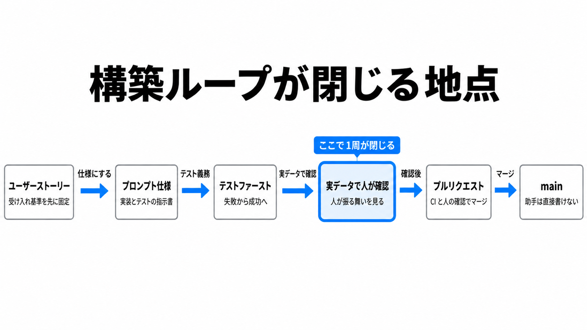

# ダイジェスト: コードを人が書かない開発で何が希少になるか、AI支援アジャイルの経験報告を読む

元記事: [arxiv-abs-2610-30916-p8_20261024.md](../../../../../articles/arxiv-abs-2610-30916-p8_20261024.md)

## ひとことで言うと

AI 助手にコードを書かせ、採点アプリを作った論文の経験報告。反復を縛ったのはコードを書くことではなく、結果が正しく必要を満たすかを知ることだった。何を信じいつ止めるかを人が決める工学的判断も、別の不足として残った。

## 核心ポイント

- 評価（結果が正しく、必要を満たすかを知ること）が足りなかった原因は費用ではなく、検査を起動しない、検査が本物の環境を踏まない、という怠りだった。この事例で評価の費用はほとんど無かった。
- 要求には事前に書けるもの (仕様とテストで固定) と、使って初めて分かるものがある。後者の例は3日目の成績面談用レポートで、テストを通ったが必要 (読めるフィードバック) を外した。
- 論文の付録が挙げた欠陥 (全欠陥ではない) の最初の検出は、単体テストと UI スモークが0件、実環境 (ブラウザ、実行時のモデル API、配備) 7件、動くシステムを見た人4件だった。
- 提案、編集、コミットを1回でまたぐ助手では、好みのゲート (道具が強制しない習慣) は迂回され、人の監視は誰かが強制する規律になる。助手が main に書けないフックを入れたあと、基準日 (2026-07-09) までのコード変更27件はすべてプルリクエスト経由になった。
- 元記事の筆者の読みでは、見積は実装と別に、機械で落とす合否、実物を見る人の地点、セッションをまたぐ証拠 (引き渡しメモや判断記録)、工学的判断、初回の配備に分ける。「評価」一語にすると、診断、配備、構造の維持が隠れるが、分けた効果は未測定である。

## メンタルモデル

1周は、受け入れ基準を先に固定したユーザーストーリーから、プロンプト仕様 (助手に渡す実装とテストの指示書) にし、受け入れ条件をテスト義務に書いてテストを失敗から成功へ進め、実データでの確認とプルリクエストまで進む。閉じるのは人が実データで確認した地点である。マージ条件は CI とこの確認で、行単位の閲読ではない。

## 具体例

実装は、設問 ID が試験をまたいで一意だという前提に立っていた。前提は記録されず後の要求で崩れ、一方の試験の編集が他方に現れた。約555の通過済みテストと自動 UI ハーネスを通り、人が実データで見つけた。

## 適用と判断

向く場面:

- エージェントに実装を任せる開発で、見積や1サイクルの完了定義を見直すとき。
- 行単位のコードレビューをマージ条件から外すかを決めるとき。

確認すること:

- 事前に書ける要求と非交渉条件 (どの要求より優先して守る条件) は、散文でなくテストの断言にする。
- アーキテクチャの上限 (例: UI がインフラに直接依存する箇所の数) は、ラチェット (改善した水準へ戻れなくする仕組み) にする。
- モックの外 (ブラウザ、実行時のモデル API、配備、実データ) と使って初めて分かる必要には、実物を見る人の地点を毎周に置く。
- レビュー完了は「人が読んだか」でなく、変更ごとの仕様とテスト、ラチェット、助手が main に書けない硬いゲート、で数える。
- 前提は判断記録に再訪条件つきで残す。

## 限界・注意点

- 開発者1人が開発者、利用者、領域の専門家を兼ねた自己報告で、数値は記述統計である。アプリのソースと試験データは非公開で、成果物パッケージにも入っておらず、独立した再現はできない。
- 開始から3営業日の時点はストーリー41、テスト415である。テスト804と、テストを除くコード約9,000行は、3日目の成績面談用レポートより後で、学生向けフィードバック版を足す直前の基準日 2026-07-09 の数字であり、大学でのパイロット運用はその後である。
- 基準日前のプルリクエスト61件はオープンからマージまで中央値約2.8分で、マージは人が読み終えた記録にならない。
- 評価者が別の人で待ちが反復より長いなら、律速は価格より、評価者が生成に追いつく速さになる、と論文の著者は予測するが測定ではなく、評価の待ち時間は記録されておらず時間に換算できない。評価に別の人や専門性が要る現場では、反復の利得が縮むという予測も未測定である。
- 論文の著者は ICSE 2027 の実務トラック (SEIP) の経験報告と位置づけるが、採録は 2026-10-24 時点で確認できない。

## 参考

- 元記事: [arxiv-abs-2610-30916-p8_20261024.md](../../../../../articles/arxiv-abs-2610-30916-p8_20261024.md)
- Weber, Zimmermann, Franceschetti. When Code Gets Cheap, Evaluation Gets Scarce: An Experience Report on AI-Assisted Agile Software Engineering. arXiv:2610.30916v1, 2026-10-22. [概要](https://arxiv.org/abs/2610.30916)
- [成果物パッケージ](https://doi.org/10.5281/zenodo.23337589). Zenodo, 2026-10-22
