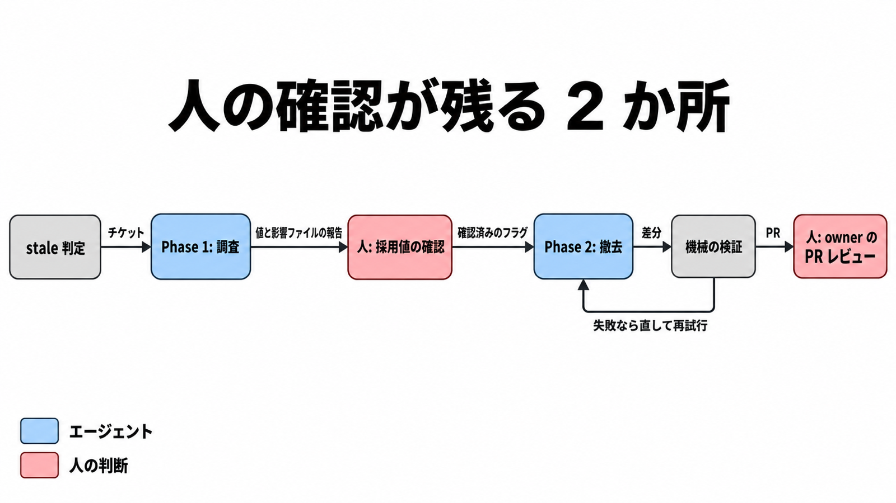

# ダイジェスト: DoorDashは機能フラグの撤去をエージェントに任せるとき、人の確認をどこに残したか

元記事: [doordash-arxiv-abs-2610-31351-p10_20261024.md](../../../../../articles/doordash-arxiv-abs-2610-31351-p10_20261024.md)

## ひとことで言うと

DoorDash は、使い終えた機能フラグの撤去を、チケットから PR までエージェントに運ばせた。人の確認は、消したあと固定する値の確認と、PR のレビューの 2 か所に残した。

## 核心ポイント

- stale は、機能フラグ（実行時の設定で機能を切り替える仕組み）のうち、90 日間設定が変更されず、コードから参照が残り、archived や retired といった終了状態ではなく、撤去しない一覧（exclusion list）の対象でもないものを指す。日次ジョブが stale を拾い、チケットを自動で作る。
- 採用値（フラグを消したあとコードに固定する値）は、コード上の既定値ではなく、本番の実験基盤が今返す値から決める。一部にしか公開していないフラグや、放棄されて公開割合が 0% の実験（公開済みとみなさず、公開前の値をコードに固定して消す）も、人が値を確認する段で扱う。
- エージェントは、ビルド、テスト、静的解析がローカルで通るまで PR を作らない。変更行カバレッジ 95% はモデルの自己申告ではなく計測で見て、自己申告が外れると 95% 未満を CI が落とす（CI の初回失敗 6 件はすべてカバレッジ不足）。
- エンジニアが受け入れた PR は 50 件中 90%（45 件）だが、軽い修正（多くはエージェントの再実行）のあとの 14 件を含む。初回でそのまま受け入れたのは 62%（31 件）。
- 失敗 5 件（エンジニアが本格的に手を入れたもの）の共通点は、フラグの型やファイル数ではなく、インターフェースをまたいで引数を通す深い呼び出しの鎖だった。その鎖の 1〜2 か所に、使われなくなったコードが残った。

## メンタルモデル

調査の報告は、人の採用値確認より前にある。確認のあと、撤去と機械の検証を失敗のあいだだけやり直し、通ったらフラグの owner（PR を割り当てられる担当者）のレビューに渡す。

## 具体例

論文の複雑度別の結果（複雑度は著者が事後に分類）。

| 複雑度 | 件数 | 初回で受け入れ | 修正を含めて受け入れ |
|---|---|---|---|
| simple（boolean 1 つ、1〜2 ファイル） | 6 | 6 | 6 |
| medium（複数の使用箇所、3〜5 ファイル） | 18 | 14 | 17 |
| complex（入れ子の条件、ファイル間の依存など） | 26 | 11 | 22 |

## 適用と判断

向く場面:

- リリース後に残ったフラグ分岐の撤去を、エージェントの作業範囲に入れるか決めるとき。

確認すること:

- 残してよい分岐（kill switch や長期の実験）と採用値を書く欄が、機能の完了チケットにあるか（元記事の提案）。
- 渡す前に、本番の値とコード上の既定値の一致を人が見ているか（stale の条件に「全員に公開済み」は無い）。
- テストの通過とは別に、参照の消し残しを見る検証の段があるか。
- 成功率を、初回、修正込み、本番マージの割合に分けて言っているか。

## 限界・注意点

- 評価は、依存性注入で配る関数越しにフラグを読み、構文木の照合では参照を追えない 1 社の Kotlin 50 件に限る。値が JSON の型のフラグを含まず、各フラグの結果は 1 回の実行で、ばらつきは測っていない。
- 論文の「バグも回帰も無かった」は 50 本の PR の観察であり、マージ後の観察期間や本番の事故率は無い。公式ブログは初回の 31 件をマージしたと書くが、修正後の 14 件が本番にマージされたかは書いていない。
- 論文が比べる手作業の 1 件 1〜2 時間は社内の経験で、実測ではない。1 件平均 $4.79 は LLM API の費用で、レビューの時間を含まない。
- フラグの存在を前提にした変数名が撤去後に残る差分は、エージェントの手順にも検証にも入っていない。
- 撤去しない一覧の件数・基準・更新者と、kill switch の扱いは不明。評価の分母に、一覧で残したフラグや確認で止めたフラグは入らない。

## 参考

- 元記事: [doordash-arxiv-abs-2610-31351-p10_20261024.md](../../../../../articles/doordash-arxiv-abs-2610-31351-p10_20261024.md)
- Chandratre, A. and Datar, J. [Automating Feature Flag Cleanup at Scale with Multi-Agent LLM Systems: An Industrial Experience at DoorDash](https://arxiv.org/html/2610.31351v1). arXiv:2610.31351v1, 2026-10-22.
- DoorDash. [Automating feature flag cleanup at scale with a multi-agent LLM system](https://careersatdoordash.com/blog/automating-feature-flag-cleanup-at-scale-with-a-multi-agent-llm-system/). 2026-08-24.
