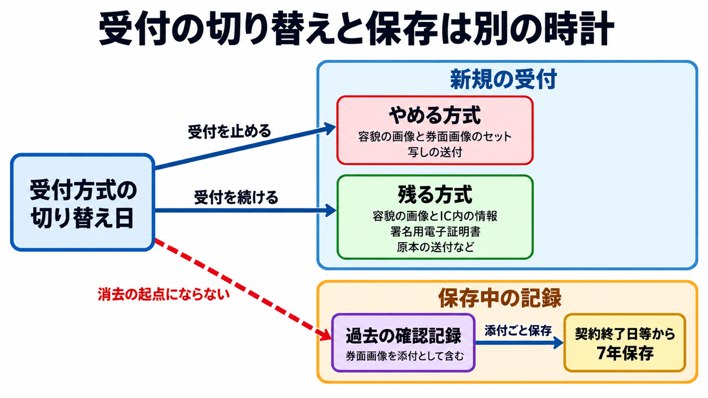

# ダイジェスト: オンライン本人確認が券面画像からICへ移るとき、過去に預かった画像をいつまで残すか

元記事: [ic-nikkei-p6_20261024.md](../../../../../articles/ic-nikkei-p6_20261024.md)

## ひとことで言うと

2027年4月1日、非対面の本人確認で、顔と券面の画像をセットで送らせる方式などが削られる。受付を変えた日は過去の画像を消してよい日ではなく、確認記録の添付として契約終了日等から7年残す。

## 核心ポイント

- 根拠は犯罪収益移転防止法（銀行などに顧客の本人確認と、その記録の保存を義務づける法律）の施行規則の改正（令和7年省令第3号）である。削られるのは顔と券面を同時に送る方式と一般の写し送付で、給与振込口座など一部の写しは残る。
- 容貌と IC 内の情報（写真を含む）や署名用電子証明書（マイナンバーカードの電子署名用証明書）は残り、顔の画像も届き続ける。原本または IC 情報は転送不要郵便（転送せず届かなければ戻る郵便）と組んで残り、非居住者等の券面画像や書類送付も同じ組み合わせで残る。
- 確認記録（本人確認の内容を事業者が作って保存する記録）は契約終了日等から7年残し、添付の画像や IC 情報もその期間残し、書いた内容は消去できない。起算は、預金口座など契約終了日で終わる取引はその日、それ以外は取引の日が基本で、どちらの場合も、本人確認を省いた後日の取引が取引の日で終わりその日が基本の起算日より後ならその日へずれる。
- 個人情報保護法の消去は努力義務で、保存期間中は利用の必要がなくなったとは言いにくい、というのが元記事の読みである。方式を変えた日に消せ、または消してよいと書いた警察庁・金融庁・個人情報保護委員会の文書は、2026年10月24日時点の確認範囲に無かった。
- 確認した範囲には、同じ日に委託契約を改めよという明文は無かった。それでも本人確認の委託先へ券面画像を提出させる条項が残っていれば、新しい受付が IC になっても画像は作られ続ける。

## メンタルモデル

切り替え日から保存中の記録へ向かう破線が、「消去の起点にならない」ことを示す。図の「写しの送付」は一般の方式だけを指す。

## 具体例

金融庁は2026年10月9日の注意喚起で、施行を待たずに画像送信の受付をやめるよう求めた。次の 2 社はその前倒しにあたる。

| 項目 | 三井住友銀行の個人口座 | PayPay |
|---|---|---|
| 券面画像の送信 | オンライン受付を2026年10月23日に停止 | 撮影申請を11月上旬までに廃止予定。10月24日時点の手順には撮影が残る |
| 運転免許証の IC | オンラインの手順に記載なし。店頭で原本を提示する | IC を読んだあと顔写真を撮る |
| 署名用電子証明書 | オンラインの方法として挙げる | 使える。IC 読取の対象外機種は書類撮影へ進む |

## 適用と判断

向く場面:

- オンライン本人確認の受付方式を変える立場で、何を止めて何を残すかを決めるとき。
- 過去に預かった券面画像の保存・削除の方針を見直すとき。

確認すること:

- 運転免許証の IC の扱いは銀行の個人口座とコード決済（具体例の PayPay）でも揃っていないので、他社の手順を写さず、やめる方式と法令上残る方式を一覧にしているか。
- 過去の確認記録を方式変更日に消さず、起算日が延びる取引を台帳に残しているか。
- 施行前に発送され施行後に届いた写しを、届いただけでは確認にせず、残る方式でやり直しているか（同省令の警察庁 Q&A No.4）。
- 委託先へ券面画像を出させる条項の有無を、金融庁が求める委託先の点検に載せているか。

## 限界・注意点

- 報道の見出しにある「3メガバンクが顔写真の本人確認を廃止」は公式発表より広い。停止日を公式に確認できるのは三井住友銀行だけで、みずほ銀行の2026年10月19日と三菱UFJ銀行の2026年5月は報道ベースの日付である。
- 在留カード裏面の撮影画像は IC 情報ではない。IC で現在の住居を確認できなければ、住居を別に確認する必要がある（同 Q&A No.9）。
- 個人情報保護委員会のガイドラインには、法令で保存期間等が定められている場合は除く、という趣旨の注記があると元記事は読んでいる。運用前に本文の文言確認が要る。
- 非居住者等の対象者と対象取引、写しが残る一部取引の範囲は特定していない。三井住友銀行の法人口座やカードローンが同じ停止に含まれるかも確認できていない。

## 参考

- 元記事: [ic-nikkei-p6_20261024.md](../../../../../articles/ic-nikkei-p6_20261024.md)
- [令和7年省令第3号に関する Q&A（警察庁）](https://www.npa.go.jp/sosikihanzai/jafic/hourei/data/25062402qa.pdf)
- [犯罪収益移転防止法の概要 2026年8月7日版（警察庁）](https://www.npa.go.jp/sosikihanzai/jafic/hourei/data/hougaiyou20260807.pdf)
- [金融庁 2026年10月9日 注意喚起](https://www.fsa.go.jp/news/r8/sonota/20261009/20261009.html)
- [PayPay 2026年10月23日 発表](https://about.paypay.ne.jp/pr/20261023/01/)
