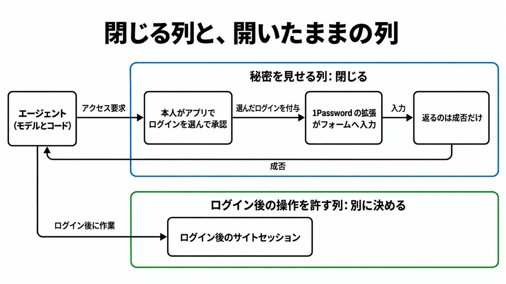

# ダイジェスト: 1Password for Agentsが閉じる秘密の経路と、ログイン後に残る権限

元記事: [password-itmedia-co-jp-aiplus-p3_20261024.md](../../../../../articles/password-itmedia-co-jp-aiplus-p3_20261024.md)

## ひとことで言うと

1Password for Agents は、本人が選んだログインを 1Password が入力し、エージェントには成否だけを返す個人向け連携。閉じるのは値がモデルとコードへ返る経路で、ログイン後の操作は別に決める。

## 核心ポイント

- 本人が自分の 1Password アプリでログイン (保管庫に保存したユーザー名やパスワードの項目) を選んで承認すると、ブラウザ拡張がタブのフォームへ値を入れ、エージェントのコードには入力の成否だけが返る。
- 報道 (ITmedia AI+) の見出しは「アクセス権限を付与」だが、付与されるのは選んだログインをフォームへ入力する資格である。宛先サービスがエージェントに狭い操作権限を発行する話ではない。
- パートナー (この連携を自社のエージェント製品に組み込む提供会社) 向けの文書では、承認はログインごとである。承認後は grant (承認したログインを入力に使ってよいという許可) の間、再プロンプトなしで入力でき、その期間は提供開始時点で 30 日である。
- 値は入力から送信までページ上にある。その間にモデルが DOM やスクリーンショットで値を読まないよう止めるのは、パートナーの側である。
- 切断 (エージェント製品の側から 1Password との接続を解除する操作) が止めるのは以後の入力で、すでにできたサイトのセッションを切る記述は確認できない。

## メンタルモデル

権限表 = エージェントを使う側が、エージェントごとに何を渡し何を許すかを列に分けた設計表。元記事が持ち込む考え方で、1Password の機能ではない。for Agents が閉じるのは図の上の枠だけで、下の枠はサイトのセッションとエージェント製品の設定で決める。

## 具体例

入力結果の `fill_submitted` は「値を入力して送信し、拡張の入力処理が戻る前にページ上の値を消した」という意味で、サイトがログインを受け付けたという意味ではない。

## 適用と判断

向く場面:

- 1Password.com の Individual / Family にある個人のログインを、対応エージェントのフォーム入力だけに使わせたいとき。

確認すること:

- 権限表で「秘密を見せる列」と「ログイン後の操作を許す列」を分け、後者の範囲を別に決めたか。
- 使うエージェントが、公式に数日以内のロールアウトとされた Meta Muse か SpaceXSI Grok Bot か、coming soon のままかを製品ページで確かめたか。
- 承認がログインごと 30 日か、エージェントのセッションごとか (2026 年 7 月からある Claude 向けの別連携 1Password for Claude は後者) を、その製品の説明で確かめたか。
- 渡したいのが実行環境の変数や企業の一時アクセスなら、Environments (実行環境の変数を管理する機能) や Privileged Access (一時付与と自動はく奪を持つ企業向け製品) を検討したか。

## 限界・注意点

- パートナー向け文書は「Partner preview only」の開発者向けプレビューである。一般提供日、安定版拡張の最低バージョン、可用性 SLA は未確認。
- パートナー向け文書が今対応とする範囲は、米国の 1password.com の Individual / Family、本人だけが使う保管庫、Chromium 系ブラウザ、ユーザー名・パスワード・ワンタイムパスワードである。
- 切断の単位は接続全体で、単一のログインだけを取り消す操作は未提供である。
- エージェント製品が接続で持つ access token と integration key (ブラウザが生成する連携ごとの鍵) が有効なら、本人がいなくても grant の間は入力できる。複数のエージェントで共有すると、1Password は区別できない。
- 個人向けに入力を後から一覧する監査画面は確認できない。Events API や監査ログは Business 向けの機能である。

## 参考

- 元記事: [password-itmedia-co-jp-aiplus-p3_20261024.md](../../../../../articles/password-itmedia-co-jp-aiplus-p3_20261024.md)
- ITmedia AI+「[1Password、エージェントにパスワードを渡さずアクセス権限を付与するサービスを発表](https://www.itmedia.co.jp/aiplus/article/2610/23/2000002545/)」(2026-10-23)
- [1Password ブログ (John Torrey、2026-10-22)](https://1password.com/blog/1password-for-ai-agents)
- [1Password 製品ページ (個人向けエージェント連携)](https://1password.com/personal-ai-agent-integrations)
- [Agentic Autofill パートナー概要](https://www.1password.dev/agentic-autofill/partners.md) / [セキュリティ](https://www.1password.dev/agentic-autofill/partners/security.md)
