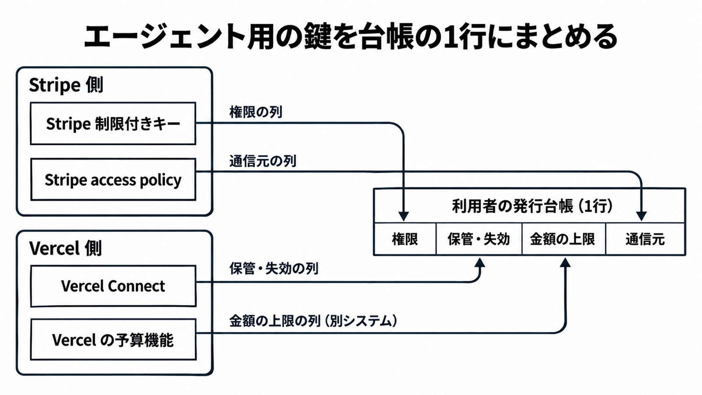

# ダイジェスト: Vercelの静的認証情報廃止論と、Stripe鍵の代行発行で短命になるもの・ならないもの

元記事: [vercel-vercel-death-to-long-p2_20261024.md](../../../../../articles/vercel-vercel-death-to-long-p2_20261024.md)

## ひとことで言うと

Vercel の新しい Stripe 鍵（Managed API Key）は、権限を絞った鍵を Vercel が作って保管する仕組みである。期限で止まる短命トークンとして扱う根拠は、公式資料に無い。

## 核心ポイント

- 10月22日の Vercel の論考は、期限なしで使い回す API キーを、OIDC（発行者が署名した JWT で身元を示す仕組み）の短命トークンへ置き換える方針を示した。Marketplace（Vercel の連携ベンダー一覧）では、2026年11月30日までに OIDC に対応せず長寿命の秘密で認証する掲載に “Not secure” を付けるとも書いた。
- 10月23日の changelog の Managed API Key は、Vercel Connect（実行時に外部サービスのトークンを取る Vercel の機能）の Stripe 向け接続方法である。エージェントまたはタスクごとに制限付きキー（resource ごとに None / Read / Write を選べる鍵）を Vercel が作って保管し、口座の全権限を持つ secret key を渡さずに済む。
- 鍵の既定の有効期限と、呼び出しごとの破棄は公式資料に書かれていない。コネクタ設定からローテーションすると、旧鍵は最大24時間有効である。
- Stripe の支払いを金額で拒否する仕組みは、公式資料に無い。Vercel の AI Gateway の予算（Vercel 経由のモデル呼び出しの上限）と Spend Management の `--pause`（予算到達で本番デプロイを止める）は、Stripe の支払いを止めない。

## メンタルモデル

権限と通信元（IP や国で絞る access policy）は Stripe、保管とコネクタからのローテーションは Vercel と、制御が別々の場所にある。そこで、利用者が自分で持つ鍵の発行台帳（エージェントに渡す鍵を1行ずつ記録する表）の1行に、列として並べる。

## 具体例

changelog の例では、日次売上を集計するエージェントには charges の読み取りだけ、オンボーディングのエージェントには customers の書き込みだけを許す鍵を分ける。実行時は Connect の関数 `getToken` で鍵を受け取り、Stripe の SDK に渡す。

## 適用と判断

向く場面:

- エージェントに Stripe を操作させるが、口座の secret key は渡したくないとき。
- 鍵のローテーションを再デプロイなしで回したいとき。

確認すること:

- 台帳の失効（寿命）の列に「既定失効の記載なし。ローテーション時は旧鍵が最大24時間有効」と書いているか。
- 金額の上限を鍵とは別の列に書き、Stripe の支払いは金額では止まらない前提にしているか。
- 身元トークンで Stripe を呼びたいなら、Stripe の WIF（AWS か Google Cloud の身元を1時間の token に交換する仕組み。private preview）を検討したか。
- Marketplace の Stripe 連携（`STRIPE_SECRET_KEY` を環境変数に置く）や、Connect に自分の静的キーを登録する接続を、長寿命の鍵として台帳に載せているか。
- Stripe が Vercel の OIDC を直接受けるという記述は無いのに、Marketplace の期限（2026年11月30日）を Stripe 鍵の短命化が完了する日として扱っていないか。

## 限界・注意点

- 短命の OIDC にも窓がある。開発環境（development）のトークンは12時間有効で、`vercel env pull` でローカルの `.env.local` に書き出される。
- GitHub Actions から Vercel へのデプロイ認証には、まだ OIDC が無く、静的な `VERCEL_TOKEN` を使う。
- 未確認: `getToken` の戻り値が呼び出しごとに作られるか、その寿命、Connect の新料金の発効状況、SLA と保管地域。

## 参考

- 元記事: [vercel-vercel-death-to-long-p2_20261024.md](../../../../../articles/vercel-vercel-death-to-long-p2_20261024.md)
- Vercel. [Death to long-lived static credentials](https://vercel.com/blog/death-to-long-lived-static-credentials). 2026-10-22.
- Vercel. [Vercel Connect adds managed Stripe API keys](https://vercel.com/changelog/vercel-connect-adds-managed-stripe-api-keys). 2026-10-23.
- Stripe. [Restricted API keys](https://docs.stripe.com/keys/restricted-api-keys).
- Stripe. [Workload Identity Federation](https://docs.stripe.com/workload-identity-federation).
