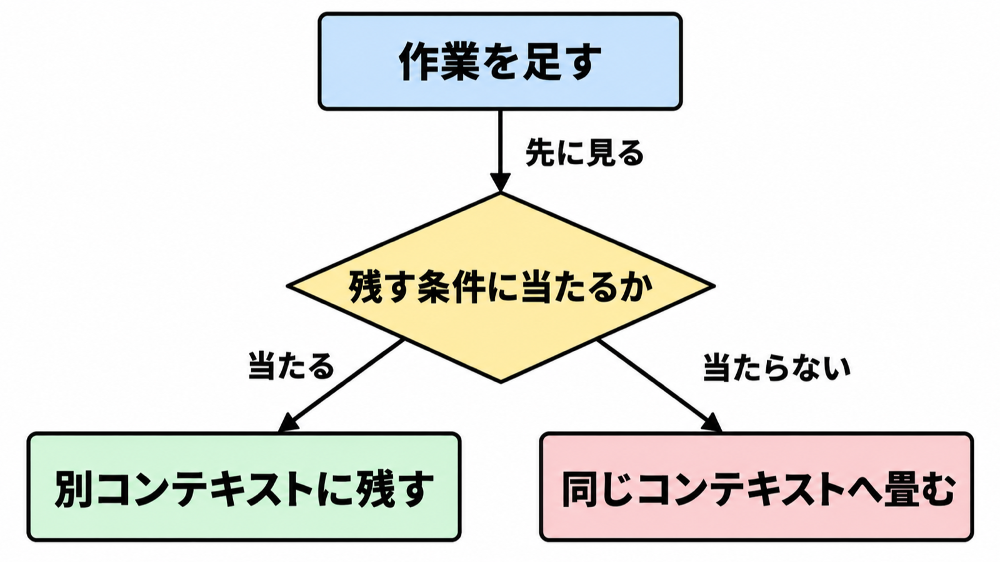

# ダイジェスト: サブエージェントをメインループへ畳む条件

元記事: [anthropic-claude-resources-p1_20261025.md](../../../../../articles/anthropic-claude-resources-p1_20261025.md)

## ひとことで言うと

サブエージェント（別の会話窓を持つ担当）を 1 つのモデルのループへ戻すかは、人数では切らない。残す条件に当たらないものだけを戻し、合否が入れ替わったタスクがあれば採用しない。

## 核心ポイント

- **畳む**とは、依頼を振り分けるルーター、手順を先に書く計画係、ドメイン別の担当というサブエージェント（その担当の会話にある発話とツール結果（コンテキスト）、ツール、指示を持ち、呼び出し元から呼ばれる）を、1 つのモデルのループへ戻し、専門の手順をスキル（手順と判断の文書で、本文は必要時に読む）へ移すことである。モデルの外の層がツールを実行して生の結果を返すので、そのターンで計画を変えられる。
- 計画を前の結果で変えたくても先に見る残す条件は、同じ窓に情報が増えて性能が落ちると測れたとき（測れる前は同じ窓に載せる）、終わったら会話窓を捨ててよい並列、適切なツールを選べないかシステムプロンプトの指示が衝突するとき、検証を別にするとき、会話を引き取るときで、当たれば別コンテキストに残す。検証を別にするのは、合否だけを返すテスト、同じ会話での自己レビュー、呼び出し元の能力が低いとき、専用ツールを要するとき、明示のチェックポイントを置くときのどれかである。
- 「選べない」は個数ではなく、1 つのループのまま適切なツールを選べないことである。30 個から 50 個を超えて選択が落ち、原因が個数なら、残す前に tool search（必要な定義だけを後から読む仕組み）を使う（およそ 10 個未満なら先に全部載せる方がたいてい速い、と Claude の SDK の文書は書く）。
- 畳む単位は 1 担当ずつで、前後を同じ端到端の評価（依頼から最終回答までのセットで、10 例あれば開始できるが検出力の主張ではない）で比べる。最終点が同じでも、合否が入れ替わったタスクがあれば採用しない。
- 外部の状態を変える能力は、担当を分けるかどうかでは決まらない。課金と、変更を確定する処理をループから外し、そのセッションでサーバが渡した ID だけを書かせ、上限を書いたあとの状態に掛けるのであって、都度の承認はその代わりにならない。

## メンタルモデル

当たれば別コンテキストに残し、当たらなければ同じコンテキストへ載せる。

## 具体例

サポートのサンプルでは、あるサブエージェントを別の担当の側へまとめただけで、メインループへ戻していない。遅延は下がったが、注文参照のツールを持ったメインが、残っていた配送担当に配送日を聞かずに答え、通っていた手順が落ちた。この落ちは 2 回中 1 回だけで、2 回ではこのような退行を見落とす。

## 適用と判断

向く場面:

- 複数の担当を本番で動かし、次の変更を品質、費用、遅延のどれで判定するかを決めたいとき。
- 購買のように、返品が注文履歴とカートとカタログを同時に要する会話で、ドメインごとの分割を見直すとき。
- ループが外部の状態を書くとき、担当の数ではなく、書ける能力の有無を見直すとき。

確認すること:

- 残す条件に当たるか。
- 選択低下の原因が定義の個数なら、残す前に tool search を試したか。
- 1 担当ずつ畳み、最終点が同じでも合否の入れ替わりが無いか。
- 外部へ書くなら、能力を外して書いたあとの状態で上限を見ているか（都度の承認で代用しない）。

## 限界・注意点

- スキルを持つ単一が、全部入りプロンプトとサブエージェントの両方より勝つことが多い、という比較は公開実験ではない。社数、課題セット、効果量は無い。
- およそ 2 倍は 1 顧客の実行時間、90.2% は別モデル比較、80% はプロンプト削減と、ばらつき説明という二つの数字で、どれも畳んだ品質の倍率ではない。
- 単一がマルチに常に勝つ、とは読まない。密に結びついた会話では単一が有利、幅を優先する探索ではマルチが有利、という公式の比較が両立する。
- 付属の参照実装は、保守も貢献の受付もしていない。実モデル実行は 1 人、1 モデル、2 回で、測定値は解説から削除されている。
- 「Opus 4.5 以降、単一ループで扱える量が増えた」は、何の量か書いていないので判定に使わない。Opus 5.5 と Fable 5.1 で推論過程を切れない、は製品ドキュメントと未照合である。

## 参考

- 元記事: [anthropic-claude-resources-p1_20261025.md](../../../../../articles/anthropic-claude-resources-p1_20261025.md)
- Anthropic. [Building agents: When to fold subagents into your main agent loop](https://claude.com/resources/articles/building-agents-when-to-fold-subagents-into-your-main-agent-loop). 2026-10-22.
- Anthropic. [The anatomy of effective commerce agents](https://claude.com/resources/articles/the-anatomy-of-effective-commerce-agents). 2026-09-02.
- Anthropic. [When to use multi-agent systems](https://claude.com/resources/articles/building-multi-agent-systems-when-and-how-to-use-them). 2026-01-23.
- Anthropic. [How we built our multi-agent research system](https://www.anthropic.com/research/multi-agent-research-system). 2025-06-13.
