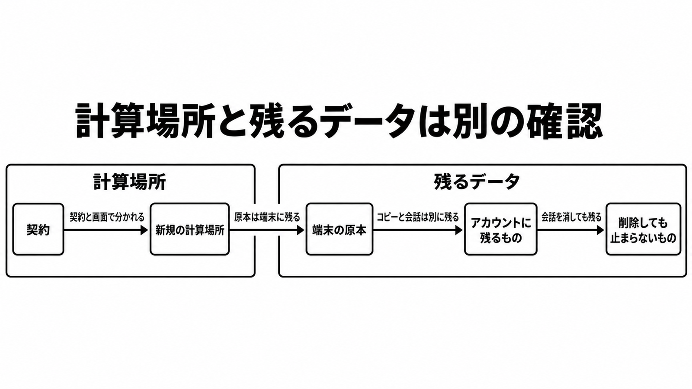

# ダイジェスト: Claude Coworkの実行場所と残るデータを契約ごとに見る

元記事: [claude-cowork-xtech-nikkei-p5_20261025.md](../../../../../articles/claude-cowork-xtech-nikkei-p5_20261025.md)

## ひとことで言うと

Cowork（複数ステップの作業を Claude に任せる機能）の新しいタスクの計算場所は、契約と画面で分かれる。端末の原本と、アカウントに残る会話やコピーは、別の確認項目にする。

## 核心ポイント

- 「クラウド型だけ」は、有料プランの Pro と Max の 2026年10月6日以降の新規タスクについて、一方の公式説明では実行場所の選択は戻せない。もう一方では、新しい Claude 体験（新しい画面のことで、チャットと Cowork を一つの会話にする統合体験とは別）の外に、切替「Run new tasks in the cloud」が残る。
- Team はクラウドが既定で所有者が切れ、Enterprise は端末が既定で所有者がクラウド実行をオンにしてグループへ付与する。HIPAA 設定（公式が HIPAA-ready と呼ぶ設定）の適用後に Cowork を再度オンにしても、実行はデスクトップアプリ上のローカルだけで、クラウドをオンにする設定はない。
- 接続フォルダ（デスクトップアプリから結んだ端末上のフォルダ）の原本は端末に残る元のファイルで、コピーはクラウドが取りに行った複製である。渡したファイルはアカウントに残る成果で、渡さない作業ファイルはクラウドセッションの終了後に残らず、会話を消しても Enterprise の統合体験で利用者が自分で開始したクラウドセッションはメンバーが削除するまで残り、定期タスク（繰り返し実行する設定）は止まらない。
- EDR（エンドポイント製品で実行の中身を見ようとする監視）は、端末側の仮想マシン（シェルと生成コードが動く Linux 環境）の中も、クラウドセッションも観察できない、と公式は書く。
- 画面の Cowork、クラウド実行、統合体験、データ保持がヘルプの既定と違えば、画面を優先する。

## メンタルモデル

左の計算場所は契約と画面で分かれ、右では原本が端末にあっても会話とコピーはアカウントに残る。

## 具体例

確認票は、計算場所、残るデータ、監視の期待の三つに分ける。残るデータは、上で分けたファイルと、利用者が開始したクラウドセッションと、定期タスクを別に書く。監視は、Compliance API（Enterprise が端末上のローカルセッションを取得する API）と監査ログで見る範囲を書く。

## 適用と判断

向く場面:

- 導入可否を「クラウド型に変わったか」の一行で書こうとしているとき。
- Team または Enterprise で、クラウド実行の組織設定を確認するとき。
- 会話の削除と、セッションや定期タスクの停止を同じ操作だと思っているとき。

確認すること:

- Pro と Max は、設定が無い画面か、先の切替が残る画面か。
- 2026年10月6日より前のタスクと、端末上の既存の定期タスクが残っているか。
- HIPAA 設定の適用後も、クラウドをオンにする設定が無いか。
- Enterprise では、統合体験の設定を変えておらず Chat と「Cloud code execution and file creation」が両方オンのときだけ 2026年11月16日に自動でオンになり、片方オフの日は通知もなくオンにならないが後から両方オンでオンになり、前提を満たせば Keep disabled を選べ、ゼロデータ保持と HIPAA-ready と CMEK では未提供である。
- ゼロデータ保持（公式が zero data retention と呼ぶ合意）の対象一覧に、Cowork と Claude Max は無い。

## 限界・注意点

- 日経コンピュータの有料本文は未読で、導入の「減る懸念」と「増える懸念」がどの制御かは断定できない。
- 処理の国やリージョン、SLA、消費者向け「Help improve our AI models」の既定は、根拠にしたヘルプには無い。
- Amazon Bedrock、Google Cloud、Microsoft Foundry 経由の、2026年10月6日以降の実行場所は未確認である。
- クラウド実行を切ったとき、進行中のセッションが止まるかは、公式ヘルプに無い。
- 接続フォルダへの変更が端末の原本へ戻るかは、ヘルプからは決まらない。

## 参考

- 元記事: [claude-cowork-xtech-nikkei-p5_20261025.md](../../../../../articles/claude-cowork-xtech-nikkei-p5_20261025.md)
- [Use Claude Cowork on web, desktop, and mobile](https://support.claude.com/en/articles/15520349-use-claude-cowork-on-web-desktop-and-mobile)
- [What to expect with Claude Cowork in the cloud](https://support.claude.com/en/articles/15811196-what-to-expect-with-claude-cowork-in-the-cloud)
- [Use Claude Cowork on Team and Enterprise plans](https://support.claude.com/en/articles/13455879-use-claude-cowork-on-team-and-enterprise-plans)
- [How long do you store my data?](https://privacy.claude.com/en/articles/10023548-how-long-do-you-store-my-data)
