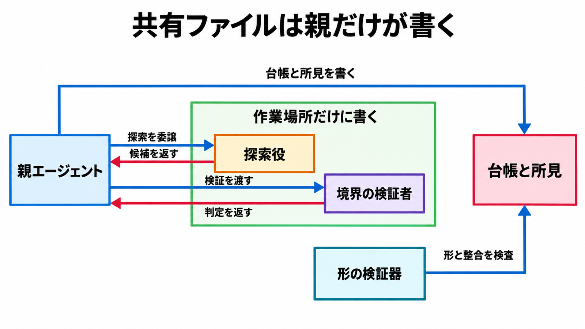

# ダイジェスト: コーディングエージェントにセキュリティ監査を任せる Cloudflare security-audit-skill

元記事: [security-audit-skill_20261025.md](../../../../../articles/security-audit-skill_20261025.md)

## ひとことで言うと

security-audit-skill は、監査手順と出力の形の検査を渡す公開スキルである。質問や限定レビューが既定で、コードベース監査・ペンテスト・網羅レビュー・報告書の明示だけが 6 相を始める。

## 核心ポイント

- スキルを読み込んだだけでは、台帳（調べた範囲の記録）・所見（判定の記録）・報告書はできない。コードベース監査、ペンテスト、網羅レビュー、報告書のいずれかを明示したときだけ 6 相（監査を区切った工程で、フル監査と呼ぶ）が始まり、それ以外は質問や限定レビューへの応答になる。
- 台帳と所見を書けるのは親だけである。探索役（割り当てられた範囲を調べ、まだ検証していない候補を返す）と、信頼境界（権限や入力の信頼度が切り替わる境目）をまたいだかを見る検証者は、自分の作業領域にだけ書く。
- 判定は 3 種類である。確定は境界をまたいだ観測と深刻度を持ち、検証待ちは未解決で深刻度を付けず、却下は理由を残して同じ主張の再報告を抑える。
- 形を検査する Node.js の検証器が成功しても、分かるのは所見と台帳の形と整合だけである。境界をまたいだかは、探索役とは別の検証者が確かめる。
- 手順は 6 相で、対象は手元の 1 リポジトリである。紹介ブログの社内の実行基盤（相の数は 7 で、候補の件数やコンテナの起動フラグを含む）は別世代で、このスキルの仕様ではない。

## メンタルモデル

探索役は候補を、検証者は判定を、親へ返す。台帳と所見を書くのは親だけで、形の検証器はその形と整合を見る。

## 具体例

README が示す依頼である。

| 依頼 | 動き |
| --- | --- |
| `security audit this codebase` | コードベース監査の明示なのでフル監査 |
| `find security vulnerabilities in ./src` | 報告書を頼まない調査なのでガイダンス |
| `do a security review, output to ~/audits/my-project` | 出力先つきの報告書依頼なのでフル監査 |

## 適用と判断

向く場面:

- 手元の 1 リポジトリを、ソースとローカルのダミー主体で監査する。
- 脆弱性の有無を質問する、または特定の指摘を追う。
- 同じリポジトリを日を分けて再実行し、前回の台帳と所見を足す。

確認すること:

- 小さい対象、再実行、最初の見取り（ひととおり見ること）には quick を使い、候補の検証と記録の最終検証は探索役とは別の 1 人にまとめる。
- 手順書どおりの冗長性が要る対象には standard を使い、候補の検証と記録の最終検証を別人にする。
- 影響や対象が大きいときは deep を使い、2 段を分け、単位にライフサイクルを含め、同じソースで覆った単位にも独立した 2 回目を付ける。
- 出力先は対象リポジトリの外か。中へ書くのは、そのディレクトリを明示し、全体がバージョン管理の無視対象だと確認できるときだけで、できなければ外部のパスで止める。
- 導入は `npx skills add` で、スキル名は `security-audit` か。`npm install security-audit-skill` は手順ではない。

## 限界・注意点

- 複数リポジトリの依存をまたぐ継続スキャンは、公開スキルの 6 相の範囲外である。
- 対象コードを動かすときは、対象とツールチェーンを読み取り専用にし、探索役・検証者と対象プロセスが書けるのは作業領域だけである。外部ネットワーク無し、許可リストだけの空環境、資源の上限を含め、これを強制できないときは実行せず検証待ちにする。
- 必要な Node.js の版はリポジトリが宣言していない。シンボリックリンクを追わない開き方と、待ちに入らず開く開き方の、どちらかが OS で使えないとき、検証器は入力を拒否する。
- 1 回のランで対象を尽くしたとはみなさない。quick、範囲を絞った実行、起動回数の上限に達した実行、未完了の報告書は部分的なパスである。
- 未確認: 「1 回のランが見つける割合は、繰り返しランの合計のおおよそ半分」という記述に、その割合を測った実験はリポジトリに無い。

## 参考

- 元記事: [security-audit-skill_20261025.md](../../../../../articles/security-audit-skill_20261025.md)
- [cloudflare/security-audit-skill](https://github.com/cloudflare/security-audit-skill/tree/c1c8a8c1471069fb0e188eeaff69b8e8db6564a8)（照合コミット `c1c8a8c`、2026-09-14）
- [SKILL.md](https://github.com/cloudflare/security-audit-skill/blob/c1c8a8c1471069fb0e188eeaff69b8e8db6564a8/skills/security-audit/SKILL.md)
- Cloudflare. [Build your own vulnerability harness](https://blog.cloudflare.com/build-your-own-vulnerability-harness)（上の社内の実行基盤を説明するブログ。公開スキルの仕様ではない）
- [Skills CLI（vercel-labs/skills）](https://github.com/vercel-labs/skills)
