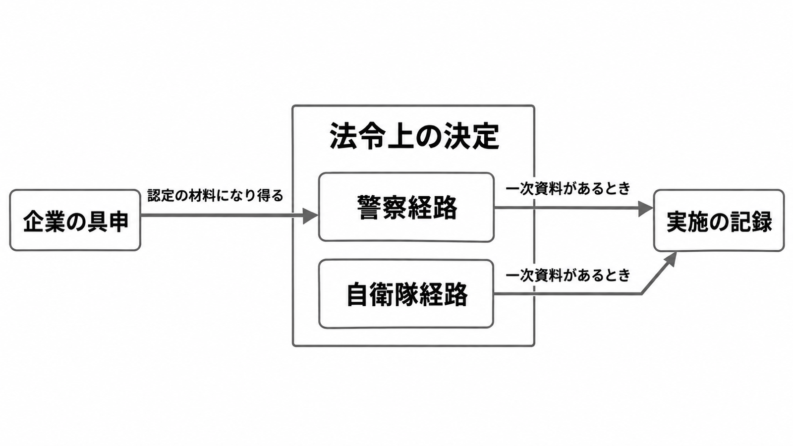

# ダイジェスト: 能動的サイバー防御のアクセス・無害化は誰が実施を決めるか

元記事: [yomiuri-co-jp-politics-20261024-p7_20261025.md](../../../../../articles/yomiuri-co-jp-politics-20261024-p7_20261025.md)

## ひとことで言うと

ここで扱う能動的サイバー防御は、アクセス・無害化措置（攻撃サーバーへ接続し、記録の確認や消去）である。2026年10月1日から実施でき、企業の具申（実施を求める申出）は、実施を決める申請ではない。

## 核心ポイント

- 実施の権限は、警察官職務執行法（警職法）第6条の2と自衛隊法第81条の3にある。強化法（重要電子計算機に対する不正な行為による被害の防止に関する法律）は根拠の整備であり、権限そのものではない。
- 警察経路の起点は、サイバー危害防止措置執行官（警察庁長官が指名する警察官）が、加害関係の通信または記録（攻撃に使われる通信もしくは電磁的記録、またはその疑い）を認め、放置すれば生命、身体または財産に重大な危害のおそれがあり、緊急の必要があることである。原則は、サイバー通信情報監理委員会（実施前に承認する機関）の承認と、警察庁長官等の指揮である。
- 自衛隊の通信防護措置（内閣総理大臣が部隊等に命ずるアクセス・無害化）は、自衛隊法が限定した重要電子計算機（強化法が被害防止の対象とする計算機を、さらに絞ったもの）に対する特定不正行為（国外の者による、回線を介した、特に高度に組織的かつ計画的な行為）に限る。特定重大支障（機能の停止または低下で、事務または事業の安定的な遂行に容易に回復できない支障が生じ、国家と国民の安全を著しく損なう事態）のおそれが大きく、自衛隊の特別の技術または情報が必要不可欠で、国家公安委員会の要請または同意があり、自衛隊が対処する特別の必要があると総理大臣が認めるときに、内閣総理大臣が命じ、部隊等は警察と共同して実施する。
- GMOインターネットの公表第4報（2026年10月24日）が示すのは、補償の発表、10月22日の警察への相談、政府への具申である。「発動第1号」は同社の位置付けで、政府が実施を決めた一次資料は同報に無い。

## メンタルモデル

具申から出る矢印の先は警察経路だけで、危害のおそれを認定する材料になり得る。中央の枠の二つの経路が、実施を決める。右の記録は、政府の一次資料があるときだけ書く。

## 具体例

お名前.comデスクトップクラウド（顧客へ Windows デスクトップを提供するサービス）への不正アクセスについて、GMOは見舞金（一律5,000円。金銭被害の有無を問わない）、代替サービス6か月無償、同社が不正取引と認めた実現損失の補償を発表した。「国内外の70を超える証券会社・FX会社等」は、攻撃者とみられる者からの連絡として書かれた数で、同社が被害を確定した件数ではない。

## 適用と判断

向く場面:

- 侵害のあと、補償、警察への相談、政府への具申を同じ記録に残しそうなとき。
- 企業の緊急要請を、無害化を実施した決定と読む報道を見るとき。
- 生命、身体、財産への危害を、特定の業種に限る話として片づけるとき。

確認すること:

- 政府が実施を認めた一次資料が無ければ、「具申済み、実施は未確認」と書く。
- 警察への相談と、無害化の実施を、別の欄にしているか。
- 補償を始める条件に、政府の反応を入れていないか。
- 自衛隊経路に乗せるなら、特定不正行為と、自衛隊法が限定する重要電子計算機に当たるかを一次資料が示しているか。
- すでに出た被害だけでは対象外にならず、放置すれば重大な危害が生じるおそれが無いときや、緊急の必要が無いときは起点を満たさない。

## 限界・注意点

- この事案で政府が危害のおそれと緊急の必要を認めたか、実施したかは、一次資料が無い。
- 日本経済新聞が伝える政府高官の発言は、会見録未確認の二次情報である。要請を受けたことと、実施を決めたことは、別である。
- 読売新聞の「実施したかを事案ごとに公表しない」は同紙の記述で、運用指針の本文には無い。
- 一部の事業者の侵害報告は、無害化の申請ではない。この事案で、その報告が実施の経路になったとは、一次資料では言えない。
- GMOの第4報は、10月21日に、お名前.comデスクトップクラウドの全プランのサーバーを停止したと書く。同報にある、不正操作、情報の公開、ランサムウェアという予告が、停止後も「放置すれば重大な危害のおそれ」を満たすと政府が見るかは、認定が未公表である。

## 参考

- 元記事: [yomiuri-co-jp-politics-20261024-p7_20261025.md](../../../../../articles/yomiuri-co-jp-politics-20261024-p7_20261025.md)
- [読売新聞「ＧＭＯの『能動的サイバー防御』緊急要請」（2026-10-24）](https://www.yomiuri.co.jp/politics/20261024-GYT1T00257/)
- [GMOインターネットグループ 第4報（2026-10-24 11:50時点）](https://group.gmo/info/alert/20261024/)
- [警察官職務執行法第6条の2](https://laws.e-gov.go.jp/law/323AC0000000136)
- [自衛隊法第81条の3](https://laws.e-gov.go.jp/law/329AC0000000165)
- [アクセス・無害化措置の運用に関する指針（令和7年12月26日）](https://www.cas.go.jp/jp/siryou/pdf/20251226_unyoshishin.pdf)
