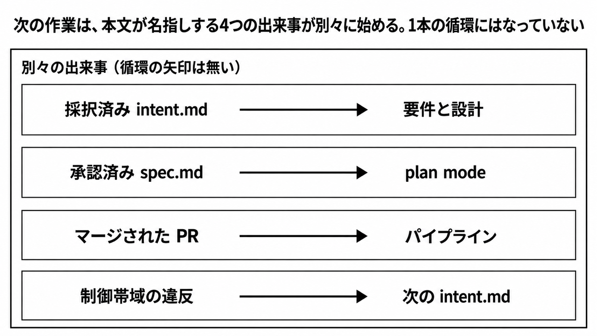

# ダイジェスト: AnthropicのSDLC（ソフトウェア開発ライフサイクル）プレイブックで次の作業が始まる条件

元記事: [anthropic-sdlc-claude-ja-p1_20261026.md](../../../../../articles/anthropic-sdlc-claude-ja-p1_20261026.md)

## ひとことで言うと

次の作業は、本文が名指しする4つの出来事で始まる。社内手順へ写す単位は、プレイ（各段階の中の具体的なやり方）ごとの成果物、承認する役割、前提である。

## 核心ポイント

- 採択済みの intent.md（採るもの採らないものを書き、共有置き場へ commit したファイル）が要件と設計を始める。承認済みの spec.md（intent.md と並べて置く仕様）が plan mode（Claude Code の計画モードで、計画の承認まで、このモードはファイルを編集できない）を始める。
- マージされた PR（pull request）がパイプラインを始める。本番の制御帯域（守る数値や状態の範囲）の違反が、次の intent.md を書く。
- plan.md（実装の計画）と差分、そのテストは、次の段階が読む例には出るが、この4つの出来事には出ない。テストの証拠は、作業中に貼った出力や PR の自動チェックで、独立した完了ファイルではない。
- 手順へ写す単位は段階名ではなく、プレイごとの成果物、承認する役割、前提である。段階名だけが揃い、承認する役割が空なら、その行はまだ手順になっていない。
- 完了は、人が見る前の測定できるチェック、コードオーナー（その変更の承認を任された人）の承認、本番の名前付きリリース承認（リリースマネージャーが本番へ出す前に行う承認）の3つに分かれる。verifier subagent（完了後に、生成した前提に引きずられないよう別コンテキストで包む最終確認）と、設定の eval（設定が変わったとき、同じ基準で見るスイート）は、この3つに入らない。

## メンタルモデル

本文は、この4つを1本の循環矢印としては書いていない。

## 具体例

人が見る前のチェックの例は、`test_status.py` のテストがすべて成功する、スクリーンショットが、添付されたモックと一致する、エンドポイントが新しいフィールドで 200 を返す、である。

## 適用と判断

向く場面:

- プレイブックを社内の工程手順へ写すとき。
- 次の作業の開始を、本文が名指しした4つの出来事で決めるとき。

確認すること:

- 始めるファイル、または PR に付く証拠が、元記事の表の行（成果物、承認する役割、前提）と対応しているか。
- verifier subagent を足しても、コードオーナーの承認の代わりにはならない。
- intent.md も spec.md も無いときでも plan mode は置ける（英語は if one exists）。
- 手順の文は、英語ページ（2026-10-26 取得）か PDF（ファイル作成 2026-09-24）のどちらから引いたかを添えているか。

## 限界・注意点

- exit criteria も「完了条件」も公式には無い。6段階すべてで開始と完了の成果物が対だという言い方は、二次情報（QualityLogic、2026-09-29）である。
- 「数時間」「数分」、2026-07-21 の別記事の「約80%」、管理設定例の `2.1.193`、架空例の 50 rps は、このガイドの計測結果や現行の製品制限としては書かない。
- 制御帯域に入れる指標の名前も、何をもって高リスクとするかの基準も、ガイドは書いていない。
- コードオーナー承認を全リポジトリの必須とは、ガイドの文だけでは固定できない。ブランチ保護（条件を満たすまで merge を拒む設定）は worthwhile と、推奨の強さで書かれ、必須の語ではない。

## 参考

- 元記事: [anthropic-sdlc-claude-ja-p1_20261026.md](../../../../../articles/anthropic-sdlc-claude-ja-p1_20261026.md)
- 英語ページ（手順の正本、`datePublished` 2026-08-21）: [The AI-native SDLC playbook](https://claude.com/resources/articles/the-ai-native-sdlc-playbook)
- 日本語ページ（同じ公開日、同じ PDF）: [AI ネイティブの SDLC プレイブック](https://claude.com/ja/resources/articles/the-ai-native-sdlc-playbook)
- PDF（ファイル作成 2026-09-24 02:08:23 JST、54ページ）: [AI Native SDLC Playbook](https://cdn.prod.website-files.com/6889473510b50328dbb70ae6/6aba736348bdf4f08183f463_AI%20Native%20SDLC%20Playbook_designv2%20%281%29.pdf)
- 80%の別記事（`datePublished` 2026-07-21）: [How Anthropic secures its AI-native software development lifecycle](https://claude.com/resources/articles/how-anthropic-secures-its-ai-native-software-development-lifecycle)
