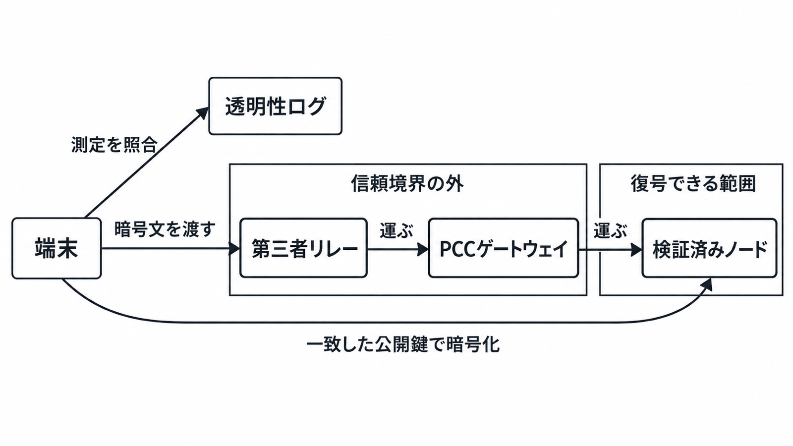

# ダイジェスト: Apple Private Cloud Computeのセキュリティ設計を公開物から読み解く

元記事: [apple-security-pcc_20261026.md](../../../../../articles/apple-security-pcc_20261026.md)

## ひとことで言うと

端末は、公開台帳に載った測定と一致するノードへだけ暗号化し、手前の中継は復号できない。ガイドとリポジトリで今確かめられる範囲は、ガイドが掲げる要件の名前より狭い。

## 核心ポイント

- Private Cloud Compute（PCC、端末だけでは足りない計算を Apple のクラウドで行う仕組み）では、端末は透明性ログ（測定値＝起動したソフトウェアのハッシュを載せる公開台帳）と一致するノードの公開鍵にだけ暗号化する。手前のロードバランサ、第三者リレー（暗号文を運ぶ中継）、PCC ゲートウェイ（暗号文をノードへ渡す）は、復号する鍵を持たない。
- セキュリティガイドは、データを残さないことや特定のユーザを狙えないことなどを含む5つの要件を、Apple silicon と Google Cloud の両方の性質だと書く。
- Apple silicon の研究用仮想マシンで本番と同じなのはユーザ空間だけで、起動とカーネルは違う。Google Cloud は、GPU の高帯域メモリ上の重みと活性化を暗号化せず、NIC や PCIe スイッチのファームウェアを測定せず、Mac では再現できない。
- 公開リポジトリ（apple/security-pcc）の利用期限はダウンロードから90日、対象は所有または管理する Apple 製コンピュータ1台、目的は PCC のセキュリティとプライバシーの検証だけ、再配布禁止である。
- 査読論文（Dittmar ら、WiSec）は、端末側のクライアントが PCC のプロトコルを使っていることを確認したと書く。再現ビルドは無い。

## メンタルモデル

## 具体例

| 読み違い | 公式の範囲 |
| --- | --- |
| 報奨金100万ドルは、ユーザデータの漏洩 | 任意の権限を伴うリモートコード実行の上限。信頼境界の外からリクエストデータへ届くリモート攻撃の上限は25万ドル。支払額の公表ではない |
| PCC がすべて NVIDIA に移り、Gemini が推論している | Gemini ファミリーの背後にある技術で次世代の Apple Foundation Models を作り、重い推論を Google Cloud と NVIDIA GPU へ広げる。Apple silicon 上の PCC は続く |
| 研究者による検証は終わっている | ガイドと研究用仮想マシンと一部ソースの公開と、第三者監査人と選ばれた研究者への早期アクセスまで。名前付き監査報告書の URL は研究ブログに無く、ほかでも見つかっていない |

## 適用と判断

向く場面:

- 端末だけでは足りない処理をこのノードへ出すとき、方式ごとに保証の深さを分ける。
- 公開リポジトリを、製品の依存や社内ライブラリとして入れるかを決める。

確認すること:

- Google Cloud を、Apple silicon と同じ検証深度と読んでいないか。
- 公開リポジトリを、上の利用条件の外で使っていないか。
- 端末が送る前の測定の照合とは別に、ノード証明書がログ掲載を強制する検査（リリースノートの既知事項 167793384）が Resolved か。
- 使う PCC のリリースが、特権的なネットワーク位置から機微情報が漏れ得た欠陥（CVE-2026-20685。対象はリリース 5E290.3 未満）に含まれるか。

## 限界・注意点

- 処理後の削除は、データを消し、アドレス空間を回収し、再起動でデータボリュームの鍵を残さないソフトウェアの性質であり、情報理論的な痕跡の消去ではない。
- 複数ターンの途中状態は、端末が渡す鍵で暗号化したキャッシュとしてノードに残り得る。端末がその鍵を再送しない限り、復号できない。
- ノード証明書は発行元の署名を見る。測定がログに載っていることの強制は、2026年10月時点では未了である。
- ソース公開の90日は、ログに載ってから90日以内にソースを出すことと、機微な修正のソースを最大90日遅らせ得ることの二義で、ダウンロードからの利用期限とは別である。研究用のモデルは本番の重みではなく、モデルとアダプタのイメージは測定しても、透明性の公開対象外である。
- 未確認は、推論プロセスを入れ替える間隔、レート上限、SLA、リージョン、データ所在地、単価である。

## 参考

- 元記事: [apple-security-pcc_20261026.md](../../../../../articles/apple-security-pcc_20261026.md)
- [Private Cloud Compute Security Guide](https://security.apple.com/documentation/private-cloud-compute/)
- [Expanding Private Cloud Compute](https://security.apple.com/blog/expanding-pcc/)（2026年6月8日）
- [apple/security-pcc](https://github.com/apple/security-pcc)
- Dittmar ら. [Unlocking Apple's Private Cloud Compute](https://doi.org/10.1145/3765613.3811691)（WiSec 2026）
