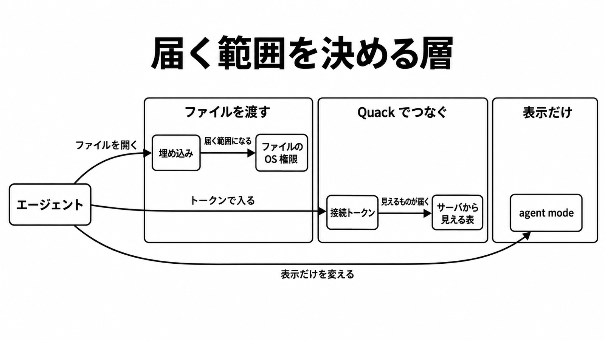

# ダイジェスト: DuckDB 2.0 LTSのQuackは接続トークンで届く範囲が決まる

元記事: [duckdb-2-0-lts-quack-publickey1-p8_20261026.md](../../../../../articles/duckdb-2-0-lts-quack-publickey1-p8_20261026.md)

## ひとことで言うと

Quack の接続トークンは、そのサーバセッション全体への鍵になる。表示とエラーの形を変える agent mode は、届く範囲の境界にはならない。

## 核心ポイント

- 埋め込み（プロセスの中でファイルを開く使い方）では、渡したファイルの OS 権限が届く範囲になる。Quack（別の DuckDB から HTTP でつなぐプロトコル）では、トークン（クライアントとサーバが比べる認証の文字列）で入ったサーバセッションが届く範囲になる。
- 既定の認可は、受け取ったクエリを書き換えずに実行する。トークンを通過したクライアントには、そのサーバセッションから見えるメモリ上の表、開いているデータベースファイル、スキーマが届く。
- 2.0.0 では、接続に付ける読み取り専用を境界として使わない。その指定のまま、行の追加や更新や削除と表定義の変更が通った報告が開いている。
- 公式 FAQ は Quack をまだ beta とし、プロトコル、関数名、既定値が壊れ得ると書く。長期サポートの期間は、プロトコルが変わらない期間ではない。
- 単一の分析ファイルは埋め込みのままにし、境界の正本をそのファイルの OS 権限にする。CLI なら safe mode（最初に開いたファイル以外と、ホストのファイル操作とシェルを止めるスイッチ）を付ける。

## メンタルモデル

左端のエージェントは、分析用のデータベースを受け取る側で、agent mode とは別である。中央に届くのは表だけでなく、開いているデータベースファイルとスキーマも含む。

## 具体例

サーバがトークンを指定して待ち、日付と名前の表を作る。別の DuckDB が同じトークンで手元のホストへ接続すると、そのサーバセッションからその表を読める。

## 適用と判断

向く場面:

- 分析用のデータベースを受け取る側が一つで、渡すファイルも一つのとき。
- DuckDB 自身のデータベースファイルを複数プロセスが同時に読み書きするときだけ、Quack を使う。
- オブジェクトストレージへ複数から書くときは、Quack ではなく DuckLake（オブジェクトストレージと、表の置き場の台帳で複数書き込みをする形式）が公式の別経路である。

確認すること:

- 届く範囲の正本を、埋め込みならそのファイルの OS 権限、Quack ならサーバセッションから見える表やファイル、のどちらに置いているか。
- 接続に付ける読み取り専用や、セッション全体への鍵である別のトークンで、読み取りだけを分けていないか。
- 認可を、クライアントが書き換えられる場所に置いた、SQL として登録した関数と、トークンと利用者名を並べた表にしていないか。
- Quack を外へ出すなら、サーバは手元のホストだけを待ち受け、TLS を終端する reverse proxy を前に置いているか。
- agent mode の省略表示やエラーの形を、ファイル権限やトークンの代わりにしていないか。

## 限界・注意点

- FAQ が beta と書くあいだ、本番へ切り替える前は既存の負荷を追いかける試験にし、ミッションクリティカルなら発表は最初のパッチまで待ってよいと書く。1.5 のサポートは 2027年3月まで残る。
- 読み取り専用の指定そのものを拒否する修正は、クエリを読み取りだけに制限する仕組みではない。公開済みの 2.0.0 に入っているかは未確認である。
- 定義を置換できる報告の再現手順は公開前の版であり、2.0.0 正式版での再検証はその報告に無い。
- 2.0 が既定で作る新規ファイルは storage version 69（ファイル形式の版）で、2.0 未満は読めない。プロトコルが長期サポートのあいだどこまで互換を保つかは、未確認である。

## 参考

- 元記事: [duckdb-2-0-lts-quack-publickey1-p8_20261026.md](../../../../../articles/duckdb-2-0-lts-quack-publickey1-p8_20261026.md)
- DuckDB. [Announcing DuckDB 2.0.0](https://duckdb.org/2026/10/21/announcing-duckdb-200.html). 2026-10-21.
- DuckDB. [Quack overview](https://duckdb.org/docs/2.0/quack/overview.html).
- DuckDB. [Quack security](https://duckdb.org/docs/2.0/quack/security.html).
- DuckDB. [Quack FAQ](https://duckdb.org/quack/faq.html).
