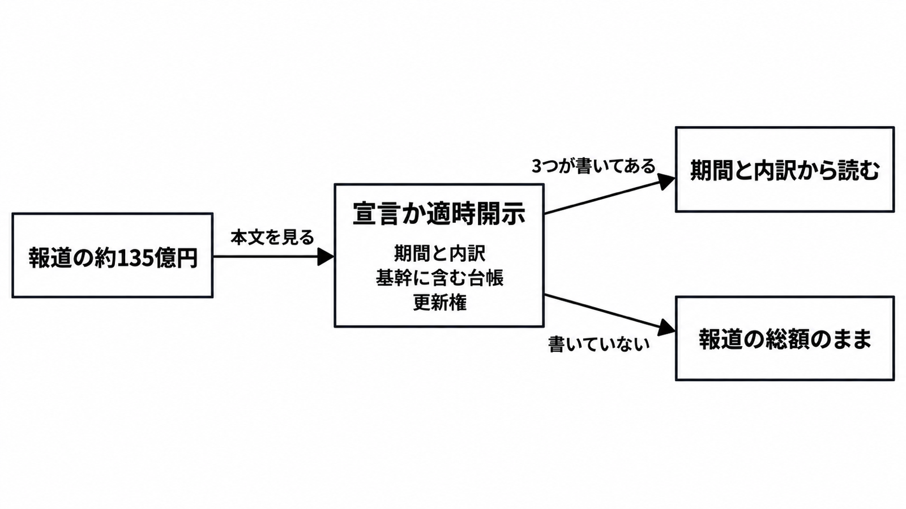

# ダイジェスト: IDOMの約135億円を台帳の更新権が分かれるまで分母にしない

元記事: [idom-ax-135-xtech-nikkei-p4_20261026.md](../../../../../articles/idom-ax-135-xtech-nikkei-p4_20261026.md)

## ひとことで言うと

約135億円は、2026年10月26日の日経クロステックの公開リード（第1回記事の冒頭の公開部分）にある。台帳（在庫・契約・返金を記録する帳票）の更新権が文書で分かれるまで、投資対効果の分母にしない。

## 核心ポイント

- 約135億円と「顧客接点から基幹まで」は公開リードにあり、有料本文は未読である。同日までに確認した適時開示（取引所を通じた法定開示）には、この額も、同紙がIDOMの同日午後の発表と書いた Gulliver（ガリバー）AX宣言（AXは、AI前提で事業とシステムを組み替える報道の呼び方）の本文も無く、確定したプログラム予算としては読まない。
- 分母にするとは、その額で効果を割ることである。宣言または設計書が、エージェント（同紙の呼び方。製品は未記載）が更新してよい台帳と、人が確定する点（候補は在庫・契約・返金）を分けるまで分母にせず、分離が無ければ「基幹まで」は範囲の宣言であり、見積・承認・取消の主体を分けた実例にはならない。
- 会社が金額つきで書いたデジタル投資は約135億円より小さく、会社は135億円との包含関係を書いていない。別の時期の金額を、135億円の内訳として足さない。
- 通期の営業利益を240億円から185.01億円へ下げた本文の理由は、上期の下振れと、下期の大型店の準備・設備、人員、買取を強める広告であり、AXを主因とは書いていない。デジタル投資の費用は、中間の期初想定410億円から432億円の差の一要素としてだけ確認できる。
- 「成約率1ポイント超上昇、60億円増収へ」は2026年10月28日公開予定の見出しで、本文は無く実績としては未確認である。支払総額（顧客が支払う総額）は、表示と違う条件で売ることと総額の外への諸費用を禁じ、基準売価（社内の売値の見積り）を画面に出す前に持つことは禁じておらず、顧客に示す支払総額の確定は別である。

## メンタルモデル

宣言本文か適時開示に3つがあれば、期間と内訳の側からプログラム予算として読み直す。無ければ報道の総額のままである。分母の条件は図の外にある。

## 具体例

| 数字 | 出所 | 扱い |
|---|---|---|
| 約135億円 | 2026-10-26 の公開リード。確認した会社資料には見当たらない | 更新権が分かれるまで分母にしない |
| 10億円 | 2026年2月期注記のCRM開発（商談から納車後までを記録する仕組みの開発） | 135億円に足さない |
| 販管費 410億→432億 | 中間の期初想定との差。販売費及び一般管理費で、一要素がCRMとAI | 全体が135億円とは確認できない |

## 適用と判断

向く場面:

- 約135億円を、IDOMのAXの投資対効果の分母にしようとしているとき。
- 通期利益の下方修正を、135億円の失敗として読もうとしているとき。
- 未刊行の増収見出しを、135億円が戻った根拠にしようとしているとき。

確認すること:

- 有料記事の本文に、対象システム、期間、委託範囲、更新権の有無があるか。
- 2026年10月26日午後以降の会社ニュース、TDnet（適時開示の閲覧サイト）、EDINET（有価証券報告書等の閲覧サイト）に、宣言の語と135億円があるか。
- エージェントが更新してよい台帳と、人が確定する在庫・契約・返金が、文書で分かれているか。
- 4億円（2027年2月期第1四半期のDX関連費の増）、761百万円（2026年3〜8月の無形固定資産の取得）、50億〜60億円（2025年の日経。会社発表に金額は無い）を、135億円へ足していないか。
- 後続の本文が出たら、成約率1ポイントの母数と、60億円が増収として何を数えた額かを、見出しではなく本文で読むか。

## 限界・注意点

- 内訳、期間、委託先、更新権の分離が有料本文にあるかは、公開リードからは分からない。
- Gulliver AX宣言の本文が有料記事の中にあるのか、同日午後の別の会社資料として出たのかは、2026年10月26日時点では分かっていない。
- 決算注記の10億円は、CRM開発の追加投資の総額とも、より大きい額の一部とも読める。
- 連載目次の導入文にある「ベテランの値付け」と、10月29日予定の見出しの基準売価が同じかは、公開文では確認できない。

## 参考

- 元記事: [idom-ax-135-xtech-nikkei-p4_20261026.md](../../../../../articles/idom-ax-135-xtech-nikkei-p4_20261026.md)
- [日経クロステック（2026-10-26）「IDOM、顧客接点から基幹までをAXの対象に約135億円」](https://xtech.nikkei.com/atcl/nxt/column/18/03801/101900001/)
- [IDOM（2025-01-06）IDOM Digital DriveとSalesforceの発表](https://idom-inc.com/news/press/20250106-37210.html)
- [IDOM（2026-10-14）業績予想の修正](https://ssl4.eir-parts.net/doc/7599/tdnet/2894591/00.pdf)
- [自動車公正取引協議会「支払総額に関する質問と回答」](https://www.aftc.or.jp/contents/am/shiharai/faq.html)
