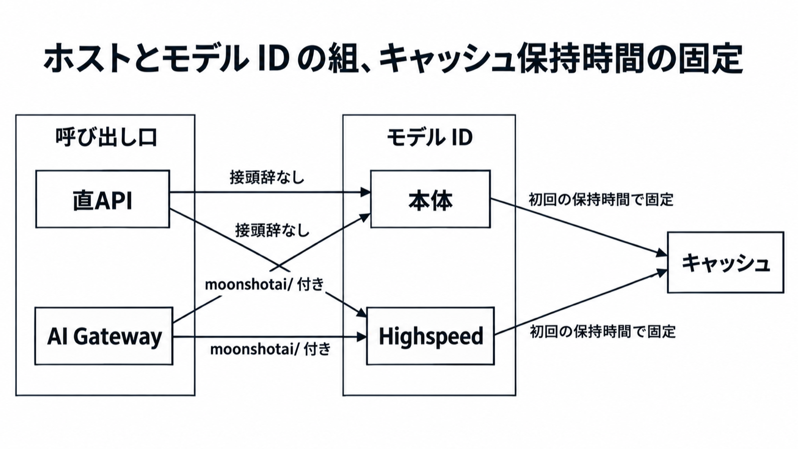

# ダイジェスト: Kimi K3.1 ProのAPI先行公開はモデルIDとキャッシュで決まる

元記事: [kimi-k3-pro-api-simonwillison-p9_20261026.md](../../../../../articles/kimi-k3-pro-api-simonwillison-p9_20261026.md)

## ひとことで言うと

重みのファイル URL が載るまで、Kimi K3.1 Pro は呼ぶ ID を設定の1つに固定する。費用の既定は本体、対話の待ち時間だけ Highspeed。保持時間は初回の書き込みで決まる。

## 核心ポイント

- 2026年11月4日は重み公開の期限であり、2026年10月26日時点の公式ブログにファイル URL は無い。ファイル URL が載るまで呼ぶ ID は設定の1つで、本体 `kimi-k3.1-pro` が費用の既定、Highspeed `kimi-k3.1-pro-highspeed`（同じ能力をより短い待ち時間で返す別 ID）は対話の待ち時間だけに使う。
- 直 API（`https://api.moonshot.ai` を直接呼ぶ）の ID に `moonshotai/` は付けず、AI Gateway（Vercel がモデル名を中継する入口）の ID には付ける。直 API 用は最初から接頭辞の無い文字列を別に持ち、Gateway の ID から接頭辞を削って送らない。
- プレフィックスキャッシュ（プロンプト先頭の一致分を別単価にする仕組み）は既定で有効で、保持時間は5分か1時間、初回の書き込みで決まり、5分と1時間のエントリは共有しない。`reasoning_effort`（推論の長さ。`low` / `high` / `max`、既定 `max`。`medium` は無い）を途中で変えると切れる。
- 利用量の項目名は呼び出し方で違い、Messages（Anthropic 互換）の `input_tokens` はキャッシュ分を含まない。ほかの項目名は元記事の表にある。
- ベンチの点数は、ID とキャッシュの選び方に使わない。発行元が違う点数は、同じ列に入れない。

## メンタルモデル

呼び出し口とモデル ID は、接頭辞の有無が組になる。キャッシュは初回の5分か1時間のままヒットで期限が延び、その選択はエントリが生きている間は替わらない。

## 具体例

料金カード（100万トークンあたり、USD）:

| 面 | 本体 | Highspeed |
|---|---|---|
| 入力 | 2.00 | 4.00 |
| 出力 | 10.00 | 20.00 |
| キャッシュヒット | 0.20 | 0.20 |

## 適用と判断

向く場面:

- 直 API か Gateway かを、環境ごとに1つ固定するとき。
- 対話で応答を待つ呼び出しに、Highspeed を使うとき。
- 次のリクエストまでの間隔で、保持時間を5分か1時間にするとき。

確認すること:

- ホストとモデル文字列を設定の1項目に固定し、実行時に接頭辞を付け外ししていないか。
- 費用の既定が本体か。遅いとき Highspeed へ自動で切り替えていないか。
- 同じ会話で `reasoning_effort` を変えていないか。変えるなら新しい会話にする。
- 5分以内に次が来るなら既定の5分のままか。人が間に入って5分を超えるなら1時間か。
- `temperature` と `top_p` は固定値以外がエラーになるので、送っていないか。

## 限界・注意点

- 1時間のキャッシュ書き込みの USD は未確認である。
- 重みのライセンス、形式、配布 URL は未掲載である。11月4日をファイルが置かれる日として扱わない。
- Enterprise の組織アカウントは、管理者が有効化するまでオフである。個人とは別である。
- フラッグシップ（1 USD のチャージ後に呼べる対象）にこの2つの ID が入るかは、公式手順では決められない。
- Zero Data Retention（リクエストデータを保持しない、というブログ上の名称）をオンにする項目名は、開いた範囲の本文に無い。`thinking` を送った結果がエラーか無視かも未確認で、送らない。

## 参考

- 元記事: [kimi-k3-pro-api-simonwillison-p9_20261026.md](../../../../../articles/kimi-k3-pro-api-simonwillison-p9_20261026.md)
- Moonshot. [Introducing Kimi K3.1 Pro](https://www.kimi.ai/blog/kimi-k3-1-pro).
- Kimi API. [クイックスタート](https://platform.kimi.ai/docs/guide/kimi-k3-1-pro-quickstart)、[料金](https://platform.kimi.ai/docs/pricing/chat)、[プレフィックスキャッシュの案内](https://platform.kimi.ai/docs/guide/context-caching).
- Simon Willison. [Introducing Kimi K3.1 Pro](https://simonwillison.net/2026/Oct/23/kimi-k31-pro/). 2026-10-23.
- Vercel. [AI Gateway への追加](https://vercel.com/changelog/kimi-k3-1-pro-and-kimi-k3-1-pro-highspeed-are-available-now-in-ai-gateway). 2026-10-23.
