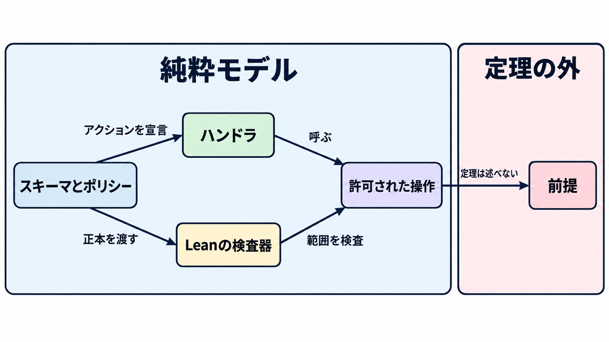

# Nyxis ダイジェスト

元記事: [Cedarを正本にLeanで認可の安全性を証明するWebバックエンド、Nyxis](../../../../../articles/nyxis_20261026.md)

## ひとことで言うと

Nyxis（v0.1.1）は、人が承認する認可の文書を基準に、ハンドラの操作が範囲内かをビルドで検査します。ログイン検証の正しさや、メールと外部呼び出しが届くことは、検査の外です。

## 核心ポイント

- **承認するのは 2 ファイル**: Cedar（誰が何をできるかを書く認可ポリシー言語）のスキーマとポリシーが正本（判定の基準になる文書）です。型がテーブル、属性が列、ID が主キーです。
- **効果を出せるのはアクションを呼んだときだけ**: 効果（出してよい DB 操作や外部通信）は宣言されたアクション 1 つにつき 1 つで、値を返すだけの分岐は持てますが、そこからは出せません。主体と時刻と一意 ID は実行側が埋め、ハンドラは偽れません。
- **検査が述べるのは、効果の範囲に収まること**: Lean（証明を機械が検査する言語）の検査器が、ビルドのたびに、出した操作がその主体と実行側の時刻と ID について効果の範囲に収まるかを見ます。ログイン検証が正しいこと、SQL が DB 上でそのとおり実行されること、届くこと、確定の失敗後に残る外部の副作用は、この検査の外です。
- **要求は 1 本ずつ新しいトランザクション**: 要求 1 本は、新しい接続の SERIALIZABLE トランザクションです。JWT（ログイン済みを示すトークン）が無い要求と検証失敗は匿名として同じ入口に入り、成功の応答と非同期送信は確定のあとです。
- **向くのは承認単位を絞った個人開発の API**: ハンドラはエージェントが書き、人間は正本だけを承認します。ブラウザから DB へ直接届く方式ではなく、行の到達を DB の RLS（クエリごとに行を制限する仕組み）に置く方式とは、判定の場所が違います。

## メンタルモデル

左の枠が検査するのは、許可された DB 操作と外部効果の記録までです。図の「許可された操作」は、その効果です。実 DB の実行結果、署名付き URL の中身、配送の成否は右の前提で、崩れるとビルドが通っても実行時の対応は保証されません。

## 具体例

掲示板で 1 件読むとき、ハンドラは主キーを指定して読み取りアクションを呼ぶだけです。実行側が行を取り、Cedar の判定器で許可を見て、許可された操作だけを SQL にします。検証に失敗したログインは匿名のまま進み、掲示板サンプルでは下書きが 403 になります。

## 適用と判断

**向く場面**

- 認可の範囲を外れた操作を、テストではなくビルドの失敗で止めたい
- 外部への送信を、許可として記録されたものだけにしたい

**確認項目**

- 配置するものは、承認した 2 ファイルを埋め込んで検査を通した成果物か
- 署名付き URL は、渡ったものに外部効果の記録があることまでが定理で、中身と保管先の検証は外だと分けているか
- 副作用のある同期呼び出しで、一意 ID を冪等キーとして本文に載せ、送り先が尊重する前提を受け入れるか
- 添付のウイルス検査とサイズ制限は、署名付き URL の発行先とアプリの責務だと分けているか
- 検査を迂回する記述をビルド時の点検がすべて見つけることと、コンパイル途中の読み書きが秘密や検査の判定に触れないことは、証明されていないと理解しているか

## 限界・注意点

- 配線で証明済みの例は、主体の組み立て、許可された操作からの SQL、BEGIN から COMMIT の順、応答の再生、記録された内容についてだけ送信処理を呼ぶことです。前提のままなのは、ログイン検証が正しいこと、配送そのもの、主キーの 1 件取得がその時点のその行であること、HTTP 本文の復号、送信処理の内部です。
- 取った行が判定材料を覆うなら、必要な行だけの判定は全行の判定と一致する、と証明は述べます。必要な絞り込みを取り切ったことの検査は無く、全行から状態を復元する経路は別 DB の照合用です。
- 同期の呼び出しのあと確定が失敗すると、DB は戻り、送り先の副作用は残ります。非同期は確定の前に送らず、送ったあとの状態更新に失敗すると再送されるので、少なくとも 1 回届きます。
- コアは v0.1.1 だが README の版バッジは v0.1.0 のままで、前提の正は日本語版です。採用後の運用実績は、この記事にありません。

## 参考

- [元記事](../../../../../articles/nyxis_20261026.md)
- [NyxFoundation/nyxis v0.1.1](https://github.com/NyxFoundation/nyxis/releases/tag/v0.1.1)
- [ASSUMPTIONS.ja.md](https://github.com/NyxFoundation/nyxis/blob/main/ASSUMPTIONS.ja.md)
- [docs/proofs.md](https://github.com/NyxFoundation/nyxis/blob/main/docs/proofs.md)
- [Cedar](https://cedarpolicy.com/)
