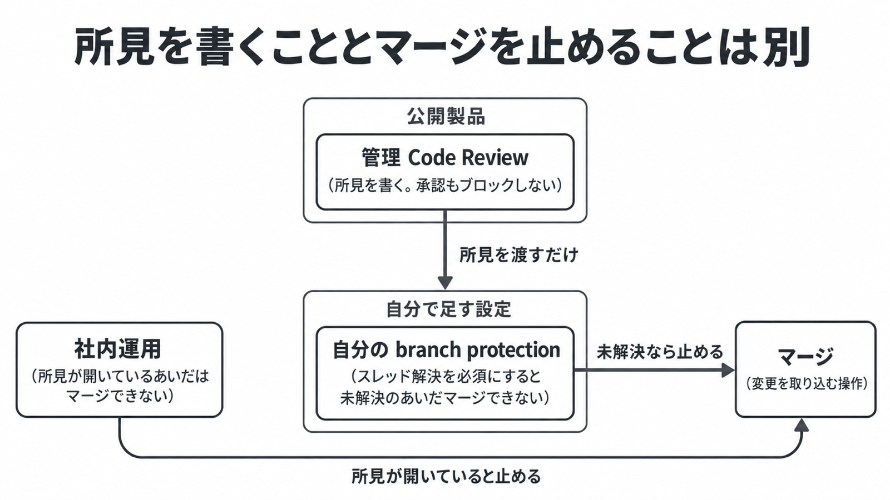

# ダイジェスト: Claude Codeチームのコードレビュー運用と公開版Code Reviewの境界

元記事: [claude-code-team-review_20261027.md](../../../../../articles/claude-code-team-review_20261027.md)

## ひとことで言うと

Claude Code チームでは、バグ所見かセキュリティ所見が開いているあいだマージできない。管理 Code Review（GitHub 上の公開サービス）は所見を書くだけで止めない。

## 核心ポイント

- 必要な人手は書いた人ではなく変更の危険度で決まり、エージェントの承認は人数に入らない。エージェントが書いた変更では動かした人が必須の人数のうちの 1 人になるが、下表の Low の「不要」にその 1 人を足すかは記事は書いていない。
- 管理 Code Review は Claude の Team と Enterprise 向けで、Anthropic の基盤上で動き、自分のランナーでは走らない。そのチェック Claude Code Review は失敗で終わらない。
- 管理側の REVIEW.md（方針のファイル）は base または default ブランチから読み、PR 内の分は読まない。`/code-review`（作業中のセッションのレビュー）は CLAUDE.md（Claude への方針ファイル）を読み、REVIEW.md は読まない。
- 所見ゼロは、バグがないことも安全であることも意味しない。管理 Code Review は draft と fork の PR をスキップし、読み取り専用で push もビルドもしない。
- 「Claude が約 90% を書く」は Claude Code 自身のコードについての自己申告で、マージ済み PR の 9 割とは書いていない。

## メンタルモデル

止める矢印は社内運用と、自分の branch protection から出る。管理 Code Review から出る矢印は、所見を渡すだけである。

## 具体例

| 危険度 | 対象の例 | 人手 |
|---|---|---|
| Low | docs、文言、機能フラグの後ろの追加 | 社内の自動レビューとセキュリティが緑なら不要 |
| Medium | 通常の製品変更、system prompt（AI への指示文） | 人 1 人 |
| High | 危険度の高い変更、オーナーが指定したパス | 人 2 人 |

## 適用と判断

向く場面:

- エージェントが PR を書き、人がそのリポジトリのオーナーであるとき。
- 管理 Code Review を入れただけではマージが止まらない、と切り分けるとき。
- auth、billing、CI、リリース、インストーラを、危険度の分類器（中身は非公開）が無くても人に見させるとき。

確認すること:

- 未解決の所見で止めるなら、スレッド解決を branch protection（マージ条件の設定）で必須にしているか。
- 両方に効かせる指示を、記事の指定どおり CLAUDE.md に置いているか。
- エージェントの承認を人数に入れず、新しいコミットで承認を外すか。
- 危険パスの人手を緩めるのは、人なしの期間の revert とインシデントが、人を残した期間と同等以下だと自分で測れたときだけか。
- 従量の利用枠（プランの枠とは別）の残高が 1 回分を下回ると、レビューをスキップする前提か。

## 限界・注意点

- 割合や倍率は、工程が原因だと切り分けた実験表が公開されていない。
- 2026-04-23 の事後報告では、あるバグが人手と自動のレビュー、テスト、社内利用を通過し、発見まで 1 週間超かかった。
- 社内の自動承認を、revert 率とインシデント率で締める仕組み（記事ではサーキットブレーカー）は、公開時点では未実装である。
- `@claude review`（PR のコメントで呼ぶレビュー）が以後の push でも走るか、所要時間と単価は、公開資料だけでは決められない。
- anthropics/claude-code#100401（2026-10-27 時点で OPEN）は、Action 経由のレビューがレビュー担当を起動せず「No issues found.」と投稿した報告で、管理 Code Review での再現は未確認である。

## 参考

- 元記事: [claude-code-team-review_20261027.md](../../../../../articles/claude-code-team-review_20261027.md)
- Claude Code チームの記事（2026-10-15）: [solving-code-review-at-anthropic](https://claude.dev/blog/solving-code-review-at-anthropic.md)
- Code Review 一般提供（2026-10-15）: [code-review-is-now-generally-available](https://claude.com/resources/articles/code-review-is-now-generally-available)
- 現行ドキュメント: [Code Review](https://code.claude.com/docs/en/code-review)
- 事後報告（2026-04-23）: [april-23-postmortem](https://www.anthropic.com/research/april-23-postmortem)
