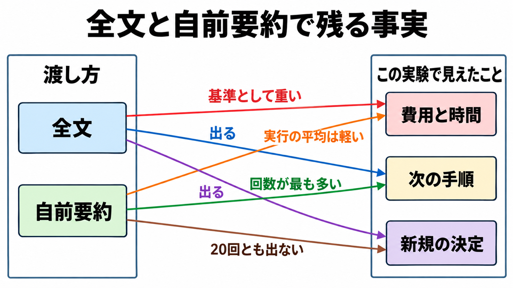

# ダイジェスト: dbt Labsが同一スキル80回で比べた文脈の渡し方

元記事: [dbt-48-5-43-2-getdbt-context-p3_20261027.md](../../../../../articles/dbt-48-5-43-2-getdbt-context-p3_20261027.md)

## ひとことで言うと

実行前に作った要約（自前要約）は、通話を記録するサービスから渡した全文より手順の実行が安く速い。新しいプロジェクトまたはリポジトリの決定は、その全文では16/20、自前要約では0/20である。

## 核心ポイント

- スキルは、通話から振り返りPDFを作る社内の手順で、変えたのは渡す文脈だけである。4通りは、通話を記録するサービスから渡す全文、同じ全文をデータベース（Snowflake）から読む、ベンダー要約（そのサービスが作った短い要約）、自前要約で、各20回である。
- 全文は約3万から7.2万文字、ベンダー要約は約500から600文字でデータベースの列へそのまま入り、自前要約は約1.2万から2万文字である。自前要約は実行の前に、SnowflakeのAI_COMPLETE（モデルとプロンプトから文章を作る関数）で作った事実に基づく要約で、分割、埋め込み、分類（検索とは別）は入っていない。
- 自前要約の手順の実行（指示、ツール呼び出し、PDF生成を含む全体）は、通話を記録するサービスから渡した全文より費用48.5%安、時間43.2%短である。要約を作る課金は入っていない。
- 品質は、その種類の詳細が出た回数であり、中身が全部出たかではない。ベンダー要約は日付、数値、肩書き（誰がどの役割か）、新規の決定（新しいプロジェクトまたはリポジトリ）、次の手順が0/20である。
- 自前要約は、記録サービスから渡した全文に対し、日付12/20対15/20、数値13/20対14/20、肩書き9/20対15/20、新規の決定0/20対16/20である。次の手順は自前要約が16/20で、全文の2条件はどちらも11/20である。

## メンタルモデル

図は、記録サービスから渡した全文と自前要約だけを示す。新規の決定の「出る」は16/20で、20回すべてではない。

## 具体例

| 渡し方 | 平均の費用と時間 | 新規の決定 |
|---|---|---|
| 全文（通話の記録サービス） | $0.66、168.7秒 | 16/20 |
| ベンダー要約 | $0.29、76.8秒 | 0/20 |
| 自前要約 | $0.34、95.8秒 | 0/20 |

## 適用と判断

向く場面:

- 残す事実の種類を手順ごとにリストし、全文、ベンダー要約、自前要約を同じ課題で比べるとき。
- 次の手順を具体にする目的で、自前要約を候補にするとき。
- 要旨だけで足りる手順で、ベンダー要約を4つの中の最安として選ぶとき。

確認すること:

- 日付、数値、肩書き、新規の決定、次の手順が要るなら、ベンダー要約を既定にしていないか。
- 決定と肩書きが毎回必須なら、この自前要約を全文の代わりにしていないか。
- 費用を、要約の生成、文脈の取得、手順本体に分けて記帳しているか。
- この実行全体の削減率を、別記事の文脈サイズ約98%減と足していないか。
- この80回を、文章の分割、埋め込み、検索の効果として読んでいないか。

## 限界・注意点

- 採点は表面化した回数で、日付の15と12のような数回の差は、各20回では差と言い切れず、0/20と16/20はその行の有無としては大きい。道具の名前は日付や決定とは別の行で、ベンダー要約は20/20でも通話で出た5つのうち1つの名前だけであり、5つの名前は元記事に無い。
- 費用の減り48.5%に対し、平均トークンの減りは約33.5%である。差の理由は実験記事に無い。
- 同じ全文をデータベースから読む条件は、通話の記録サービスから渡した全文（$0.66、168.7秒）より費用13.6%安、時間14.4%短である。決定は15/20で品質帯は近く、費用13.6%を絞り込み列だけの原因とは切り分けられない（列の中身は実験記事に無く、トークン減は約3.2%）。
- 顧客データは非公開で、第三者は同じ80回を再実行できない。
- 実行したモデル名、採点者、期待する文字列、要約生成の金額は実験記事に無い。決定の0/20が要約に無かったのか成果物まで届かなかったのか採点の文言が狭かったのかは分かれておらず、再利用で元が取れる回数も生成のドルが非公開なので計算できない。

## 参考

- 元記事: [dbt-48-5-43-2-getdbt-context-p3_20261027.md](../../../../../articles/dbt-48-5-43-2-getdbt-context-p3_20261027.md)
- Christine Berger、dbt Labs。[Showing our work: a controlled experiment in context engineering](https://www.getdbt.com/blog/context-engineering-experiment-dbt-mcp)。Last edited on Oct 26, 2026。
- Britton Stamper、dbt Labs。[From analytics engineer to context engineer](https://www.getdbt.com/blog/from-analytics-engineer-to-context-engineer)。2026-08-06。
- dbt Developer Hub。[dbt MCP FAQs and troubleshooting](https://docs.getdbt.com/docs/dbt-ai/mcp-troubleshooting)。
- Snowflake。[AI_COMPLETE (single string)](https://docs.snowflake.com/en/sql-reference/functions/ai_complete-single-string)。
