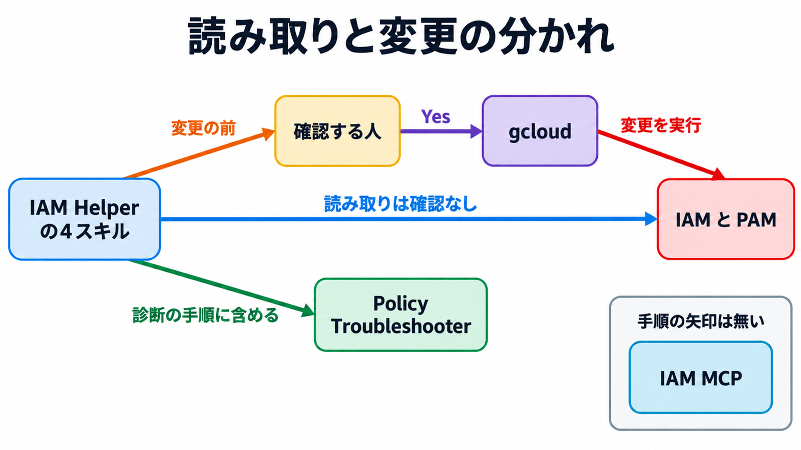

# ダイジェスト: Google Cloud IAM HelperのスキルとMCPで権限変更を見積もる

元記事: [google-cloud-iam-mcp-cloud-p2_20261027.md](../../../../../articles/google-cloud-iam-mcp-cloud-p2_20261027.md)

## ひとことで言うと

Google Cloud の IAM Helper は、権限の診断と変更を 4 本の手順書（スキル）に分ける。読み取りは原則確認なし、変更は原則、人の確認のあとで gcloud を実行する。

## 核心ポイント

- 4 本の手順書は、403 の診断、過去アクセスの再評価、許可と拒否の変更、期限付きの昇格（PAM、期限で外れる一時申請の機能）に分かれ、読み取りは原則確認なし（ロール一覧の検索前だけ確認する）。許可の binding、拒否、entitlement（申請できるロールと期間）、grant（期限付き申請）の作成・更新・削除・承認・申請の拒否・取消は Yes のあと gcloud で、依頼者フロー（開発中の 403）の既存 entitlement への申請だけは Yes を挟まない。
- リスクの低・中・高は警告の強さだけを変え、確認は省略しない。Yes を出す人と、実行するエージェントが別人かの検査は無く、別人にするにはチケットか PAM の別承認者を手順の外に書く。
- 公式のリモート MCP（外部ツールを決まった入出力で呼ぶプロトコル）には、403 を説明する Policy Troubleshooter と、別ホストでのプロジェクトのロール作成・拒否作成があり、手順書が書くのは Troubleshooter だけである。診断専用としてエージェントへ渡すと変更ツールまで届き、手順書の Yes は直接呼ぶ別クライアントには掛からない。
- 再評価（Policy Simulator）は、過去 90 日のうち直近 1,000 件のアクセスログを提案した許可でやり直す。適用してよいのは、終了コード 0、失われるアクセスと失われるかもしれないアクセスがどちらも 0 件、各要素の error と UNKNOWN_CHANGE（現状と提案のどちらでも未確定）が無いときだけで、集計は失われる側の 2 つだけを数える。
- 拒否は許可より先に評価される。同じ権限を足しても 403 が残ることがある。

## メンタルモデル

## 具体例

記事の位置づけ表を 3 行に縮めたもの。

| 置き方 | 変更の止まり方 |
| --- | --- |
| IAM Helper の手順書 | 会話上の Yes、または PAM の別承認者 |
| 公式の IAM MCP | 呼び出し元の IAM。確認文はサーバー側に無い |
| Terraform の apply | レビューと pipeline の承認 |

## 適用と判断

向く場面:

- 既存の Google Cloud の階層で、403 の解消と一時的な権限昇格を進めたいとき。
- 許可の変更を適用する前に、直近のアクセスが失われないか見たいとき。

確認すること:

- 診断用と変更用（プロジェクト IAM 管理、拒否管理、PAM 管理）を別主体に付け、変更用は承認のある主体に置いたか。
- いまの許可ポリシーの取得が失敗した、空、または提案との差分が無いとき、再評価へ進んでいないか。
- entitlement が複数なら、プロジェクト、フォルダ、組織の順で狭い方を選ぶか。
- 終わった grant は申請時間で外し、手動では取り消さないか。
- 未認証を含む誰でも、または認証済みなら誰でも、への基本ロール（owner や editor など）を拒否しているか。

## 限界・注意点

- スキル原文の拒否更新コマンドは公開 CLI に無く、更新は `gcloud iam policies update` を使う。拒否の条件は、資源に付いたタグを見る関数だけで、スキル例の時刻条件はそのままでは作れない。
- MCP の拒否作成はプロジェクトだけである。gcloud の拒否は組織、フォルダ、プロジェクトに付けられる。
- 再評価できないのは、拒否ポリシー、VPC Service Controls（境界外 API の制限）、一般のトラブルシュート、条件付き binding の変更である。
- 手順の npx 接続例は公開 npm に無く起動せず、`roles/basic.viewer` は基本ロール一覧に無い。不明点は `"1h"` が gcloud の公開書式で受理されるかである。

## 参考

- 元記事: [google-cloud-iam-mcp-cloud-p2_20261027.md](../../../../../articles/google-cloud-iam-mcp-cloud-p2_20261027.md)
- [Scale agents securely with IAM Helper Agent Skills and MCP Tools](https://cloud.google.com/blog/products/identity-security/scale-agents-securely-with-iam-helper-agent-skills-and-mcp-tools/)
- [google/skills（commit 84e8150）](https://github.com/google/skills/tree/84e8150e4fa71bf422d5b224e215f5ba13864aa3)
- [MCP Reference: iam.googleapis.com](https://docs.cloud.google.com/iam/docs/reference/mcp)
- [Policy Simulator で IAM の変更を再評価する](https://docs.cloud.google.com/policy-intelligence/docs/simulate-iam-policies)
